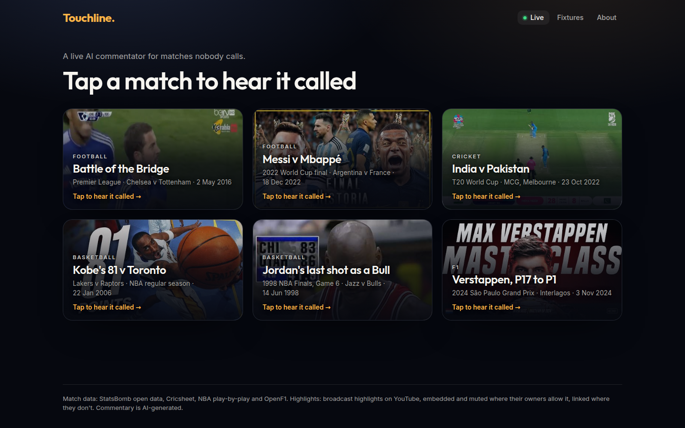

<div align="center">


<br>

[](https://www.python.org)
[](https://fastapi.tiangolo.com)
[](https://mubit.ai)
[](https://elevenlabs.io)
[](https://night-shift-5zvig7nbvq-ew.a.run.app)

**A live AI commentator for every match nobody calls, trained through Mubit on its own calls and every producer fix.**

[**Try it live**](https://night-shift-5zvig7nbvq-ew.a.run.app) · [**Backup page**](https://night-shift-5zvig7nbvq-ew.a.run.app/stage) · [**The six screens**](#the-six-screens) · [**How it uses Mubit**](#how-it-uses-mubit) · [**For judges**](#for-judges) · [**Run it**](#run-it) · [**Demo script**](docs/demo.md)




<sub>Historical screenshots, before Spain v England and Hamilton were replaced (#114). The deployed
page on 24 October 2026, captured in headless Chrome: the match wall, then a tap into
Spain v England with Olga Carmona's goal being called. YouTube wouldn't play in the headless browser,
so each video's own thumbnail stands in for its highlights. The lines, panels and numbers are live.</sub>

</div>

---

Built at Night Shift: Mubit Hackathon, London, 23 to 25 October 2026. Track: Own your intelligence layer.

## The problem

Somewhere tonight a county cricket chase goes to the last ball, and nobody calls it. A women's
league side scores the goal of its season, and the stream is silent. Most matches in most sports are
played like this: grassroots and lower-league football, most of the women's game, club and county
cricket. Fans following a stream or a live score get a bare ticker, or nothing.

A big model could commentate them. But it is too slow to call a moment while the moment is still on
screen, and too expensive to run for every moment of every match.

## What Touchline is

**Touchline** gives every match a commentator. It plays a match's broadcast highlights, and as each
key moment plays it calls it in one short, emotional line, read aloud in a commentator's voice and
shown as a large subtitle. A line is never shown or spoken before its moment reaches the picture.

One agent calls every sport. It reads the match's real event feed, looks up the score, the player and
recent play with tools, and never sees anything from later in the match than the moment it is
calling. A producer corrects any line that's wrong, and the fix goes back through Mubit to train the
commentator.

## How it uses Mubit

Every LLM call goes through Mubit, and Mubit trains a small commentator model on our traffic and on
producer fixes. That smaller model is what would make a commentator for every match affordable.

1. **Every call goes through Mubit.** Each line is one call to Mubit's Anthropic endpoint
   (`claude-haiku-4-5`), or two when the agent uses its one permitted round of tools. There is one
   session per match, and no model is called from the browser.
2. **One task for every sport.** The system prompt, message template, tools and model are the same,
   byte for byte, for football, cricket, basketball and F1; the sport goes in the message. Mubit sees
   one task to learn from.
3. **Real traffic only.** `scripts/replay_matches.py` replays distinct real football and cricket
   matches, never padded or repeated calls. Held-out matches and the demo matches are never replayed,
   so the trained model is judged only on matches it never saw.
4. **A producer's fix is training signal.** A fix is stored beside the original line and sent back
   through the same Mubit task and session.
5. **Counted at Mubit.** Each line stores the Mubit request id of every call it made, and
   `GET /stats` counts calls from those ids.
6. **The trained model is measured, not assumed.** The Mubit task holds about 700 requests on the
   frozen prompt and tools (695 by our logs: 678 line requests and 17 correction turns), from 637
   lines over 64 matches (28 football, 28 cricket, 4 basketball, 4 F1);
   `/stats` counts the live service's own calls. The adapter has not been trained or tried yet, so it
   has not passed anything; `/stats` reports it as `not_trained`. When it is tried, we compare it with the big model on
   held-out moments. The aim is that it matches the big model at lower cost; we make no claim that it
   beats it.

## The six screens

Six famous matches, each replayed from real event data over its broadcast highlights and called by
the same commentator with the same prompt.

| Screen | Sport and data | Voice | What it calls |
|---|---|---|---|
| The Battle of the Bridge: Chelsea 2-2 Tottenham, 2016 | Football, StatsBomb | British Football Announcer | The four goals, Hazard's equaliser that made Leicester champions |
| Argentina v France, 2022 World Cup final | Football, StatsBomb | British Football Announcer | Messi's two goals, Di María, Mbappé's three, the shoot-out |
| India v Pakistan, 2022 T20 World Cup | Cricket, Cricsheet | Raju | The wickets, the sixes, Kohli's two sixes off Rauf, the last ball |
| Michael Jordan's last shot, 1998 NBA Finals Game 6 | Basketball, NBA play-by-play | Sam | The fourth quarter's baskets, Jordan's steal from Malone, the winning shot, the buzzer |
| Kobe Bryant's 81 against Toronto, 2006 | Basketball, NBA play-by-play | Sam | His baskets through the second half, the record-breaking points, the buzzer |
| Max Verstappen from 17th to win the 2024 São Paulo Grand Prix | F1, OpenF1 timing | British Football Announcer | The rain, the safety car, the red flag, Verstappen taking the lead, the flag |

Lines are voiced by ElevenLabs `eleven_v3`, its most expressive model, with an audio tag per moment:
shouting for a goal or a wicket, hushed for the build-up. The voices are ElevenLabs library voices:
the British Football Announcer for football and F1, Raju for cricket and Sam for basketball
([docs/voice.md](docs/voice.md)). The voice is a setting on the page, and a change applies from the
next line. The browser's own speech is the fallback.

## For judges

Live URL: <https://night-shift-5zvig7nbvq-ew.a.run.app> (Cloud Run, real Mubit calls). The backup page,
<https://night-shift-5zvig7nbvq-ew.a.run.app/stage>, is one static file served by the same server.
Every number below was read from that service's `GET /stats` on 24 October 2026 at 00:17 UTC; anything
not yet measured says so.

| Criterion | Evidence | Measured | Check it |
|---|---|---|---|
| Use of Mubit | Every call goes through Mubit's Anthropic endpoint, one session per match, one task for every sport | Live service: 547 lines; 573 Mubit calls, counted by their request ids. The Mubit task: about 700 requests on the frozen prompt (695 by our logs) over 64 matches | `curl -s https://night-shift-5zvig7nbvq-ew.a.run.app/stats` (`mubit_requests`) |
| Use of Mubit: a correction becomes a model update | `POST /lines/{line_id}/fix` stores the fix beside the original and sends it through the same task and session | 0 fixes on the live service so far; the first is made in the demo | `fixes` in `/stats` |
| Usefulness | Real matches from real event data in four sports, called the way a TV commentator would | 6 demo matches served | `curl -s https://night-shift-5zvig7nbvq-ew.a.run.app/matches` |
| Technical execution | FastAPI server, durable store on Cloud Storage, server-sent event stream, commentary gated on the video player's clock, an offline test suite and a live smoke test on every deploy | Health: ok | `curl -s https://night-shift-5zvig7nbvq-ew.a.run.app/health` |
| Demo | A 2-minute live demo on the deployed URL, scripted in [docs/demo.md](docs/demo.md) | To be rehearsed and recorded | |
| Track: quality, cost and latency side by side | The proof panel and `GET /stats` show latency, cost per line, lines, fixes and the trained model's result | Big model, 547 lines: first word of the model's text (not the audio) p50 523 ms, p95 951 ms; full line p50 851 ms, p95 1,187 ms; $0.0017 a line. The trained model: not trained or tried yet | `curl -s https://night-shift-5zvig7nbvq-ew.a.run.app/stats` |

### Quality, cost and latency, side by side

| | Big model (`claude-haiku-4-5` via Mubit) | Our trained commentator |
|---|---|---|
| Agreement with the big model on held-out moments | baseline | not tried yet |
| Cost per line | $0.0017 | not tried yet |
| Tokens per line, in / out | about 1,602 / 29 (876,281 / 15,732 over 547 lines) | not tried yet |
| First word of the model's text, p50 / p95 | 523 ms / 951 ms | not tried yet |
| Full line, p50 / p95 | 851 ms / 1,187 ms | not tried yet |

### Status

As of 24 October 2026, 00:17 UTC.

| Capability | Status |
|---|---|
| The six screens, replayed from real data and synced to the broadcast highlights (A-6.4, A-10) | Live |
| One task for every sport; facts from tools, never from later in the match (A-1.2, A-1.4, A-10.3) | Live |
| Expressive voice per sport, with a voice setting (A-6.3, A-6.6) | Live |
| Proof panel: latency, cost per line, lines, fixes and the adapter's result (A-7.1) | Live |
| Producer fix: the server stores it and sends it through Mubit (A-4.1) | Live, with the Fix button on the page |
| The home page as a wall of all six matches; tap one to watch it called full screen (A-6.5) | Live |
| Mubit's trained commentator against the big model on held-out moments (R-8) | Not trained or tried yet; about 700 requests on the frozen prompt (695 by our logs) |

## Run it

Needs [uv](https://docs.astral.sh/uv/) and `make`.

```bash
make smoke   # offline: replays every sample match with a fake model, no keys needed
make check   # lint and the test suite, offline
make dev     # the server on localhost; set MUBIT_API_KEY in .env for real commentary
```

Or open the live URL, <https://night-shift-5zvig7nbvq-ew.a.run.app>, or its backup page,
<https://night-shift-5zvig7nbvq-ew.a.run.app/stage>.

## Architecture

- **Match server** (`core/`, FastAPI on Cloud Run): replays a match's event feed, streams moments and
  lines to the page over server-sent events, takes producer fixes and serves `GET /stats`.
- **Moment picker** (`agent/feed.py`): turns StatsBomb, Cricsheet, NBA and OpenF1 data into key
  moments, never reading ahead of the moment it emits.
- **Commentator agent** (`agent/`): one fixed prompt and its tools; one call through Mubit per line,
  or two after its one permitted round of tools.
- **Store**: lines and fixes as JSON lines on Cloud Storage; on Cloud Run the server refuses to start
  without it.
- **Live page** (`web/`): the YouTube highlights player drives the clock; each line is shown and
  spoken when the picture reaches its moment.

C4 diagrams: [context](docs/architecture/c4_context.png), [containers](docs/architecture/c4_container.png),
[components](docs/architecture/c4_component.png). They were drawn before the video redesign: where they
say "stickman replay", the page now plays the broadcast highlights.

## Data and video

- Football: [StatsBomb open data](https://github.com/statsbomb/open-data), used under its licence.
- Cricket: ball-by-ball data from [Cricsheet](https://cricsheet.org).
- Basketball: stats.nba.com play-by-play, via the [shufinskiy/nba_data](https://github.com/shufinskiy/nba_data) mirror (Apache-2.0).
- F1: timing data from the [OpenF1](https://openf1.org) API.
- Video: broadcast highlights on YouTube, embedded and muted, never downloaded or rehosted; the
  commentator reads the event feed, not the video. The two basketball games are from the NBA's own
  channel. Argentina v France, Chelsea v Tottenham, India v Pakistan and the São Paulo Grand Prix are
  re-uploads or fan edits of the TV coverage by others, because the official uploads block embedding
  or don't exist.

## Pre-existing work

All application code was written during the event. The only files brought in are the team's own deploy
tooling (`Dockerfile`, `scripts/deploy.sh` and the bootstrap script), copied from our starter repo; that
commit names its source.

## What we'd build next

Today Touchline calls replays of real matches, with the commentary synced to the broadcast footage.
Next:

- **More sports, then esports.** Any sport with real event data, through the same agent, tools and
  Mubit task; then esports and video-game events, where the match data already comes as a live feed.
- **Live streams, not just replays.** Calling a match as it is broadcast, with the same producer fixes
  feeding the same training loop.

## Team

- Atilade ([@atiladeokegab](https://github.com/atiladeokegab)): lead and design
- Persia ([@PersiaF04](https://github.com/PersiaF04)): full stack

Requirements: [docs/PRD.md](docs/PRD.md); each one has an ID such as A-6.4 and a test. How the team
works, the rules for our AI agents and the build process: [TEAMWORK.md](TEAMWORK.md).
