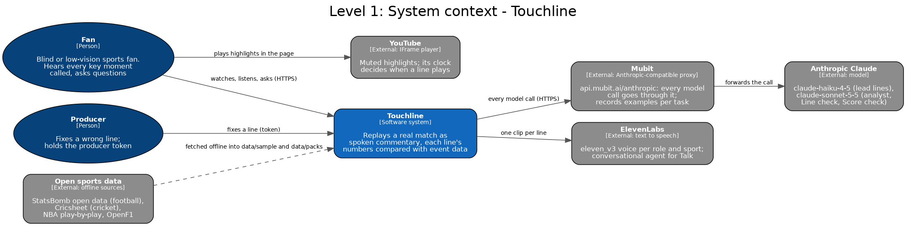
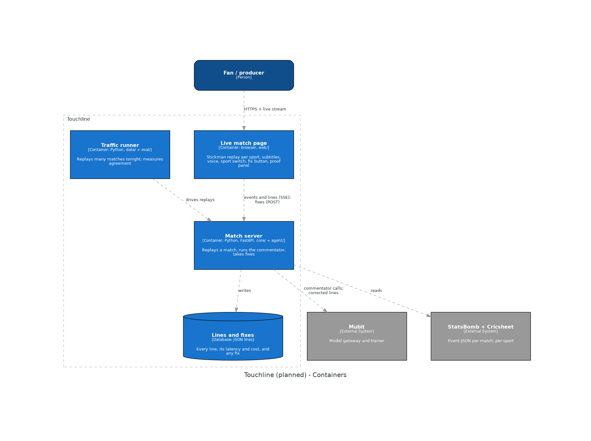
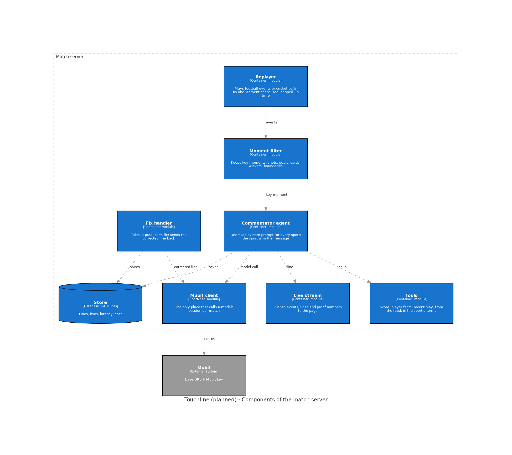

# Touchline

**One live AI commentator for football and cricket, trained on its own corrected calls.**

Built at Night Shift: Mubit Hackathon, London, 23 to 25 October 2026. Track: Own your intelligence layer.

## The problem

Most matches are played with nobody calling them: grassroots and lower-league football, most of the
women's game, club and county cricket. Fans following a stream or a live score get silence or a bare
ticker. A big model could commentate them, but it is too slow to call a moment while it is still on
screen, and too expensive to run for every moment of every match.

## What Touchline does

- **Calls the moment.** Real match event feeds replay as stickmen on a pitch or field. At each key
  moment (shots, goals, cards, wickets, boundaries) the commentator looks up the facts it needs with
  tools (score, player, recent play) and calls it in one short spoken line, with subtitles.
- **One commentator, two sports.** Switch from football to cricket mid-replay and the same agent calls
  the new sport. One system prompt, one tool set: every call in every sport is one Mubit task.
- **Producer fixes become training data.** A producer corrects any wrong line on the page. The fix is
  stored beside the original and sent back through Mubit.
- **A smaller model that matches the big one.** Every call goes through Mubit, which trains a small
  task-adapted commentator. We show the big model and ours calling the same moments.

## The demo, in one line

The 2023 Women's World Cup final replays as stickmen and Touchline calls it aloud in under a second, the
producer fixes one wrong line on stage, our own trained commentator calls a moment beside the big model,
then one tap switches to Kohli's last overs against Pakistan in 2022 and the same commentator calls cricket.

## How it uses Mubit

- Every model call goes through Mubit's Anthropic endpoint (`claude-haiku-4-5`), one session per match.
- Real traffic: dozens of replayed matches in both sports, so the task passes the training threshold
  with varied, real calls.
- Producer corrections go back through Mubit in the same task and session.
- Mubit trains the adapted commentator; we compare it with the big model on matches it never saw.

## Quality, cost and latency, side by side

Measured on held-out matches, filled in from the proof panel before submission.

| | Big model | Our trained commentator |
|---|---|---|
| Agreement with the big model | baseline | to be measured |
| Cost per line | to be measured | to be measured |
| First word, p50 / p95 | to be measured | to be measured |

## Run it

Needs [uv](https://docs.astral.sh/uv/) and `make`.

```bash
make smoke   # offline: replays one sample match per sport with a fake model, no keys needed
make dev     # the live page on localhost; set MUBIT_API_KEY in .env for real commentary
```

## Data

- Football: [StatsBomb open data](https://github.com/statsbomb/open-data), used under its licence.
- Cricket: ball-by-ball data from [Cricsheet](https://cricsheet.org).

## Architecture







## Pre-existing work

All application code was written during the event. The only files brought in are the team's own deploy
tooling (`Dockerfile`, `scripts/deploy.sh` and the bootstrap script), copied from our starter repo; that
commit names its source.

## Team

- Atilade ([@atiladeokegab](https://github.com/atiladeokegab)): lead and design
- Persia ([@PersiaF04](https://github.com/PersiaF04)): full stack

How the team works, the rules for our AI agents and the build process: [TEAMWORK.md](TEAMWORK.md).
