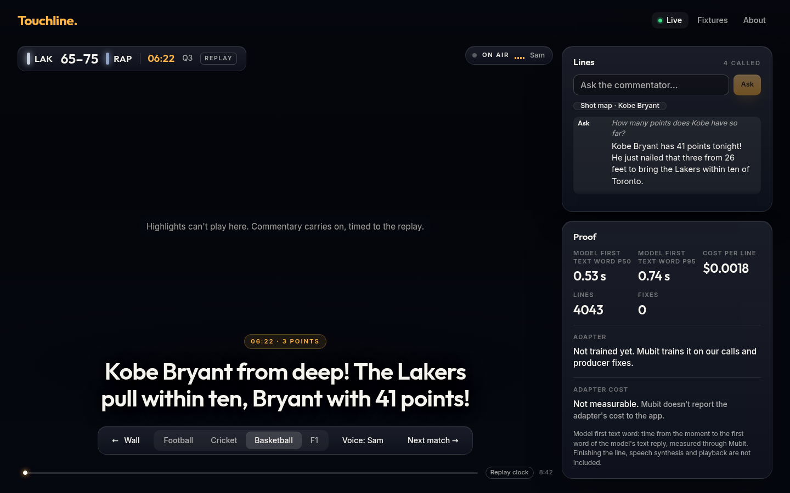
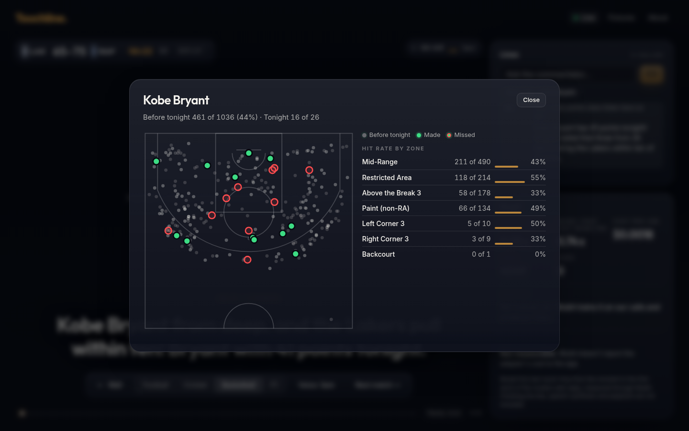
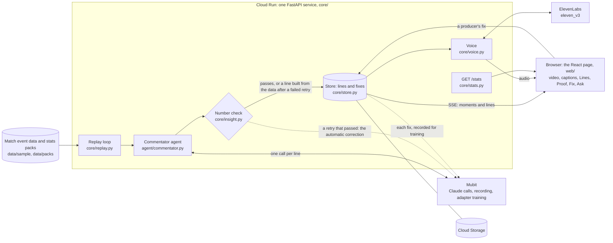

<div align="center">


<sub><b>Touchline: the describer that checks itself.</b> For the match nobody described.</sub>

<br>

[](https://www.python.org)
[](https://fastapi.tiangolo.com)
[](https://mubit.ai)
[](https://elevenlabs.io)
[](https://night-shift-5zvig7nbvq-ew.a.run.app)

# Touchline: the describer that checks itself

### The match nobody described

Touchline describes the matches a platform streams with nobody describing them. It checks every number in the lead's calls before it speaks (the analyst's stat lines are checked from [#224](https://github.com/atiladeokegab/night-shift/pull/224) on), fixes what it can itself, sends the rest to a producer, and every fix trains that platform's own describer in Mubit.

What you hear are **replays, as if live**: real matches' event data played back over their broadcast highlights, each line called at its moment as if the match were on now. Sky Sports now describes [about 109 Premier League games a season](#the-problem) aloud, and none below the top flight.

<!-- DEMO GIF SLOT (build-140): the demo GIF, full width, with a one-line caption under it. -->

**How well the check works:** on 300 lines the live site had said, labelled by a separate model
before the check ran, it caught 8 of the 15 wrong lines (recall 53%) and flagged no right line for a
wrong number (precision 100%, 8 of 8). A small sample; [what it misses](#how-well-the-check-works).

[**Try it live**](https://night-shift-5zvig7nbvq-ew.a.run.app) · [**Correction loop**](#correction-loop-with-evidence) · [**For judges**](#for-judges) · [**Real numbers**](#real-numbers) · [**Architecture**](docs/ARCHITECTURE.md) · [**Known limitations**](#known-limitations) · [**Checks**](#checks) · [**Run it**](#run-it) · [**Demo script**](docs/demo.md)


<sub>The live site on 24 October 2026 at 13:20 UTC, captured in headless Chrome: the 1998 NBA Finals Game 6, Jordan's last shot as a Bull,
with the lead calling Kukoc's three and the analyst's stat lines in the gap after it. YouTube won't play in a headless browser, so the video area is empty and the page says
so; the lines, voice timing and numbers are live.</sub>

</div>

## Correction loop, with evidence

Every moment line goes through a number check before it is spoken: the score, who leads, the
margin, the players' counts and, in football, what kind of event it was ([`core/insight.py`](core/insight.py)).
A line that fails is tried once more. If the retry passes, the failed try is sent to Mubit as a
correction, with no person involved; if it fails too, a line built from the match data is spoken
instead. A producer fixes the rest from the page, and each fix goes to Mubit the same way.
The analyst's stat lines, the lead's replies to them and Ask answers get the same number check,
against the stat and the match so far: a wrong number is tried once more, then the line is dropped
and never said (an answer becomes the off-air line).

Mubit's versions of our commentator, copied from Mubit's console into
[`data/side_by_side.json`](data/side_by_side.json), and the corrections waiting for the next one, from the live [`GET /stats`](https://night-shift-5zvig7nbvq-ew.a.run.app/stats) on
24 October 2026 at 15:23 UTC:

| Mubit version | Trained on | Score on Mubit's test | Passed |
|---|---|---|---|
| Versions 1 to 6 | Our recorded commentary lines | Best 55.8% | No, none of the 6 |
| Next version | 66 corrections recorded for training, the team's, from the number-check fix list (`fixes_toward_next`: 66, `adapter.needed`: 25), plus 8 corrections the number check sent itself (`fixes_auto`) | Training (`adapter.status`) | Not yet |

<!-- CORRECTION LOOP PLACEHOLDER: one row per Mubit version (trained on, score, passed), copied
from Mubit's console (Adapters) with the date read. Replace the "Versions 1 to 6" row. -->

<!-- AUTONOMY PLACEHOLDER (#204): once #204 merges, the counts from /stats, per match and overall:
lines called, passed first time, auto-fixed (the retry passed), sent to a producer (the retry
failed and the data line was spoken). State the time of the /stats read. -->

**Why a correction is a follow-up turn.** Mubit has no feedback API: it learns from the calls it
records. So a correction is sent, on purpose, as the next turn of the wrong line's own call, in the
same task and session: the original request, the line the model said, then "Producer correction.
Reply with exactly this line: …" with the corrected line. Mubit records that call, so the corrected
line is training data for the next version ([`agent/commentator.py`](agent/commentator.py)
`correct`, [`tests/test_core_fix.py`](tests/test_core_fix.py)).

---

Built at Night Shift: Mubit Hackathon, London, 23 to 25 October 2026. Track: Own your intelligence layer.

## For judges

**Live:** <https://night-shift-5zvig7nbvq-ew.a.run.app> (Cloud Run, real Mubit calls, sound on).

### The 60-second path

1. Open the live link and tap **Brighton v Bristol City**, a Women's Super League match from the
   long tail: the kind of match nobody describes. Each line is called and spoken at its moment in
   the broadcast, as if live.
2. Tap **Kobe's 81 v Toronto**. In the **Lines** card, type a question into **Ask the commentator**,
   for example "How many points does Kobe have?". The answer is spoken and lands in the log.
3. Tap the **Shot map · Kobe Bryant** chip: every shot before tonight, tonight's made and missed, and
   his hit rate by zone.
4. Tap **Fix** on any line: a producer corrects it, and the fix goes back through Mubit beside the
   original ([why a follow-up turn](#correction-loop-with-evidence)).
5. Read the **Proof** card, then check it: `curl -s https://night-shift-5zvig7nbvq-ew.a.run.app/stats`.
6. Tap **Cricket** in the sport bar: the same commentator, same prompt, calls India v Pakistan.

### What each feature is

| Feature | Status | Proof in the code |
|---|---|---|
| [The seven matches](#the-seven-matches) | Live | [`GET /matches`](https://night-shift-5zvig7nbvq-ew.a.run.app/matches), [`agent/feed.py`](agent/feed.py) |
| [Two commentators: lead and analyst](#two-commentators-lead-and-analyst) | Live (#130, #142) | [`core/insight.py`](core/insight.py), [`core/replay.py`](core/replay.py) |
| [Ask, by typing](#ask-by-typing-or-by-voice) | Live | [`POST /replays/{id}/ask`](core/app.py), [`agent/ask.md`](agent/ask.md) |
| [Ask, by voice](#ask-by-typing-or-by-voice) | Live (#145) | [`web/src/voice.ts`](web/src/voice.ts), [`web/src/components/MicButton.tsx`](web/src/components/MicButton.tsx), [`web/src/voice.test.ts`](web/src/voice.test.ts) |
| [Follow a player: shot map](#follow-a-player) | Live | [`GET /replays/{id}/players/{name}/shots`](core/app.py), [`web/src/components/ShotMap.tsx`](web/src/components/ShotMap.tsx) |
| [Follow a player: picker and profile card](#follow-a-player) | Live (#140, #152) | [`GET /replays/{id}/players/{name}/profile`](core/app.py), [`web/src/components/ProfileCard.tsx`](web/src/components/ProfileCard.tsx) |
| [Producer fixes](#producer-fixes) | Live | [`POST /lines/{id}/fix`](core/app.py), [`tests/test_core_fix.py`](tests/test_core_fix.py) |
| [Big model vs ours](#big-model-vs-ours) | Live under the Proof card (#144, #147, #150) | [`data/side_by_side.json`](data/side_by_side.json), [`eval/side_by_side.py`](eval/side_by_side.py) |
| [The Proof panel](#the-proof-panel) | Live | [`GET /stats`](https://night-shift-5zvig7nbvq-ew.a.run.app/stats), [`core/stats.py`](core/stats.py) |
| Live screen layout: the video in a card, Lines and Proof beside it, playback controls | Live (#132) | [`web/src/components/Live.tsx`](web/src/components/Live.tsx) |

#### The seven matches


One match from the long tail and six famous ones, in four sports, each replayed from real event data
over its broadcast highlights and called by the same commentator with the same prompt. A line is
never shown or spoken before its moment reaches the picture: the YouTube player's clock gates it
([`web/src/gate.ts`](web/src/gate.ts)).

| Match | Sport and data | Voice | What it calls |
|---|---|---|---|
| The long tail: Brighton 3-2 Bristol City, Women's Super League, 2024 | Football, StatsBomb | British Football Announcer | The five goals: Bristol City come level twice, then Terland's winner in stoppage time |
| The Battle of the Bridge: Chelsea 2-2 Tottenham, 2016 | Football, StatsBomb | British Football Announcer | The four goals, Hazard's equaliser that made Leicester champions |
| Argentina v France, 2022 World Cup final | Football, StatsBomb | British Football Announcer | Messi's two goals, Di María, Mbappé's three, the shoot-out |
| India v Pakistan, 2022 T20 World Cup | Cricket, Cricsheet | Raju | The wickets, the sixes, Kohli's two sixes off Rauf, the last ball |
| Michael Jordan's last shot as a Bull, 1998 NBA Finals Game 6 | Basketball, NBA play-by-play | Sam | The fourth quarter's baskets, Jordan's steal from Malone, the winning shot, the buzzer |
| Kobe Bryant's 81 against Toronto, 2006 | Basketball, NBA play-by-play | Sam | His baskets through the second half, the record-breaking points, the buzzer |
| Max Verstappen from 17th to win the 2024 São Paulo Grand Prix | F1, OpenF1 timing | British Football Announcer | The rain, the safety car, the red flag, Verstappen taking the lead, the flag |

Lines are voiced by ElevenLabs `eleven_v3` with an audio tag per moment: shouting for a goal or a
wicket, hushed for the build-up ([`core/voice.py`](core/voice.py), [docs/voice.md](docs/voice.md)).

#### Two commentators: lead and analyst

The lead calls each big moment. In the quiet stretches between them, an analyst fills the gap with a
stat line built only from the pre-match pack and the match so far, in a calmer second voice; every
fourth line, the lead replies ([`core/insight.py`](core/insight.py)). Stat lines are stored and reused
by later replays of the same match.

Since #142 the analyst has its own prompt ([`agent/analyst.md`](agent/analyst.md)) with the stat
as the event, and each fact states its period, such as "this season before tonight". Analyst lines
and the lead's replies run on `claude-sonnet-5-5` with its lowest thinking setting
(`between_tools`), unrecorded, so they never split the moment lines' Mubit task
([`agent/commentator.py`](agent/commentator.py)).

#### Ask, by typing or by voice



A viewer types a question mid-replay. The answer uses only what has happened up to the moment on
screen, so it never spoils what comes next. It is spoken by the analyst, at a gap in the commentary; the
question and answer take over the caption, and nothing cuts the answer off ([`core/app.py`](core/app.py) `ask`, [`agent/ask.md`](agent/ask.md),
[`web/src/turns.ts`](web/src/turns.ts), [`tests/test_core_ask.py`](tests/test_core_ask.py)). Answers
go through Mubit unrecorded: they have their own prompt.

**By voice (#145):** hold the mic button, or the space bar, and
speak; the browser's own speech recognition fills the box and sends it. The answer is held until the
current line ends and no big moment is due, then spoken
([`web/src/voice.ts`](web/src/voice.ts), [`web/src/turns.ts`](web/src/turns.ts), [`web/src/turns.test.ts`](web/src/turns.test.ts)).
Where the browser has no speech recognition, the button is hidden and typing still works.

#### Follow a player



Tap the chip for the player in the latest moment: their shots from the season before (from the
match's pre-match pack) and tonight's so far, with hit rate by zone. It reads only moments up to the
one on screen ([`core/app.py`](core/app.py) `shots`, [`core/predict.py`](core/predict.py),
[`tests/test_core_shots.py`](tests/test_core_shots.py)).

Or follow anyone in the match: search for them in the Follow picker, and a profile card shows their
record before tonight and tonight's so far, while their lines are marked in the log. Like the shot
map, it reads only moments up to the one on screen ([`core/app.py`](core/app.py) `players` and
`profile`, [`core/predict.py`](core/predict.py),
[`web/src/components/FollowPicker.tsx`](web/src/components/FollowPicker.tsx),
[`web/src/components/ProfileCard.tsx`](web/src/components/ProfileCard.tsx),
[`tests/test_follow.py`](tests/test_follow.py), [`web/src/follow.test.ts`](web/src/follow.test.ts)).


#### Producer fixes


A producer corrects a wrong line on the page. The server stores the fix beside the original and sends
it back through the same Mubit task and session, as a second turn: that is how a correction is built to become
training signal. `/stats` shows 66 corrections recorded for training: the team's, from the
number-check fix list, applied on the live site. No adapter version trained on them is recorded
yet ([`core/app.py`](core/app.py) `fix_line`, [`tests/test_core_fix.py`](tests/test_core_fix.py)).

#### Big model vs ours

The big model's line on six held-out moments (three football, three cricket, matches never used for
training), recorded through Mubit with recording off, with each line's latency and cost
([`data/side_by_side.json`](data/side_by_side.json), [`eval/side_by_side.py`](eval/side_by_side.py),
[`tests/test_side_by_side.py`](tests/test_side_by_side.py)). Until an adapter version passes Mubit's test,
those lines stand as the baseline ours must match, and the panel says why there is no line of ours:
Mubit serves an adapter only once a version passes, and only in its console's Try models, never to
the app by API. The panel
([`web/src/components/SideBySide.tsx`](web/src/components/SideBySide.tsx)) sits under the Proof card on
every live page.


#### The Proof panel


Live latency, cost per line and lines called, split by lead and analyst (#166); the fixes Mubit trains
on and how many count toward the next adapter; and the adapter's state. All computed from the store,
the same numbers as `GET /stats` (its `by_speaker`) ([`web/src/components/ProofPanel.tsx`](web/src/components/ProofPanel.tsx),
[`core/stats.py`](core/stats.py)).

### Against the judging criteria

Each criterion weighs the same; one line each, with where to check it.

- **Use of Mubit (a correction becomes a model update):** every call goes through one Mubit task; its recorded lines have trained [6 adapter versions](#real-numbers) so far (none passed yet), and a producer's [fix](#producer-fixes) is stored beside the line as the correction for the next version: 66 corrections recorded for training so far, the team's, from the number-check fix list.
- **Usefulness (a real recurring task):** a major broadcaster now describes [only some Premier League games (about 109 of 380)](#the-problem), and elsewhere live audio description is voluntary and patchy; Touchline speaks the key moments of [seven real matches in four sports](#the-seven-matches) from their real event data.
- **Technical execution:** a line in [545 ms to its first word](#real-numbers) (median), gated on the video's clock, an offline test suite (`make check`) and a live smoke test on every deploy; [architecture](docs/ARCHITECTURE.md) and [known limitations](#known-limitations).
- **Demo:** two minutes on the live URL, scripted in [docs/demo.md](docs/demo.md); the [60-second path](#the-60-second-path) above is the short version.

## The product: where this goes

> **Vision, not what's built.** This weekend's build is the seven replays above. This is the full product.

- **Every streamed match, described aloud.** Leagues, clubs, rights holders and streaming platforms
  switch it on for the long tail of matches they stream with no describer, in any language or voice:
  lower-league and grassroots football, the women's game, club and county cricket.
- **A describer per broadcaster, owned by them.** Each broadcaster gets its own cheap commentator as
  a Mubit adapter, trained on its own matches, and every producer correction is a training signal
  that makes it better.
- **Built for fans who can't see the screen.** Audio first, with keyboard and screen reader working
  throughout (#170, built). Football shots already say where on the pitch they came from, from the
  event data's own locations (#172).
- **The fan layer.** Ask by typing or voice, a choice of voices, and Follow a player, on any match.
- **At scale,** Redis fans each match's lines out to every viewer and caches them across instances,
  and SurrealDB holds players, teams, matches and seasons as a graph
  ([docs/ARCHITECTURE.md](docs/ARCHITECTURE.md#at-scale-a-plan-not-built)).

## Real numbers

Read once from the live service's [`GET /stats`](https://night-shift-5zvig7nbvq-ew.a.run.app/stats)
on 24 October 2026 at 15:23 UTC, adapter status included; every number below comes from that one
read, and they move as people use the site. Moment lines are `claude-haiku-4-5` calls, recorded;
since #142 the analyst's stat lines and the lead's replies to it are `claude-sonnet-5-5`, unrecorded.
The totals count both, each priced at its own model's rate, and `by_speaker` splits them.

| | Big model via Mubit (all lines) | Our trained commentator (Mubit adapter) |
|---|---|---|
| Lines called | 6,305 (6,446 Mubit calls, counted by their request ids) | none: not callable by the app |
| First word of the model's text, p50 / p95 | 545 ms / 1,446 ms | not measured |
| Full line, p50 / p95 | 902 ms / 1,837 ms | not measured |
| Cost per line | $0.0019 | not reported by Mubit |
| Tokens per line, in / out | about 1,600 / 31 (10,090,212 / 198,448 over 6,305 lines) | not measured |
| Corrections | 66 recorded for training, all 66 counted toward the next adapter version: the team's, from the number-check fix list; and 8 the number check made itself (`fixes_auto`) | |

Split by speaker (`by_speaker`, same read):

| | Lines | First word, p50 / p95 | Cost per line |
|---|---|---|---|
| Lead (Haiku moment lines, Sonnet replies) | 5,391 | 538 ms / 919 ms | $0.0018 |
| Analyst (stat lines; Haiku before #142, Sonnet since) | 914 | 892 ms / 3,615 ms | $0.0025 |

The overall p95 (1,446 ms) is above the lead's (919 ms) because the analyst's lines are slower.

"First word" is the time from the moment to the first word of the model's text reply, not the audio:
speech synthesis and playback come after it.

**One match, voice included: $0.38 on average.** `/stats` measures every full replay on the live
site (one played from kick-off): the model cost of every line it said and every answer, plus its
voice characters, at list prices. Over the 13 full replays it has measured, that is $0.09 of model
and $0.29 of voice a match (`cost_per_match_usd`, `model_cost_per_match_usd` and
`voice_cost_per_match_usd`; [`core/stats.py`](core/stats.py) `_per_match`,
[`tests/test_match_cost.py`](tests/test_match_cost.py)). An earlier figure, $0.70, was one keyed run
of Kobe's 81 highlights alone: 60 lines, all 60 spoken, $0.15 of model and $0.54 of voice (6,909
characters) ([#181](https://github.com/atiladeokegab/night-shift/pull/181)). The two measure
different replays; `/stats` is the one that updates. The voice price assumes an ElevenLabs
subscription tier, $0.08 per 1,000 characters for `eleven_v3`; pay-as-you-go is $0.10.

**The adapter, exactly as it stands.** Mubit has trained 6 adapter versions on our task's recorded lines. All 6 are "not
ready": none has passed Mubit's test yet, and the best scored 55.8% on Mubit's test. That is the record in [`data/side_by_side.json`](data/side_by_side.json), copied by hand from
Mubit's console on 24 October 2026. We make no claim that the adapter matches the big model until a
result shows it. `/stats` reports the adapter's status as `training` (at 15:23 UTC), recorded from
the console with [`eval/record_adapter.py`](eval/record_adapter.py); it reports no agreement result,
because no version has passed.

## How well the check works

Before a lead line is spoken, the number check reads it against the moment's data
([`core/insight.py`](core/insight.py) `wrong_numbers`, which includes the event check). We measured
it on 300 lines the live site had already said.

**Precision 100% (8 of 8 flags were wrong lines). Recall 53% (8 of 15 wrong lines caught).**

| | Lines | Wrong | Flagged | Caught | Missed | False alarms | Precision | Recall |
|---|---|---|---|---|---|---|---|---|
| All | 300 | 15 | 8 | 8 | 7 | 0 | 100% | 53% |
| Basketball | 93 | 4 | 2 | 2 | 2 | 0 | 100% | 50% |
| Cricket | 56 | 6 | 4 | 4 | 2 | 0 | 100% | 67% |
| F1 | 25 | 0 | 0 | 0 | 0 | 0 | n/a | n/a |
| Football | 126 | 5 | 2 | 2 | 3 | 0 | 100% | 40% |

**How the lines were picked.** From a read-only copy of the live store's lines (24 October 2026,
about 15:40 UTC; 6,446 records), we kept each distinct lead line once, per match, moment and text,
and left out the analyst's lines and the fallback lines, which are built from the data. We drew 300
of them, stratified by match: 30 from each of the 7 matches (F1 had only 25 distinct lines, so all
25), and the rest by each match's share, with a fixed seed (219). 13 are the lead's replies to the
analyst. Only 6 of the 300 had been through the live check when they were said, because most were
said before it marked lines; the rest are scored here for the first time.

**Who labelled them.** The lines were labelled by a separate agent reading the match data, before
running the check. That agent was a model, not a person. It read each line with the match header,
the moment's data, the eight moments before it and, for a reply, what the analyst had just said. It
had no access to the checker. It labelled each line right or wrong by the written rules in
[`eval/checker_eval.py`](eval/checker_eval.py) (`RULES`): a number the data contradicts or does not
give, a wrong player or team, a wrong lead or level claim, a wrong event, or leaked reasoning is
wrong; leaving something out is never wrong. The labels were committed before the checker was run on
them ([`eval/checker_labels.jsonl`](eval/checker_labels.jsonl)).

**What it misses.** The 7 wrong lines it let through:

- "Bulls down two with ninety seconds to play!" (two lines, Jordan's Bulls). The clock said 1:45.
  The check lets a basketball clock round to the half minute, so it accepts ninety.
- "Back-to-back sixes off Patel!" (Pakistan v India). A dot ball came between them. The check does
  not test streak claims.
- "Iftikhar Ahmed to 18 off six balls". The data gives 18 from three sixes in four balls, and 24 off
  the last six. The check does not test a batter's count over a span.
- "Lautaro Martínez with the half volley, it's blocked away!" (World Cup final). The shot went off
  target. The event check does not tell blocked from off target.
- "Argentina three, France three in the shootout". The shootout was 1-1; 3-3 was the match score.
- "Argentina three, France two, still level". The numbers are right, but "still level" is not. In
  football, the check tests a level claim only on a goal.

**Read these numbers with care.** 15 wrong lines is a small count. One more catch moves recall by 7
points, and a 95% interval for 8 of 15 runs from about 30% to 75%. Precision of 8 of 8 means at
least about 68% at the same confidence. The labels are a model's reading of the data, so they can be
wrong too.

**Omissions are counted apart.** The live check also retries a line that leaves out a milestone or
how a shot ended. The labels never call an omission wrong, so the figures above leave those reasons
out. Counted as the live check counts them, it also flags 14 lines labelled right, for a precision of
36%. Each such line is regenerated once; if the retry fails too, the line built from the data is
said instead, and the failed try goes to the producer's fix queue.

Rerun it with `uv run python -m eval.checker_eval`. The test
[`tests/test_checker_eval.py`](tests/test_checker_eval.py) fails if the checker drops below 90%
precision or 50% recall on these labels.

## The problem

On 10 October 2026 Sky Sports launched live descriptive audio commentary for the Premier League:
one match a day each game week, about 109 of the league's 380 games a season
([ISPreview](https://www.ispreview.co.uk/index.php/2026/10/sky-sports-to-introduce-live-subtitles-and-live-descriptive-audio-commentary.html)).
A major broadcaster now ships audio description for live football, but only for the top flight, and
none below it. Touchline is for every other match with a data feed.

At least 2.2 billion people have a near or distance vision impairment
([WHO](https://www.who.int/news-room/fact-sheets/detail/blindness-and-visual-impairment)). For a fan
who can't see the screen, a match that nobody describes is a match they can't follow.

Outside Sky's matches, live audio description is voluntary and patchy. In UK football some top clubs,
such as Manchester City, and some smaller ones, such as Wrexham, Bolton, Cardiff and Altrincham, run
audio-descriptive commentary, and a Level Playing Field survey found few clubs offering it live
([Disability News Service](https://www.disabilitynewsservice.com/premier-league-should-be-ashamed-of-treatment-of-blind-fans/)).
Rules don't close the gap: in the US the FCC requires the top networks to describe 87.5 hours a
quarter, and live sport is effectively outside it
([Federal Register](https://www.govinfo.gov/content/pkg/FR-2024-03-12/html/2024-05186.htm)). Where a
club does describe its matches, the money can come from the fans: one supporters' association funded
a £4,000 audio-description project at Wrexham, including four years of running it
([Level Playing Field](https://www.levelplayingfield.org.uk/news-item/audio-description-commentary-at-wrexham-afc)).

A model can describe the rest, if it speaks while the moment is still on screen and costs little
enough to run for every match. Touchline's model costs $0.0019 a line, with the voice not included,
and has the first word of its text out in 545 ms and the full line in 902 ms (medians from the live
site's [`/stats`](https://night-shift-5zvig7nbvq-ew.a.run.app/stats) on 24 October 2026 at
15:23 UTC).

**Who it's for:** fans who can't see the screen. **Who pays:** rights holders, leagues, clubs and
streaming platforms, for the long tail of matches they stream with no describer.

## What Touchline is

**Touchline** describes a match aloud for fans who can't see it. It plays a match's broadcast
highlights, and as each key moment plays (a goal, a wicket, a three) it calls it in one short line,
read aloud in a commentator's voice and shown as a large subtitle. It describes key moments, not
every pass: what happened and who did it, often with the score. Football shots say where on the pitch they came
from, from the event data's own locations (#172). The page itself works by keyboard and screen
reader, with every control a 44 px target, checked by axe on the home and live pages
([`web/e2e/a11y.spec.ts`](web/e2e/a11y.spec.ts), #170).

One agent calls every sport. It reads the match's real event data, looks up the score, the player and
recent play with tools, and never sees anything from later in the match than the moment it is
calling. A producer corrects any line that's wrong, and the fix goes back through Mubit beside the
line, as a correction for the commentator's next training.

## How it uses Mubit

Every LLM call goes through Mubit, and Mubit trains a small commentator model on our recorded traffic;
producer fixes go into the same task as corrections. That smaller model is what would make a commentator for every match affordable.

1. **Every call goes through Mubit.** Each moment line is one call to Mubit's Anthropic endpoint
   (`claude-haiku-4-5`, recorded), or two when the agent uses its one permitted round of tools. The
   analyst's stat lines and the lead's replies are one call each to `claude-sonnet-5-5`, unrecorded. There is one
   session per match, and no model is called from the browser
   ([`agent/commentator.py`](agent/commentator.py)).
2. **One task for every sport.** The system prompt, message template, tools and model are the same,
   byte for byte, for football, cricket, basketball and F1; the sport goes in the message. Mubit sees
   one task to learn from ([`agent/prompt.md`](agent/prompt.md), [`agent/tools.json`](agent/tools.json)).
3. **Real traffic only.** [`scripts/replay_matches.py`](scripts/replay_matches.py) replays distinct
   real football and cricket matches, never padded or repeated calls. Held-out matches and the demo
   matches are never replayed, so the trained model is judged only on matches it never saw.
4. **The demo key trains nothing.** The live site runs on a separate demo Mubit key with recording
   off (`MUBIT_RECORD=off` in [`scripts/deploy.sh`](scripts/deploy.sh)); training traffic comes from
   the replay script on the owner's key. If the demo key runs out, the commentator moves to the
   owner's key, which records. Ask answers and side-by-side runs are always unrecorded.
5. **A producer's fix is recorded to Mubit for training.** A fix is stored beside the original line
   and sent as the next turn of that line's request on the owner's key (`MUBIT_FALLBACK_KEY`) with
   recording on, whatever `MUBIT_RECORD` says; a fix to an analyst's stat line stays unrecorded,
   like those lines. The Proof card shows the fixes recorded and how many count toward the next
   adapter. `/stats` shows 66 corrections recorded for training: the team's, from the number-check
   fix list. No adapter version trained on them is recorded yet; the 6 so far were trained on
   recorded commentary.
6. **Mubit request ids we stored.** Each line stores the Mubit request id of every call it made,
   and `GET /stats` counts calls from those ids; nothing checks them against Mubit's console.
7. **The trained model is measured, not assumed.** 6 adapter versions trained, none has passed Mubit's
   test yet (best 55.8%), and the app does not call an adapter ([Real numbers](#real-numbers)). The
   aim is that one matches the big model at lower cost; we make no claim that any does.

## Architecture

The full picture, with a C4 container diagram of what runs now and a second, plan-only diagram for
scale: [docs/ARCHITECTURE.md](docs/ARCHITECTURE.md).



**Now.** One Cloud Run service: a FastAPI match server ([`core/`](core)) that also serves the React
page ([`web/`](web)). It replays a match's event feed, asks the commentator agent
([`agent/`](agent)) for each line through Mubit, has ElevenLabs voice it, keeps lines and fixes as
JSON lines on Cloud Storage, and streams moments and lines to the browser over server-sent events.
The commentator's tools and the shot map read per-match stats packs ([`data/packs/`](data/packs)).

**At scale (a plan, not built).**

- **Redis** as a shared cache of lines, stat lines and voice clips across instances (today each
  replay pays for its own lines, and voice clips sit in one instance's memory); pub/sub fan-out of
  each match's lines to thousands of viewers; per-viewer Ask limits.
- **SurrealDB** for players, teams, matches and seasons as a graph, behind the commentator's tools,
  Follow a player and the heat maps, replacing per-match JSON packs at thousands of matches.
- **What stays:** Mubit for every model call and the trained adapter, and Cloud Run as the host.

## Known limitations

- **The adapter isn't ready or callable.** 6 adapters, none ready, best 55.8% on Mubit's test. Mubit
  serves an adapter only in its console, so the app can't call one, and its cost per line isn't
  measurable.
- **The Proof card counts the moment lines only.** The analyst's lines and Ask answers are
  number-checked too ([`core/insight.py`](core/insight.py) `Gaps.line`, `checked_answer`), but
  aren't in `/stats`'s called, auto-fixed and sent-to-a-human counts.
- **One instance.** The service runs with `--max-instances 1` ([`scripts/deploy.sh`](scripts/deploy.sh)):
  replays and voice clips live in that process's memory
  ([`core/replay.py`](core/replay.py), [`core/voice.py`](core/voice.py)).
- **Every viewer starts their own replay.** Two people watching the same match pay Mubit twice for
  the big moments ([`core/replay.py`](core/replay.py)).
- **The store rewrites a whole object on every append**, and `/stats` reads the whole lines file each
  time, which is published after every line ([`core/store.py`](core/store.py), [`core/stats.py`](core/stats.py)).
  Fine for a demo; a database once two producers edit at once.
- **Cricket has no ball timestamps** in Cricsheet, so a ball counts as 30 seconds
  ([`core/replay.py`](core/replay.py)).
- **Line timing assumes the video starts with the replay**; the page doesn't send its player's clock
  back to the server ([`core/replay.py`](core/replay.py)).
- **Predictions are approximations:** the packs mark no starters, and a cricket batter's runs tonight
  include extras ([`core/predict.py`](core/predict.py)).
- **The highlights are re-uploads** for four of seven matches, because the official uploads block
  embedding or don't exist. If one is taken down, the commentary carries on without the picture.
- **Not in `make check`:** the browser checks. The live page renders in unit tests
  ([`web/src/live.test.ts`](web/src/live.test.ts)), but speech playback
  ([`web/src/useSpeech.ts`](web/src/useSpeech.ts)) and the accessibility run
  ([`web/e2e/a11y.spec.ts`](web/e2e/a11y.spec.ts), `npx playwright test` in `web/`) need a real
  browser, so they run by hand. Real Mubit and ElevenLabs calls are checked only by the smoke test
  after each deploy.

## Checks

| What | Count | Runs |
|---|---|---|
| Python tests: the number check, replay timing, the store, Mubit and ElevenLabs calls against fakes, the deploy script | 671 | `make check`, offline; and in `make smoke` |
| Web unit tests: the live page, the Proof card, Fix, Ask, captions | 82 | `npm test` in `web/` |
| Offline smoke: every sample match replayed end to end through the real server with a fake model | 7 matches | `make smoke`; in CI on every PR into `integration` ([`.github/workflows/smoke.yml`](.github/workflows/smoke.yml)), which also builds the container and imports the app inside it |
| Live smoke on the real URL: one replay streams moments and lines, and the service's store grows by the lines it streamed | 1 replay | after every deploy, in [`scripts/deploy.sh`](scripts/deploy.sh) (`BASE_URL=<url> python -m core.smoke`) |
| Accessibility: no serious axe violation on the home or live page, 44 px targets, a match started and a question asked by keyboard alone | 1 spec | by hand, `npx playwright test` in `web/` (needs a browser) |

One command runs lint, the format check, every Python test and the offline smoke:

```bash
make smoke
```

The web tests are `cd web && npm ci && npm test`. Counts are from 24 October 2026.

## Run it

Needs [uv](https://docs.astral.sh/uv/) and `make`.

```bash
make smoke   # offline: replays every sample match with a fake model, no keys needed
make check   # lint and the test suite, offline
make dev     # the server on localhost; export MUBIT_API_KEY for real commentary (make dev doesn't read .env)
```

## Data and video

- Football: [StatsBomb open data](https://github.com/statsbomb/open-data), used under its licence.
- Cricket: ball-by-ball data from [Cricsheet](https://cricsheet.org).
- Basketball: stats.nba.com play-by-play, via the [shufinskiy/nba_data](https://github.com/shufinskiy/nba_data) mirror (Apache-2.0).
- F1: timing data from the [OpenF1](https://openf1.org) API.
- Video: broadcast highlights on YouTube, embedded and muted, never downloaded or rehosted; the
  commentator reads the event feed, not the video. The two basketball games are from the NBA's own
  channel, and Brighton v Bristol City from Brighton & Hove Albion's. Argentina v France, Chelsea v
  Tottenham, India v Pakistan and the São Paulo Grand Prix are re-uploads or fan edits of the TV
  coverage by others, because the official uploads block embedding or don't exist.

## Pre-existing work

All application code was written during the event. The only files brought in are the team's own deploy
tooling (`Dockerfile`, `scripts/deploy.sh` and the bootstrap script), copied from our starter repo; that
commit names its source.

## What we'd build next

- **Scale**, as in [docs/ARCHITECTURE.md](docs/ARCHITECTURE.md): Redis and SurrealDB, so one call per
  moment serves every viewer.
- **More sports, then esports.** Any sport with real event data, through the same agent, tools and
  Mubit task; then esports and video-game events, where the match data already comes as a live feed.
- **Live streams, not just replays.** Calling a match as it is broadcast, with the same producer fixes
  feeding the same training loop.

## Team

- Atilade ([@atiladeokegab](https://github.com/atiladeokegab)): lead and design
- Persia ([@PersiaF04](https://github.com/PersiaF04)): full stack

Requirements: [docs/PRD.md](docs/PRD.md); each one has an ID such as A-6.4, and the tests that
check one name its ID. How the team
works, the rules for our AI agents and the build process: [TEAMWORK.md](TEAMWORK.md).
