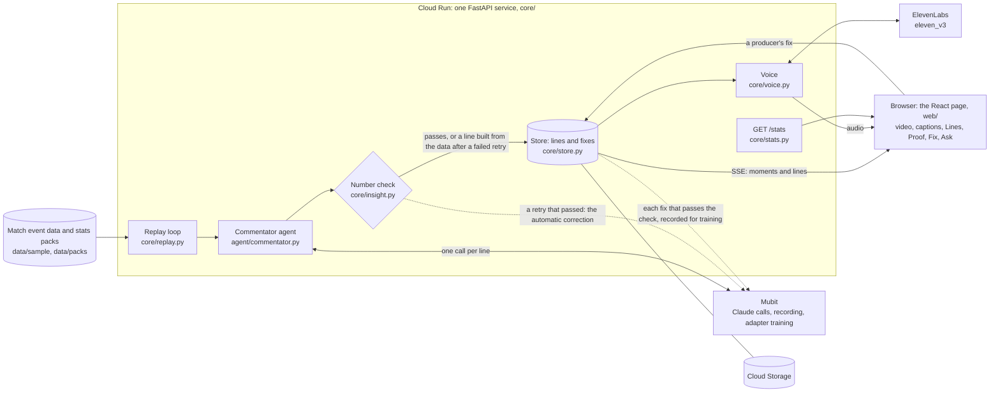

<div align="center">


<sub><b>Touchline: the describer that checks itself.</b> For the match nobody described.</sub>

<br>

[](https://www.python.org)
[](https://fastapi.tiangolo.com)
[](https://mubit.ai)
[](https://elevenlabs.io)
[](https://night-shift-5zvig7nbvq-ew.a.run.app)

# Touchline: the describer that checks itself

### The match nobody described

Touchline describes the matches a platform streams with nobody describing them. It checks the score, the leader and the key numbers against the match data before it speaks, fixes what it can itself, sends the rest to a producer, and each fix that passes the number check is recorded in Mubit as training data for that platform's own describer.

What you hear are **replays, as if live**: real matches' event data played back over their broadcast highlights, each line called at its moment as if the match were on now. From 10 October 2026 Sky Sports runs live descriptive audio commentary on [about 109 Premier League games a season](#the-problem), one match a day each game week ([ISPreview](https://www.ispreview.co.uk/index.php/2026/10/sky-sports-to-introduce-live-subtitles-and-live-descriptive-audio-commentary.html), [What Hi-Fi?](https://www.whathifi.com/streaming-entertainment/tv-streaming-services/sky-announces-a-significant-step-forward-for-its-accessible-premier-league-coverage-and-its-a-promising-move)). Touchline describes a match in any of its four sports from the match's event data, with a **Close your eyes** mode (#277), for about $0.35 per key-moments replay, voice included.

**Who it is for:** a blind or low-vision fan following a match with no described commentary. Two whole matches lead the page, every key moment from start to finish with no video: Orlando Pride v North Carolina Courage (NWSL, 2018) and Netherlands v Nepal (Women's T20 World Cup Qualifier, 2026). A key-moments replay costs $0.35 on average, voice included: $0.09 model and $0.26 voice, over the 37 measured on the live [`GET /stats`](https://night-shift-5zvig7nbvq-ew.a.run.app/stats) on 24 October 2026 at 19:37 UTC (`cost_per_match_usd`). That is not the price of a full 90 minutes: a whole match calls every moment, so it costs more.

<!-- DEMO GIF SLOT (build-140): the demo GIF, full width, with a one-line caption under it. -->

**How well the check works:** on 300 new lines the live site had said, labelled by a separate model
before the check ran, it caught 1 of the 6 wrong lines (recall 17%) with no false alarm (precision
100%, 1 of 1), exactly as before #293: on unseen lines the new rules caught nothing more. On the 300
lines the rules were written against it catches 14 of 15, a tuned-on score. Small samples; [both sets](#how-well-the-check-works).

[**Try it live**](https://night-shift-5zvig7nbvq-ew.a.run.app) · [**Correction loop**](#correction-loop-with-evidence) · [**For judges**](#for-judges) · [**Real numbers**](#real-numbers) · [**Architecture**](docs/ARCHITECTURE.md) · [**Known limitations**](#known-limitations) · [**Checks**](#checks) · [**Run it**](#run-it) · [**Demo script**](docs/demo.md)


<sub>The live site on 24 October 2026 at 13:20 UTC, captured in headless Chrome: the 1998 NBA Finals Game 6, Jordan's last shot as a Bull,
with the lead calling Kukoc's three and the analyst's stat lines in the gap after it. YouTube won't play in a headless browser, so the video area is empty and the page says
so; the lines, voice timing and numbers are live.</sub>

</div>

## Correction loop, with evidence

Every moment line goes through a number check before it is spoken: the score, who leads, the
margin, the players' counts and, in football, what kind of event it was ([`core/insight.py`](core/insight.py)).
A line that fails is tried once more. If the retry passes, the failed try is sent to Mubit as an
automatic correction attempt, with no person involved; if it fails too, a line built from the match
data is spoken instead. A producer fixes the rest from the page, and each fix goes to Mubit the same
way. Only a fix whose corrected reply passes the number check is recorded as training data; one that
fails is stored but not recorded (`recorded: false`), and a fix to an analyst's stat line is never
recorded. A fix that passes that first, unrecorded check is then sent again, the same request, on
the recording key; that recorded second reply is checked again and can still fail. It stays
recorded in Mubit (`recorded: true`, `reply_passed: false`), but it doesn't count toward the next
version (`fixes_toward_next`).
A correction is the next turn of the line's own call, so only the messages change, never the
prompt, tools or model. It says what was wrong and gives the facts, and the commentator writes
the fixed line itself. A correction is recorded only after an unrecorded try passes the number
check. If the recorded reply still fails, it is marked and does not count toward the next version.
The turn the code builds for the Jordan fix in the table below, had it been made after #245
(Jazz v Bulls, 1998 NBA Finals Game 6, moment 30), sent after the wrong line:

```text
Producer correction: Wrong score
The facts at this moment. Score: Utah Jazz 86, Chicago Bulls 85. Leader: Utah Jazz lead 86-85. Player total: Michael Jordan, 43 points tonight.
The producer's line: Michael Jordan with the driving layup, forty-three for him! Utah still lead, eighty-six to eighty-five.
Say your line again, corrected: the line alone, at most 20 words.
```

Each fix stores this turn as `correction`, with `reply_passed`.

A fix applies to the next lines straight away, and Mubit records it for training. Every line the
commentator writes later in that match, in this replay and the next, carries its last five fixes in the user
message: when, what the commentator said, what was wrong and the producer's line. The system
prompt, tools and model stay the same, so it is still one Mubit task, and the number check still
runs on every line.

The analyst's stat lines, the lead's replies to them and Ask answers get the same number check,
against the stat and the match so far: a wrong number is tried once more, then the line is dropped
and never said (an answer becomes the off-air line).

**Mubit, exactly as its console shows it.** Mubit's console overview, read on 24 October 2026 at
about 19:15 UTC, shows 8 tasks, 7 adapters and 0 serving. Mubit keys a task on its fingerprint: the
system prompt, the tools, the output format and the model. Each prompt change started a new task, so
our recorded commentary is split across six separate tasks rather than one. The overview lists these
six, as they are; the other 2 tasks, Line check among them, aren't listed on it. None has passed
Mubit's 95% target and no adapter serves.

| Task | Status | Examples | Quality |
|---|---|---|---|
| Live television commentator 5 (current) | Collecting examples | 269 | 14.3% |
| Live sports commentator | Testing | 155 | 5.9% |
| Live sports commentator 2 | Testing | 141 | 58.3% |
| Live television commentator 3 | Testing | 132 | 55.8% |
| Live television commentator | Collecting examples | 118 | 0.0% |
| Live television commentator 2 | Testing | 111 | 25.0% |

What we did about it: [Line check](#how-it-uses-mubit), one frozen task whose answer key comes from
code, with its recorded checks and the producers' fixes. Beside the rules (#298), it checks each new lead
line; stored replays are checked once as they play (its count is `linecheck` on [`/stats`](https://night-shift-5zvig7nbvq-ew.a.run.app/stats)). Its
flags go to the producer's fix queue ([how well it works](#line-check-beside-the-rules)).
[`data/side_by_side.json`](data/side_by_side.json) still holds an earlier hand-copied read, best
55.8%, and `/stats`'s `adapter` still says "Collecting", from a record made at 13:04 UTC.

The corrections waiting, from the live [`GET /stats`](https://night-shift-5zvig7nbvq-ew.a.run.app/stats) on 24 October 2026 at 19:37 UTC:
67 recorded for training, the team's, from the number-check fix list; only a fix whose recorded
reply passes the number check counts (`fixes_toward_next`: 67). Beside them, 33 automatic correction
attempts by the number check (`fixes_auto_sent`). `adapter.summary`: "Collecting: no adapter version
recorded yet, as of 24 Oct 2026 13:04 UTC."

How the check left the lead's calls, from the same read (`autonomy`, `autonomy_by_match`). These
count only calls made since the check started marking lines; older stored lines aren't in them.

| Match | Called | Passed first time | Fixed itself (the retry passed) | Sent to a producer (the data line was said) |
|---|---|---|---|---|
| All nine | 855 | 817 | 24 | 14 |
| Messi v Mbappé | 318 | 302 | 12 | 4 |
| Battle of the Bridge | 174 | 173 | 1 | 0 |
| Orlando v North Carolina | 135 | 121 | 5 | 9 |
| Netherlands v Nepal | 63 | 62 | 1 | 0 |
| India v Pakistan | 56 | 55 | 1 | 0 |
| Brighton v Bristol City | 49 | 48 | 1 | 0 |
| Jordan's last shot as a Bull | 35 | 32 | 2 | 1 |
| Kobe's 81 v Toronto | 20 | 19 | 1 | 0 |
| Verstappen, P17 to P1 | 5 | 5 | 0 | 0 |

**Why a correction is a follow-up turn.** Mubit has no feedback API: it learns from the calls it
records. So a correction is sent, on purpose, as the next turn of the wrong line's own call, in the
same task and session: the original request, the line the model said, then the correction turn
above (the reason, the facts, the producer's line). Mubit records the commentator's corrected
reply, so it is training data for the next version ([`agent/commentator.py`](agent/commentator.py)
`correct`, [`tests/test_core_fix.py`](tests/test_core_fix.py)).

**What a correction teaches, and its limit.** The recorded example holds the moment's own request,
a wrong call, what was wrong with it and the right call, written by the model itself. Fixes made
before #245 asked for the producer's line word for word instead. We can't yet say what a version
trained on either learns: no version trained on corrections has been tested.

**Anatomy of a fix.** One real correction from the review queue to Mubit. The fix stores the
correction call's Mubit request id and the exact correction turn, and `GET /lines/{line_id}`
returns them under `fix`.

Read 24 Oct 2026 from one real fix (Bulls v Jazz 1998, the Jordan layup).

| Step | Value |
|---|---|
| The wrong line | The model said "Jordan with the driving layup! Chicago Bulls take the lead, 85-86!" Utah led 86-85. The number check caught it before air: a safe line built from the data was spoken instead ("Michael Jordan with the driving layup. Utah Jazz lead eighty-six, eighty-five."), and the line went to the fix queue |
| The checker's reason | "Chicago Bulls do not lead" |
| The producer's fix | "Michael Jordan with the driving layup, forty-three for him! Utah still lead, eighty-six to eighty-five." (reason: Wrong score) |
| What Mubit was given (`fix.correction`, #245) | Not in this fix: it predates #245 |
| The commentator's corrected reply, and whether it passed the number check (`fix.reply_passed`) | Not in this fix: it predates #245 |
| Mubit request id | `mreq_01a16eb90c9076f0b88abe5089b47e1e` |
| Recorded for training | Yes: `recorded: true` |
| What the next replay said | At 16:23:09 UTC, five seconds after the fix, the producer's line, marked fixed, with no model call (line `3ccce616bff14206bd6b3c8126343b88`) |

---

Built at Night Shift: Mubit Hackathon, London, 23 to 25 October 2026. Track: Own your intelligence layer.

## For judges

**Live:** <https://night-shift-5zvig7nbvq-ew.a.run.app> (Cloud Run, real Mubit calls, sound on).

### The 60-second path

1. Open the live link and tap **Brighton v Bristol City**, a Women's Super League match from the
   long tail: the kind of match nobody describes. Each line is called and spoken at its moment in
   the broadcast, as if live.
2. Tap **Kobe's 81 v Toronto**. In the **Lines** card, type a question into **Ask the commentator**,
   for example "How many points does Kobe have?". The answer is spoken and lands in the log.
3. Tap the **Shot map · Kobe Bryant** chip: every shot before tonight, tonight's made and missed, and
   his hit rate by zone.
4. Tap **Fix** on any line: a producer corrects it, and the fix goes back through Mubit beside the
   original ([why a follow-up turn](#correction-loop-with-evidence)).
5. Read the **Proof** card, then check it: `curl -s https://night-shift-5zvig7nbvq-ew.a.run.app/stats`.
6. Tap **Cricket** in the sport bar: the same commentator, same prompt, calls India v Pakistan.

### What each feature is

| Feature | Status | Proof in the code |
|---|---|---|
| [The nine matches](#the-nine-matches) | Live | [`GET /matches`](https://night-shift-5zvig7nbvq-ew.a.run.app/matches), [`agent/feed.py`](agent/feed.py) |
| [Two commentators: lead and analyst](#two-commentators-lead-and-analyst) | Live (#130, #142) | [`core/insight.py`](core/insight.py), [`core/replay.py`](core/replay.py) |
| [Ask, by typing](#ask-by-typing-or-by-voice) | Live | [`POST /replays/{id}/ask`](core/app.py), [`agent/ask.md`](agent/ask.md) |
| [Ask, by voice](#ask-by-typing-or-by-voice) | Live (#145) | [`web/src/voice.ts`](web/src/voice.ts), [`web/src/components/MicButton.tsx`](web/src/components/MicButton.tsx), [`web/src/voice.test.ts`](web/src/voice.test.ts) |
| [Follow a player: shot map](#follow-a-player) | Live | [`GET /replays/{id}/players/{name}/shots`](core/app.py), [`web/src/components/ShotMap.tsx`](web/src/components/ShotMap.tsx) |
| [Follow a player: picker and profile card](#follow-a-player) | Live (#140, #152) | [`GET /replays/{id}/players/{name}/profile`](core/app.py), [`web/src/components/ProfileCard.tsx`](web/src/components/ProfileCard.tsx) |
| [Producer fixes](#producer-fixes) | Live | [`POST /lines/{id}/fix`](core/app.py), [`tests/test_core_fix.py`](tests/test_core_fix.py) |
| [Big model vs ours](#big-model-vs-ours) | Live under the Proof card (#144, #147, #150) | [`data/side_by_side.json`](data/side_by_side.json), [`eval/side_by_side.py`](eval/side_by_side.py) |
| [The Proof panel](#the-proof-panel) | Live | [`GET /stats`](https://night-shift-5zvig7nbvq-ew.a.run.app/stats), [`core/stats.py`](core/stats.py) |
| Live screen layout: the video in a card, Lines and Proof beside it, playback controls | Live (#132) | [`web/src/components/Live.tsx`](web/src/components/Live.tsx) |

#### The nine matches


Three matches from the long tail and six famous ones, in four sports, each replayed from real event data
and called by the same commentator with the same prompt. The two whole matches have no video; the
rest play over their broadcast highlights. A line is never shown or spoken before its moment reaches the picture: the YouTube player's clock gates it
([`web/src/gate.ts`](web/src/gate.ts)).

| Match | Sport and data | What it calls |
|---|---|---|
| The long tail: Brighton 3-2 Bristol City, Women's Super League, 2024 | Football, StatsBomb | The five goals: Bristol City come level twice, then Terland's winner in stoppage time |
| Orlando Pride v North Carolina Courage, NWSL 2018 | Football, StatsBomb | The whole match, every key moment from kick-off to full time: the shots, the substitutions, an own goal, Courage winning 4-3 |
| Netherlands v Nepal, Women's T20 WC Qualifier 2026 | Cricket, Cricsheet | The whole match, every key moment: the wickets, the boundaries, Nepal's chase of 141 to the last ball |
| The Battle of the Bridge: Chelsea 2-2 Tottenham, 2016 | Football, StatsBomb | The four goals, Hazard's equaliser that made Leicester champions |
| Argentina v France, 2022 World Cup final | Football, StatsBomb | Messi's two goals, Di María, Mbappé's three, the shoot-out |
| India v Pakistan, 2022 T20 World Cup | Cricket, Cricsheet | The wickets, the sixes, Kohli's two sixes off Rauf, the last ball |
| Michael Jordan's last shot as a Bull, 1998 NBA Finals Game 6 | Basketball, NBA play-by-play | The fourth quarter's baskets, Jordan's steal from Malone, the winning shot, the buzzer |
| Kobe Bryant's 81 against Toronto, 2006 | Basketball, NBA play-by-play | His baskets through the second half, the record-breaking points, the buzzer |
| Max Verstappen from 17th to win the 2024 São Paulo Grand Prix | F1, OpenF1 timing | The rain, the safety car, the red flag, Verstappen taking the lead, the flag |

The booth is two commentators: Jim, the lead, and Julian, the analyst, who call each other by name
([`core/voice.py`](core/voice.py) `NAMES`). Lines are voiced by ElevenLabs `eleven_v3` with an audio tag per moment: shouting for a goal or a
wicket, hushed for the build-up ([`core/voice.py`](core/voice.py), [docs/voice.md](docs/voice.md)).

#### Two commentators: lead and analyst

The lead calls each big moment. In the quiet stretches between them, an analyst fills the gap with a
stat line built only from the pre-match pack and the match so far, in a calmer second voice. The
two take turns until the next moment (#297): the analyst's stat, the lead coming back to it, then
the next stat, each line one that ends before the moment ([`core/insight.py`](core/insight.py)
`Gaps.line`). Stat lines are stored and reused
by later replays of the same match.

Since #142 the analyst has its own prompt ([`agent/analyst.md`](agent/analyst.md)) with the stat
as the event, and each fact states its period, such as "this season before tonight". Analyst lines
and the lead's replies run on `claude-sonnet-5-5` with its lowest thinking setting
(`between_tools`), unrecorded, so they never split the moment lines' Mubit task
([`agent/commentator.py`](agent/commentator.py)).

#### Ask, by typing or by voice


A viewer types a question mid-replay. The answer uses only what has happened up to the moment on
screen, so it never spoils what comes next. It is spoken by the analyst, at a gap in the commentary; the
question and answer take over the caption, and only a decisive moment cuts the answer off, which
then offers "Hear it again" ([`core/app.py`](core/app.py) `ask`, [`agent/ask.md`](agent/ask.md),
[`web/src/turns.ts`](web/src/turns.ts), [`tests/test_core_ask.py`](tests/test_core_ask.py)). Answers
go through Mubit unrecorded: they have their own prompt.

**By voice (#145):** hold the mic button, or the space bar, and
speak; the browser's own speech recognition fills the box and sends it. The answer is held until the
current line ends and no big moment is due, then spoken
([`web/src/voice.ts`](web/src/voice.ts), [`web/src/turns.ts`](web/src/turns.ts), [`web/src/turns.test.ts`](web/src/turns.test.ts)).
Where the browser has no speech recognition, the button is hidden and typing still works.

#### Follow a player


Tap the chip for the player in the latest moment: their shots from the season before (from the
match's pre-match pack) and tonight's so far, with hit rate by zone. It reads only moments up to the
one on screen ([`core/app.py`](core/app.py) `shots`, [`core/predict.py`](core/predict.py),
[`tests/test_core_shots.py`](tests/test_core_shots.py)).

Or follow anyone in the match: search for them in the Follow picker, and a profile card shows their
record before tonight and tonight's so far, while their lines are marked in the log. Like the shot
map, it reads only moments up to the one on screen ([`core/app.py`](core/app.py) `players` and
`profile`, [`core/predict.py`](core/predict.py),
[`web/src/components/FollowPicker.tsx`](web/src/components/FollowPicker.tsx),
[`web/src/components/ProfileCard.tsx`](web/src/components/ProfileCard.tsx),
[`tests/test_follow.py`](tests/test_follow.py), [`web/src/follow.test.ts`](web/src/follow.test.ts)).


#### Producer fixes


A producer corrects a wrong line on the page. The server stores the fix beside the original and sends
it back through the same Mubit task and session, as a second turn: that is how a correction is built to become
training signal. `/stats` shows 67 corrections recorded for training: the team's, from the
number-check fix list, applied on the live site. No adapter version trained on them is recorded
yet ([`core/app.py`](core/app.py) `fix_line`, [`tests/test_core_fix.py`](tests/test_core_fix.py)).

#### Big model vs ours

The big model's line on six held-out moments (three football, three cricket, matches never used for
training), recorded through Mubit with recording off, with each line's latency and cost
([`data/side_by_side.json`](data/side_by_side.json), [`eval/side_by_side.py`](eval/side_by_side.py),
[`tests/test_side_by_side.py`](tests/test_side_by_side.py)). Until an adapter version passes Mubit's test,
those lines stand as the baseline ours must match, and the panel says why there is no line of ours:
Mubit serves an adapter only once a version passes, and only in its console's Try models, never to
the app by API. The panel
([`web/src/components/SideBySide.tsx`](web/src/components/SideBySide.tsx)) sits under the Proof card on
every live page.


#### The Proof panel


Live latency, cost per line and lines called, split by lead and analyst (#166); the fixes recorded in Mubit
as training data and how many count toward the next adapter; Line check's row (#298); and the adapter's state. All computed from the store,
the same numbers as `GET /stats` (its `by_speaker`) ([`web/src/components/ProofPanel.tsx`](web/src/components/ProofPanel.tsx),
[`core/stats.py`](core/stats.py)).

### Against the judging criteria

Each criterion weighs the same; one line each, with where to check it.

- **Use of Mubit (a correction recorded for the next model version):** every call goes through Mubit; each prompt change started a new task, so the console shows [six commentary tasks](#correction-loop-with-evidence), best 58.3% against a 95% target, 0 adapters serving; and a producer's [fix](#producer-fixes) is stored beside the line as the correction for the next version: 67 corrections recorded for training so far, the team's, from the number-check fix list.
- **Usefulness (a real recurring task):** a major broadcaster now describes [only some Premier League games (about 109 of 380)](#the-problem), and elsewhere live audio description is voluntary and patchy; Touchline speaks the key moments of [nine real matches in four sports](#the-nine-matches) from their real event data.
- **Technical execution:** a line in [549 ms to its first word](#real-numbers) (median), gated on the video's clock, an offline test suite (`make check`), browser tests in CI on every PR and a live smoke test on every deploy; [architecture](docs/ARCHITECTURE.md) and [known limitations](#known-limitations).
- **Demo:** a film under 2:00 (1:50 target) on the live URL, opening on Brighton v Bristol City with **Close your eyes**, scripted in [docs/demo.md](docs/demo.md); the [60-second path](#the-60-second-path) above is the short version.

## The product: where this goes

> **Vision, not what's built.** This weekend's build is the nine replays above. This is the full product.

- **Every streamed match, described aloud.** Leagues, clubs, rights holders and streaming platforms
  switch it on for the long tail of matches they stream with no describer, in any language or voice:
  lower-league and grassroots football, the women's game, club and county cricket.
- **A describer per broadcaster, owned by them.** Each broadcaster gets its own cheap commentator as
  a Mubit adapter, trained on its own matches, and each producer correction that passes the
  number check is recorded as training data for it.
- **Built for fans who can't see the screen.** Audio first, with keyboard and screen reader working
  throughout (#170, built). Football shots already say where on the pitch they came from, from the
  event data's own locations (#172).
- **The fan layer.** Ask by typing or voice, a choice of voices, and Follow a player, on any match.
- **At scale,** Redis fans each match's lines out to every viewer and caches them across instances,
  and SurrealDB, already the graph behind Follow a player, takes over every pack
  ([docs/ARCHITECTURE.md](docs/ARCHITECTURE.md#at-scale-a-plan-not-built)).

## Real numbers

Read once from the live service's [`GET /stats`](https://night-shift-5zvig7nbvq-ew.a.run.app/stats)
on 24 October 2026 at 19:37 UTC, adapter status included; all the figures below come from that one
read, and they move as people use the site. Moment lines are `claude-haiku-4-5` calls, recorded;
since #142 the analyst's stat lines and the lead's replies to it are `claude-sonnet-5-5`, unrecorded.
The totals count both, each priced at its own model's rate, and `by_speaker` splits them.

| | Big model via Mubit (all lines) | Our trained commentator (Mubit adapter) |
|---|---|---|
| Lines called | 7,470 (7,621 Mubit calls, counted by their request ids) | none: not callable by the app |
| First word of the model's text, p50 / p95 | 549 ms / 1,401 ms | not measured |
| Full line, p50 / p95 | 907 ms / 1,782 ms | not measured |
| Cost per line | $0.0020 | not reported by Mubit |
| Tokens per line, in / out | about 1,600 / 31 (12,053,469 / 232,799 over 7,470 lines) | not measured |
| Corrections | 67 recorded for training, all 67 counted toward the next adapter version: the team's, from the number-check fix list; and 33 automatic correction attempts by the number check (`fixes_auto_sent`), not recorded corrections | |

Split by speaker (`by_speaker`, same read):

| | Lines | First word, p50 / p95 | Cost per line |
|---|---|---|---|
| Lead (Haiku moment lines, Sonnet replies) | 6,428 | 543 ms / 982 ms | $0.0018 |
| Analyst (stat lines; Haiku before #142, Sonnet since) | 1,042 | 898 ms / 3,418 ms | $0.0027 |

The overall p95 (1,401 ms) is above the lead's (982 ms) because the analyst's lines are slower.

"First word" is the time from the moment to the first word of the model's text reply, not the audio:
speech synthesis and playback come after it. "Audio first" (`audio_first_ms_p50` / `p95` over
`audio_lines`, in the lead's block only, since #233) runs from the moment until its line's full
audio clip is ready on the server, not until the listener hears it, with the number check, its retry
and the voice's retry or fallback included. It leaves out the browser's own playback start, lines with no audio, and lead
lines voiced only when the page asked again after the audio made ahead failed (that retry starts
from the stored line, which carries no moment time). The analyst has no such figure: its stat line
is called and checked before its moment is published, and its audio is made ahead of its slot, so
the wait would not be a listener's. Same read: p50 3.7 s, p95 9.0 s, over 522 lead lines.

**One key-moments replay, voice included: $0.35 on average.** That is not the price of a full 90
minutes. `/stats` measures every replay played from kick-off on the live site: the model cost of
every line it said and every answer, plus its voice characters, at list prices. Over the 37 it had
measured on 24 October 2026 at 19:37 UTC, that is $0.09 of model and $0.26 of voice a replay (`cost_per_match_usd`, `model_cost_per_match_usd` and
`voice_cost_per_match_usd`; [`core/stats.py`](core/stats.py) `_per_match`,
[`tests/test_match_cost.py`](tests/test_match_cost.py)). An earlier figure, $0.70, was one keyed run
of Kobe's 81 highlights alone: 60 lines, all 60 spoken, $0.15 of model and $0.54 of voice (6,909
characters) ([#181](https://github.com/atiladeokegab/night-shift/pull/181)). The two measure
different replays; `/stats` is the one that updates. The voice price assumes an ElevenLabs
subscription tier, $0.08 per 1,000 characters for `eleven_v3`; pay-as-you-go is $0.10.

**The adapter, exactly as it stands.** Mubit's console shows 8 tasks, 7 adapters and 0 serving
(24 October 2026, about 19:15 UTC). Each prompt change started a new commentary task; the best of
the six scores 58.3% against a 95% target ([the six](#correction-loop-with-evidence)). No adapter
serves or has passed, and we make no claim that one matches the big model.
[`data/side_by_side.json`](data/side_by_side.json) holds an earlier hand-copied read, best 55.8%,
and `/stats`'s `adapter` a record from 13:04 UTC that says "Collecting", both recorded with
[`eval/record_adapter.py`](eval/record_adapter.py); neither reports an agreement result.

## How well the check works

Before a lead line is spoken, the number check reads it against the moment's data
([`core/insight.py`](core/insight.py) `wrong_numbers`, which includes the event check). We measured
it twice, on two separate sets of 300 lines the live site had already said.

**On lines it was never tuned on, recall did not improve.** On 300 held-out lines it caught 1 of
the 6 wrong lines (recall 17%) and flagged no right line (precision 100%, 1 of 1): the same as the
check before #293. The first set is the one the new rules were written against, so its 14 of 15 is a
tuned-on score, not the result.

| Labels | Checker | Lines | Wrong | Flagged | Caught | Missed | False alarms | Precision | Recall |
|---|---|---|---|---|---|---|---|---|---|
| **Held-out** (new lines) | after #293 | 300 | 6 | 1 | 1 | 5 | 0 | **100% (1 of 1)** | **17% (1 of 6)** |
| Held-out (new lines) | before #293 | 300 | 6 | 1 | 1 | 5 | 0 | 100% (1 of 1) | 17% (1 of 6) |
| First set | before #293 | 300 | 15 | 8 | 8 | 7 | 0 | 100% (8 of 8) | 53% (8 of 15) |
| First set: the set the rules were written against | after #293 | 300 | 15 | 14 | 14 | 1 | 0 | 100% (14 of 14) | 93% (14 of 15) |

With 6 wrong lines, one more catch or miss moves held-out recall by about 17 points.

**A note on cricket streaks.** A rule for cricket streaks ("back-to-back sixes") was built and then
dropped. On the held-out set it flagged two lines that the labeller called right:
- "Kohli makes it four in a row!" at 17.6. Kohli's fours before it came at 17.1 and 17.3. After the
  four at 17.3 he kept the strike, so 17.4 was his, and 17.4 and 17.5 together made only 2 runs.
- "back-to-back maximums for Hardik" at 11.6. Pandya's six before it came at 11.1. After it he kept
  the strike, so 11.2 was his, and 11.2 and 11.3 together made 1 run.

By the ball numbers neither streak happened, so the labels may be wrong. We did not change them, and
the precision on unseen lines must not drop, so the rule is out. It is the first set's one miss.

**Two sets, and why.** The first set's 7 misses showed six kinds of wrong line the check did not
test: a basketball clock said to the second, a streak ("back-to-back sixes"), a batter's runs over a
span of balls, blocked vs off target vs saved, the shootout's score vs the match score, and a level
claim on a football moment that is not a goal. We added a general rule for each one (#293), except
the cricket streak (above), and tested each rule on lines of our own as well, right lines included:
a time in minutes and seconds, the shot clock, a negated or wished-for streak, "not wide", and
"were level" or "level with the last defender". Fixing a set's own misses makes its score look better
than the check really is, so we drew a second, held-out set and labelled it before the new rules
ran on it.

**How the lines were picked.** Both sets come from read-only copies of the live store's lines. Each
set keeps every distinct line once, by match, moment and text. Fallback lines are left out, because
they are built from the data. Each set is stratified by match: 30 lines from each match, or all of
them when a match has fewer, and the rest by each match's share, with a fixed seed.
- First set: seed 219, from a copy taken on 24 October 2026 at about 15:40 UTC (6,446 records). It
  has lead lines only, 13 of them replies. Only 6 of its lines had been through the live check when
  they were said.
- Held-out set: seed 293, from a copy taken on 24 October 2026 at about 18:17 UTC (7,170 records).
  It excludes all 300 lines of the first set and includes the analyst's lines (47 of them). 90 of
  its lines had already passed the live check when they were said, so its wrong lines are the ones
  that check let through.

**Who labelled them.** Each set was labelled by a separate, fresh agent, before the check was run on
it. Both agents were models, not people. Each agent read every line with:
- the match header;
- the moment's data;
- the eight moments before it;
- for a reply, what the analyst had just said;
- for the analyst, what the analyst was given.

Neither agent had access to the checker. Both labelled each line right or wrong by the same written
rules in [`eval/checker_eval.py`](eval/checker_eval.py) (`RULES`). A line is wrong if it has:
- a number the data contradicts or does not give;
- a wrong player or team;
- a wrong lead or level claim;
- a wrong event;
- leaked reasoning.

Leaving something out is never wrong. Each set's labels were committed before the checker was run
on it ([`eval/checker_labels.jsonl`](eval/checker_labels.jsonl),
[`eval/heldout_labels.jsonl`](eval/heldout_labels.jsonl)).

**What it still misses.** The 5 held-out lines labelled wrong that it let through are of kinds it
does not test:
- an analyst line calling a two-pointer a three, with the wrong points total;
- "at the halfway mark" with 12 of 20 overs bowled;
- "Tottenham still lead one-nil" when Tottenham led 2-1;
- "one kick away" after the shootout's winning kick;
- "Kohli! Two sixes tonight". The labeller saw only this six in the eight moments it was shown. The
  match data has an earlier Kohli six at 11.4, so we think this label is mistaken too.

**Read these numbers with care.** These are small counts:
- 6 wrong held-out lines put a 95% interval for recall of about 3% to 56%;
- 1 of 1 flag puts precision at no less than about 21%;
- the first set's 14 of 15 is about 70% to 99% at the same confidence, but on lines the rules
  were written for;
- three of the 6 held-out wrong labels were judgement calls: "one kick away" after the winning
  kick, "the halfway mark" at 12 overs, and Kohli's "two sixes".

The labels are a model's reading of the data, so they can be wrong too, as the two cricket streak
lines above may show.

**Omissions are counted apart.** The live check also retries a line that leaves out a milestone or
how a shot ended. The labels never call an omission wrong, so the figures above leave those reasons
out. Counted as the live check counts them, the precision falls to 10% on the held-out set (9 lines
labelled right also flagged) and to 50% on the first set (14). Each such line is regenerated once.
If the retry fails too, the line built from the data is said instead, and the failed try goes to
the producer's fix queue.

Rerun it with `uv run python -m eval.checker_eval` (the first set) and
`uv run python -m eval.checker_eval --heldout`. The test
[`tests/test_checker_eval.py`](tests/test_checker_eval.py) fails if the checker drops below what is
measured today on either set. [`tests/test_recall_classes.py`](tests/test_recall_classes.py) holds a
wrong and a right line for each of the six rules.

### Line check beside the rules

The same labelled lines, lead lines only, through Line check: a keyed run of
[`eval/linecheck_eval.py`](eval/linecheck_eval.py), recording off, on integration `b4d4cf4`. On
unseen lines Line check caught 3 of 5 wrong lines, against 1 of 5 for the rules, and it flagged 5
right ones. A Line check flag only sends the line to the producer's fix queue; it never stops the line
being said. The samples are small: one catch moves these a lot.

| Set | Checker | Flagged | Caught | Wrong lines |
|---|---|---|---|---|
| First set (287 lead lines) | rules | 8 | 8 | 15 |
| First set | Line check | 18 | 10 | 15 |
| Held-out (288 lead lines) | rules (before #301) | 1 | 1 | 5 |
| Held-out | Line check | 8 | 3 | 5 |

## The problem

On 10 October 2026 Sky Sports launched live descriptive audio commentary for the Premier League:
one match a day each game week, about 109 of the league's 380 games a season
([ISPreview](https://www.ispreview.co.uk/index.php/2026/10/sky-sports-to-introduce-live-subtitles-and-live-descriptive-audio-commentary.html)).
A major broadcaster now ships audio description for live football, for about 109 of the Premier
League's 380 games ([What Hi-Fi?](https://www.whathifi.com/streaming-entertainment/tv-streaming-services/sky-announces-a-significant-step-forward-for-its-accessible-premier-league-coverage-and-its-a-promising-move)). Touchline is for every match with a data feed.

At least 2.2 billion people have a near or distance vision impairment
([WHO](https://www.who.int/news-room/fact-sheets/detail/blindness-and-visual-impairment)). For a fan
who can't see the screen, a match that nobody describes is a match they can't follow.

Outside Sky's matches, live audio description is voluntary and patchy. In UK football it is run club
by club, at the ground: a 2015 Level Playing Field survey of the 20 Premier League clubs found only
four with in-house commentary by trained audio describers
([Disability News Service](https://www.disabilitynewsservice.com/premier-league-should-be-ashamed-of-treatment-of-blind-fans/)).
Rules don't close the gap: in the US the FCC requires the top networks to describe 87.5 hours a
quarter, and live or near-live programming is exempt
([Federal Register](https://www.govinfo.gov/content/pkg/FR-2024-03-12/html/2024-05186.htm)). Where a
club does describe its matches, the effort can come from the fans: at Wrexham the disabled supporters'
association, with local sponsors, placed a £4,000 audio-description project with the club, four
years of running it included, at no cost to the club
([Level Playing Field](https://www.levelplayingfield.org.uk/news-item/audio-description-commentary-at-wrexham-afc)).

A model can describe the rest, if it speaks while the moment is still on screen and costs little
enough to run for every match. Touchline's model costs $0.0020 a line, with the voice not included,
and has the first word of its text out in 549 ms and the full line in 907 ms (medians from the live
site's [`/stats`](https://night-shift-5zvig7nbvq-ew.a.run.app/stats) on 24 October 2026 at
19:37 UTC).

**Who it's for:** fans who can't see the screen. **Who pays:** rights holders, leagues, clubs and
streaming platforms, for the long tail of matches they stream with no describer.

## What Touchline is

**Touchline** describes a match aloud for fans who can't see it. It plays a match's broadcast
highlights, and as each key moment plays (a goal, a wicket, a three) it calls it in one short line,
read aloud in a commentator's voice and shown as a large subtitle. It describes key moments, not
every pass: what happened and who did it, often with the score. Football shots say where on the pitch they came
from, from the event data's own locations (#172). The page itself works by keyboard and screen
reader, with every control a 44 px target, checked by axe on the home and live pages
([`web/e2e/a11y.spec.ts`](web/e2e/a11y.spec.ts), #170).

One agent calls every sport. It reads the match's real event data, looks up the score, the player and
recent play with tools, and never sees anything from later in the match than the moment it is
calling. A producer corrects any line that's wrong, and the fix goes back through Mubit beside the
line, as a correction for the commentator's next training.

## How it uses Mubit

Every LLM call goes through Mubit, which records our traffic as training data for a small commentator
model; producer fixes go into the same task as corrections. A version is used only once it passes
Mubit's test, and none has yet ([as its console shows it](#correction-loop-with-evidence)). That smaller model is what would make a commentator for every match affordable.

1. **Every call goes through Mubit.** Each moment line is one call to Mubit's Anthropic endpoint
   (`claude-haiku-4-5`, recorded), or two when the agent uses its one permitted round of tools. The
   analyst's stat lines and the lead's replies are one call each to `claude-sonnet-5-5`, unrecorded. There is one
   session per match, and no model is called from the browser
   ([`agent/commentator.py`](agent/commentator.py)).
2. **One task for every sport.** The system prompt, message template, tools and model are the same,
   byte for byte, for football, cricket, basketball and F1; the sport goes in the message. Mubit sees
   one task to learn from ([`agent/prompt.md`](agent/prompt.md), [`agent/tools.json`](agent/tools.json)).
3. **Real traffic only.** [`scripts/replay_matches.py`](scripts/replay_matches.py) replays distinct
   real football and cricket matches, never padded or repeated calls. Held-out matches and the demo
   matches are never replayed, so the trained model is judged only on matches it never saw.
4. **The demo key trains nothing.** The live site runs on a separate demo Mubit key with recording
   off (`MUBIT_RECORD=off` in [`scripts/deploy.sh`](scripts/deploy.sh)); training traffic comes from
   the replay script on the owner's key. If the demo key runs out, the commentator moves to the
   owner's key, which records. Ask answers and side-by-side runs are always unrecorded.
5. **A producer's fix that passes the number check is recorded to Mubit for training.** A fix is
   stored beside the original line. Its corrected reply is checked first, unrecorded; only one that
   passes is sent as the next turn of that line's request on the owner's key (`MUBIT_FALLBACK_KEY`)
   with recording on, whatever `MUBIT_RECORD` says. One that fails is stored with `recorded: false`,
   and a fix to an analyst's stat line stays unrecorded, like those lines. The Proof card shows the fixes recorded and how many count toward the next
   adapter. `/stats` shows 67 corrections recorded for training: the team's, from the number-check
   fix list. No adapter version trained on them is recorded yet.
6. **Mubit request ids we stored.** Each line stores the Mubit request id of every call it made,
   and `GET /stats` counts calls from those ids; nothing checks them against Mubit's console.
7. **The trained model is measured, not assumed.** Each prompt change started a new task: six
   commentary tasks, best 58.3% against a 95% target, 0 adapters serving, and the app does not
   call an adapter ([the six](#correction-loop-with-evidence)). The
   aim is that one matches the big model at lower cost; we make no claim that any does.
8. **Line check, a task with exact answers.** A separate, frozen recorded task checks a stored line against
   its moment's facts and answers one JSON object: score, leader, player total and event, each
   `ok`, `wrong` or `not_said` ([`eval/linecheck.py`](eval/linecheck.py),
   [`eval/seed_linecheck.py`](eval/seed_linecheck.py)). The answer key comes from code, never a
   model, and a line code can't decide is left out. Some examples are **planted**: a right line with
   one field changed so it is wrong, marked `planted: true`. They balance the labels; they are not
   real errors the commentator made. Every line of the WSL match (3913122) and the F1 race (9636)
   is held out and never sent to Mubit. Beside the rules (#298), it checks each new lead line; stored
   replays are checked once as they play (`linecheck` on [`/stats`](https://night-shift-5zvig7nbvq-ew.a.run.app/stats)). A flag sends the
   line to the producer's fix queue and never stops it being said
   ([how well it works](#line-check-beside-the-rules)).

## Architecture

The full picture, with a C4 container diagram of what runs now and a second, plan-only diagram for
scale: [docs/ARCHITECTURE.md](docs/ARCHITECTURE.md).



**Now.** One Cloud Run service: a FastAPI match server ([`core/`](core)) that also serves the React
page ([`web/`](web)). It replays a match's event feed, asks the commentator agent
([`agent/`](agent)) for each line through Mubit, has ElevenLabs voice it, keeps lines and fixes as
JSON lines on Cloud Storage, and streams moments and lines to the browser over server-sent events.
The commentator's tools and the shot map read per-match stats packs ([`data/packs/`](data/packs)).
Follow a player reads the same packs as a graph in embedded SurrealDB (players, teams, matches and
seasons, loaded in memory at startup in about a second), which also answers "Also in our library":
the player's other matches and teammates. If the graph fails, it reads the packs.

**At scale (a plan, not built).**

- **Redis** as a shared cache of lines, stat lines and voice clips across instances (today each
  replay pays for its own lines, and voice clips sit in one instance's memory); pub/sub fan-out of
  each match's lines to thousands of viewers; per-viewer Ask limits.
- **SurrealDB** as its own service behind the commentator's tools and the heat maps too, replacing
  per-match JSON packs at thousands of matches. Built so far: the embedded graph behind Follow a
  player.
- **What stays:** Mubit for every model call and the trained adapter, and Cloud Run as the host.

## Known limitations

- **The number check misses most wrong lines it was not tuned on.** On 300 new labelled live lines
  it caught 1 of the 6 wrong ones (recall 17%, no better than before #293), with no false alarm
  (precision 100%, 1 of 1). It checks the score, the leader and the key
  numbers, not every claim ([how well the check works](#how-well-the-check-works)).
- **The voice comes seconds after the moment.** From the moment to its line's audio ready on the
  server: p50 3.7 s, p95 9.0 s over 522 lead lines (`/stats` `by_speaker.lead.audio_first_ms_p50`
  and `_p95`, 24 October 2026 at 19:37 UTC). The text's first word is out in about half a second.

- **The adapter isn't ready or callable.** Six commentary tasks, 0 adapters serving, best 58.3% against a 95% target. Mubit
  serves an adapter only in its console, so the app can't call one, and its cost per line isn't
  measurable.
- **The Proof card counts the moment lines only.** The analyst's lines and Ask answers are
  number-checked too ([`core/insight.py`](core/insight.py) `Gaps.line`, `checked_answer`), but
  aren't in `/stats`'s called, auto-fixed and sent-to-a-human counts.
- **A fix is locked only where `PRODUCER_TOKEN` is set.** With it set, `POST /lines/{id}/fix` needs
  the header `X-Producer-Token` and answers 401 without it; unset, anyone can post a fix
  ([#240](https://github.com/atiladeokegab/night-shift/pull/240), [`core/app.py`](core/app.py)
  `fix_line`). [`scripts/deploy.sh`](scripts/deploy.sh) passes it to Cloud Run from the deploy's
  own environment (never `.env`), so the live service has it exactly when the deploy did; one set
  on the service by hand is wiped by the next deploy. It is a plain Cloud Run env var, not a secret: it is visible in the service config, in the deployer's gcloud logs and under `bash -x`. Either way, a fix is number-checked against its
  moment before it is stored, and one that contradicts the data gets a 422 and is never sent to Mubit.
- **Two files break the repo's own 1,000-line rule** ([AGENTS.md](AGENTS.md)): [`core/insight.py`](core/insight.py)
  at 1,728 lines and [`tests/test_core_voice.py`](tests/test_core_voice.py) at 1,001. Splitting them waits
  until after the event.
- **One instance.** The service runs with `--max-instances 1` ([`scripts/deploy.sh`](scripts/deploy.sh)):
  replays and voice clips live in that process's memory
  ([`core/replay.py`](core/replay.py), [`core/voice.py`](core/voice.py)).
- **Every viewer starts their own replay.** Two people watching the same match pay Mubit twice for
  the big moments ([`core/replay.py`](core/replay.py)).
- **The store rewrites a whole object on every append**, and `/stats` reads the whole lines file each
  time, which is published after every line ([`core/store.py`](core/store.py), [`core/stats.py`](core/stats.py)).
  Fine for a demo; a database once two producers edit at once.
- **Cricket has no ball timestamps** in Cricsheet, so a ball counts as 30 seconds
  ([`core/replay.py`](core/replay.py)).
- **Line timing assumes the video starts with the replay**; the page doesn't send its player's clock
  back to the server ([`core/replay.py`](core/replay.py)).
- **Predictions are approximations:** the packs mark no starters, and a cricket batter's runs tonight
  include extras ([`core/predict.py`](core/predict.py)).
- **The highlights are re-uploads** for four of the seven matches with video, because the official uploads block
  embedding or don't exist. If one is taken down, the commentary carries on without the picture.
- **Not in `make check`:** the browser checks. The live page renders in unit tests
  ([`web/src/live.test.ts`](web/src/live.test.ts)), but speech playback
  ([`web/src/useSpeech.ts`](web/src/useSpeech.ts)) and the accessibility run
  ([`web/e2e/a11y.spec.ts`](web/e2e/a11y.spec.ts)) need a real browser: they run in CI on every PR
  into `integration`, or by hand with `npx playwright test` in `web/`, against a match server with
  no keys. Real Mubit and ElevenLabs calls are checked only by the smoke test after each deploy.

## Checks

| What | Count | Runs |
|---|---|---|
| Python tests: the number check, replay timing, the store, Mubit and ElevenLabs calls against fakes, the deploy script | 1,000 tests pass (`make check` prints `1000 passed`; pytest counts each parametrized case, so there are fewer `def test_` functions) | `make check`, offline; and in `make smoke` |
| Web unit tests: the live page, the Proof card, Fix, Ask, captions | 119 | `npm test` in `web/` |
| Offline smoke: every sample match replayed end to end through the real server with a fake model | 9 matches | `make smoke`; in CI on every PR into `integration` ([`.github/workflows/smoke.yml`](.github/workflows/smoke.yml)), which also builds the container and imports the app inside it |
| Live smoke on the real URL: one replay streams moments and lines, and the service's store grows by the lines it streamed | 1 replay | after every deploy, in [`scripts/deploy.sh`](scripts/deploy.sh) (`BASE_URL=<url> uv run python -m core.smoke`) |
| Browser tests: no serious axe violation on the home or live page, 44 px targets, a match started and a question asked by keyboard alone; the voice heard, the mic, watching | 4 specs | in CI on every PR into `integration` (the web job), or `npx playwright test` in `web/` |

One command runs lint, the format check, every Python test and the offline smoke:

```bash
make smoke
```

The web tests are `cd web && npm ci && npm test`. Counts are from 24 October 2026.

## Run it

Needs [uv](https://docs.astral.sh/uv/) and `make`.

```bash
make smoke   # offline: replays every sample match with a fake model, no keys needed
make check   # lint and the test suite, offline
make dev     # the server on localhost; export MUBIT_API_KEY for real commentary (make dev doesn't read .env)
```

Recording: [`.env.example`](.env.example) and the deploy set `MUBIT_RECORD=off`, so those calls train
nothing. The code itself records unless it says `off` ([`agent/commentator.py`](agent/commentator.py)),
and `make dev` doesn't read .env: export `MUBIT_RECORD=off` to keep your calls out of training, or
`MUBIT_RECORD=on` to record them.

The live site's budget guard reads these settings; `0` turns one off, and tests and `make smoke` run with all four off.

| Setting | Default | What it limits |
|---|---|---|
| `MAX_LIVE_REPLAYS` | 4 | Replays making new lines at once. Past it, a replay plays the match's stored lines with no model or voice call (browser speech), or the page says to try again in a minute |
| `REPLAYS_PER_HOUR` | 10 | Replay starts per visitor (the first `X-Forwarded-For` hop) in any hour; then 429 with `Retry-After` |
| `ASKS_PER_HOUR` | 20 | Asks per visitor in any hour; then 429 with `Retry-After` |
| `DAILY_BUDGET_USD` | 50 | Today's model and voice spend (UTC). Past it, replays play stored lines in browser speech and Ask answers "Commentator is off air for today"; `GET /stats` shows `budget` |

## Data and video

- Football: [StatsBomb open data](https://github.com/statsbomb/open-data), used under its licence.
- Cricket: ball-by-ball data from [Cricsheet](https://cricsheet.org).
- Basketball: stats.nba.com play-by-play, via the [shufinskiy/nba_data](https://github.com/shufinskiy/nba_data) mirror (Apache-2.0).
- F1: timing data from the [OpenF1](https://openf1.org) API.
- Video: broadcast highlights on YouTube, embedded and muted, never downloaded or rehosted; the
  commentator reads the event feed, not the video. The two basketball games are from the NBA's own
  channel, and Brighton v Bristol City from Brighton & Hove Albion's. Argentina v France, Chelsea v
  Tottenham, India v Pakistan and the São Paulo Grand Prix are re-uploads or fan edits of the TV
  coverage by others, because the official uploads block embedding or don't exist.

## Pre-existing work

All application code was written during the event. The only files brought in are the team's own deploy
tooling (`Dockerfile`, `scripts/deploy.sh` and the bootstrap script), copied from our starter repo; that
commit names its source.

## What we'd build next

- **Scale**, as in [docs/ARCHITECTURE.md](docs/ARCHITECTURE.md): Redis and SurrealDB, so one call per
  moment serves every viewer.
- **More sports, then esports.** Any sport with real event data, through the same agent, tools and
  Mubit task; then esports and video-game events, where the match data already comes as a live feed.
- **Live streams, not just replays.** Calling a match as it is broadcast, with the same producer fixes
  feeding the same training loop.

## Team

- Atilade ([@atiladeokegab](https://github.com/atiladeokegab)): lead and design
- Persia ([@PersiaF04](https://github.com/PersiaF04)): full stack

Requirements: [docs/PRD.md](docs/PRD.md); each one has an ID such as A-6.4, and the tests that
check one name its ID. How the team
works, the rules for our AI agents and the build process: [TEAMWORK.md](TEAMWORK.md).
