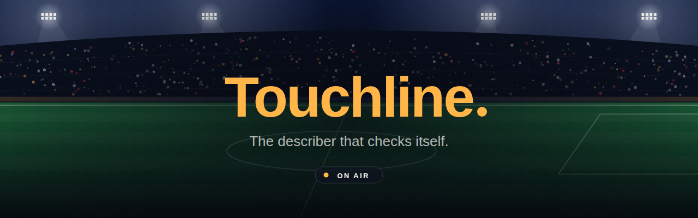
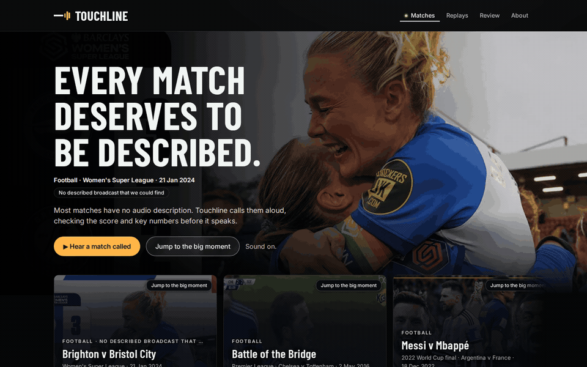
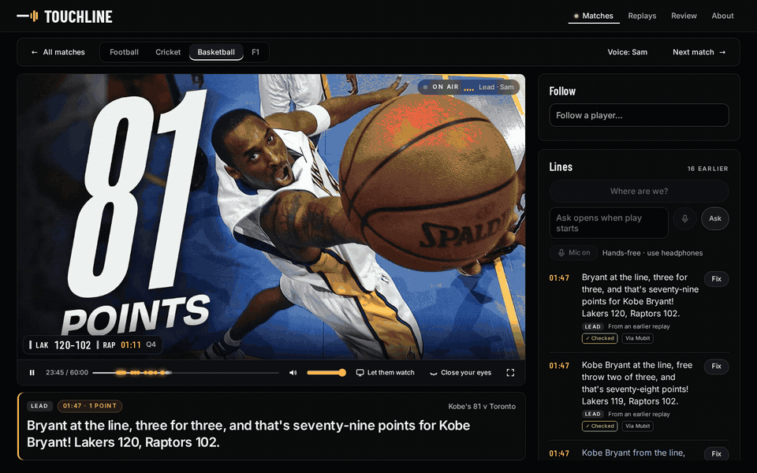
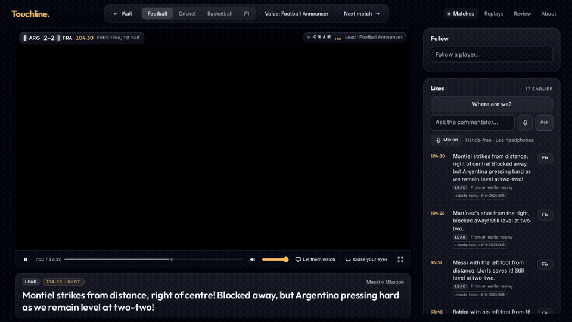
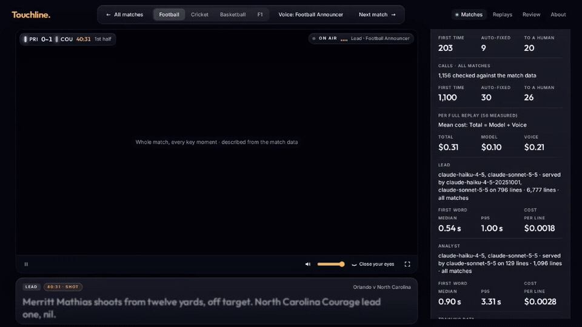
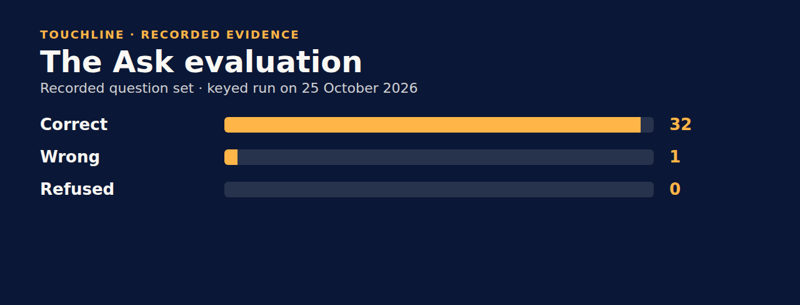
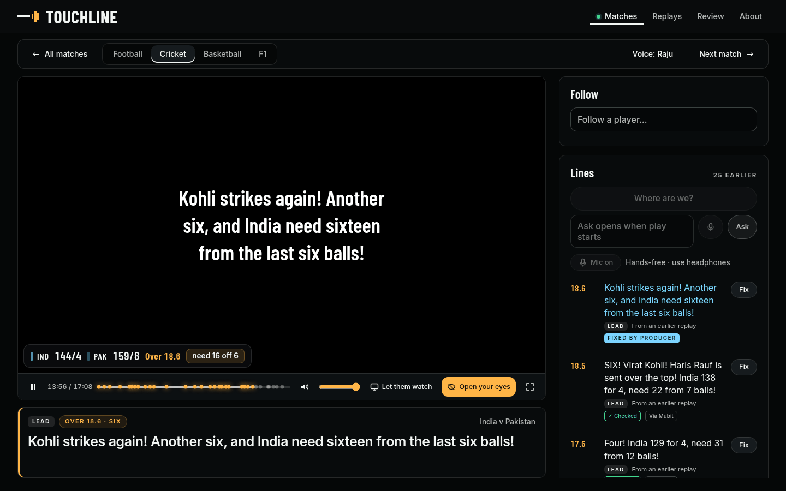
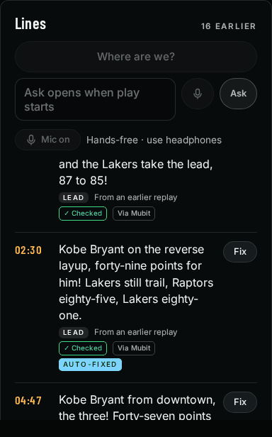
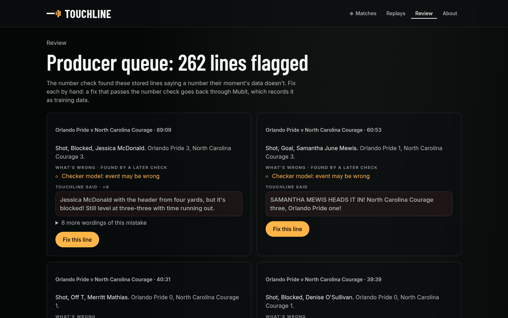

# Touchline

[](pyproject.toml)
[](https://github.com/atiladeokegab/night-shift/actions/workflows/smoke.yml)
[](#installation)

Blind and low-vision fans often get a score feed for a match that nobody describes. A score tells you who is ahead, but rarely tells you what just happened. Touchline turns a recorded match's event feed into spoken play-by-play and checks the score and key figures before each lead line goes on air.

Fans can also ask about the moment they are watching. In a saved Ask evaluation, Touchline answered **32 of 33 questions correctly**. [Keyed evaluation](eval/ask_eval_keyed_20261025.txt)

Built at the Mubit Night Shift hackathon in London on 23–25 October 2026. Touchline describes replays of recorded matches across four sports. Producer corrections train the Mubit task, and the running app checks commentary in code.

**[Run the interactive demo](#installation)** · **[Watch the replay walkthrough](docs/assets/replay-walkthrough.mp4)**



<sub>Actual Touchline screen recording. The GIF shows the commentary text, score and check badges from a recorded replay.</sub>

## How it works

1. **Replay the moment.** Match events are released in order and become spoken lines and captions. The fan can hide the picture or follow the score and commentary together (`core/replay.py`, `core/app.py`).

   

2. **Check the numbers before air.** The checker compares the candidate line with the match state. Touchline retries a wrong line once and can fall back to a sentence built from the feed. The Proof panel shows the counts (`core/insight.py`).

   

3. **Review what was said.** The Lines panel shows the replay transcript with check status. A producer can open the review queue, correct a line and submit a labelled example to Mubit (`core/app.py`, `agent/scorecheck.py`).

   

## Results



The keyed Ask run records one wrong answer and zero refusals. A separate saved live-stat snapshot averages **$0.41 per highlights replay, with voice**, over 133 replays. [Evidence and scopes](docs/evidence.md#readme-figures)

| Recorded check | Result |
| --- | --- |
| [Ask responses](eval/ask_eval_keyed_20261025.txt) | **MEASURED** · 32 correct, 1 wrong, 0 refused |
| [Live replay cost](eval/live_stats_2026-10-25.json) | **MEASURED** · $0.41 per highlights replay including voice |

| Eyes-closed replay | Wrong line caught | Producer review |
| --- | --- | --- |
|  |  |  |

## Installation

You need Git, Make, Python 3.12, [uv](https://docs.astral.sh/uv/) and Node.js 22.12 or later for the web build.

```sh
git clone https://github.com/atiladeokegab/night-shift.git
cd night-shift
(cd web && npm ci && npm run build)  # Build the web interface served by the API
MUBIT_RECORD=off make dev           # Serve the app at http://localhost:8000
make smoke                         # Optional, run the offline checks and sample replays
```

The offline smoke run uses a fake model. Set `MUBIT_API_KEY` for real commentary and `ELEVENLABS_API_KEY` for its server voice.

## Documentation

[Features and source files](docs/features.md) · [Architecture](docs/ARCHITECTURE.md) · [Evidence](docs/evidence.md) · [Mubit correction loop](docs/mubit.md).

## Contact

Open an [issue](https://github.com/atiladeokegab/night-shift/issues) with the match and timestamp. Team members include [Atilade Oke](https://github.com/atiladeokegab) ([LinkedIn](https://www.linkedin.com/in/atiladeoke/)) and [Persia](https://github.com/PersiaF04).

## Contributing

Run `make smoke` and include the match event and replay moment for changes to commentary or verification.

## Citation

```bibtex
@software{touchline_2026,
  title = {Touchline: The Describer That Checks Itself},
  year = {2026},
  url = {https://github.com/atiladeokegab/night-shift}
}
```

## License

Contact the maintainers for terms on the project code. Match data comes from [StatsBomb Open Data](https://github.com/statsbomb/open-data), [Cricsheet](https://cricsheet.org), the [NBA play-by-play mirror](https://github.com/shufinskiy/nba_data) (Apache-2.0) and [OpenF1](https://openf1.org). Each source's own terms apply. Highlight videos are embedded from their source channels.
