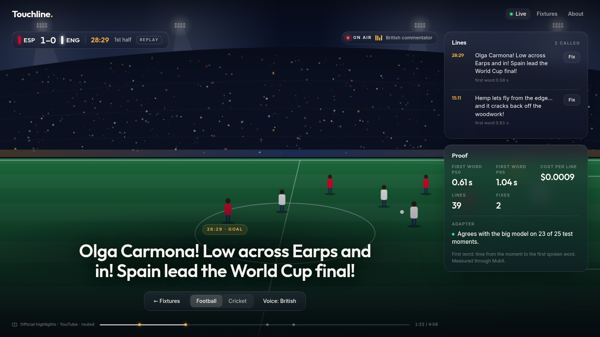

<div align="center">


<br>

[](https://www.python.org)
[](https://fastapi.tiangolo.com)
[](https://mubit.ai)
[](https://elevenlabs.io)
[](https://cloud.google.com/run)

**One live AI commentator for football and cricket, trained on its own corrected calls.**

[**See it live**](#see-it-live) · [**Run it**](#run-it) · [**How it uses Mubit**](#how-it-uses-mubit) · [**Architecture**](#architecture) · [**Team**](#team)

</div>

---

Somewhere tonight a county cricket chase goes to the last ball, and nobody calls it. A women's
league side scores the goal of its season, and the stream is silent. Most matches in most sports are
played like this: grassroots and lower-league football, most of the women's game, club and county
cricket. Fans following a stream or a live score get a bare ticker, or nothing.

A big model could commentate them. But it is too slow to call a moment while the moment is still on
screen, and too expensive to run for every moment of every match.

**Touchline** is one live AI commentator for both sports. It plays a match's official highlights,
and as each key moment plays it calls it in one short, emotional line, read aloud in a commentator's
voice and shown as a large subtitle. A producer fixes any line that's wrong, the fix goes back through
Mubit, and Mubit trains a smaller commentator that calls the same moments at a fraction of the cost.

Built at Night Shift: Mubit Hackathon, London, 23 to 25 October 2026. Track: Own your intelligence layer.

## See it live

<div align="center">



<sub>The live page, from the design mockup (<code>docs/mockup/index.html</code>): a drawn night stadium
stands in for the embedded highlights, and the numbers are samples.</sub>

</div>

## What Touchline does

- **Calls the moment, over the real match.** The page plays the match's official highlights (an
  embedded YouTube player, muted). As each key moment plays (shots, goals, saves, wickets, boundaries)
  the commentator looks up the facts it needs with tools (score, player, recent play) and calls it in
  one short line, shown as a large subtitle and spoken aloud. A line never appears before its moment
  plays in the video.
- **Sounds like a commentator.** A goal, a saved penalty, a six or a wicket is called with a live
  commentator's excitement, at most 20 words, with every name and score still right.
- **Your choice of voice.** The voice is a setting on the page: cricket defaults to an Indian
  commentator, football to a British one, and a change takes effect from the next line without a
  reload.
- **One commentator, two sports.** Switch from football to cricket mid-demo and the same agent calls
  the new sport. One system prompt, one tool set: every call in every sport is one Mubit task.
- **Producer fixes become training data.** A producer corrects or rejects any line in one tap. The
  fix is stored beside the original and sent back through Mubit.
- **A smaller model that matches the big one.** Every call goes through Mubit, which trains a small
  task-adapted commentator. We show the big model and ours calling the same moments.

## The demo, in one line

The 2023 Women's World Cup final plays on screen and Touchline calls each moment aloud, in a British
voice, about a second after it happens; the producer fixes one wrong line on stage; our own trained
commentator calls a moment beside the big model; then one tap switches to Kohli's last overs against
Pakistan in 2022 and the same commentator calls the cricket in an Indian voice.

## How it uses Mubit

- Every model call goes through Mubit's Anthropic endpoint (`claude-haiku-4-5`), one session per match.
- Real traffic: dozens of replayed matches in both sports, so the task passes the training threshold
  with varied, real calls.
- Producer corrections go back through Mubit in the same task and session.
- Mubit trains the adapted commentator; we compare it with the big model on matches it never saw.

## Quality, cost and latency, side by side

Measured on held-out matches, filled in from the proof panel before submission.

| | Big model | Our trained commentator |
|---|---|---|
| Agreement with the big model | baseline | to be measured |
| Cost per line | to be measured | to be measured |
| First word, p50 / p95 | to be measured | to be measured |

## Run it

Needs [uv](https://docs.astral.sh/uv/) and `make`.

```bash
make smoke   # offline: replays one sample match per sport with a fake model, no keys needed
make dev     # the live page on localhost; set MUBIT_API_KEY in .env for real commentary
```

## Data

- Football: [StatsBomb open data](https://github.com/statsbomb/open-data), used under its licence.
- Cricket: ball-by-ball data from [Cricsheet](https://cricsheet.org).
- Video: each demo match's official highlights, embedded from the competition's YouTube channel and
  played muted; never downloaded or rehosted. The commentator reads the event feed, not the video.

## Architecture


## Pre-existing work

All application code was written during the event. The only files brought in are the team's own deploy
tooling (`Dockerfile`, `scripts/deploy.sh` and the bootstrap script), copied from our starter repo; that
commit names its source.

## Team

- Atilade ([@atiladeokegab](https://github.com/atiladeokegab)): lead and design
- Persia ([@PersiaF04](https://github.com/PersiaF04)): full stack

How the team works, the rules for our AI agents and the build process: [TEAMWORK.md](TEAMWORK.md).
