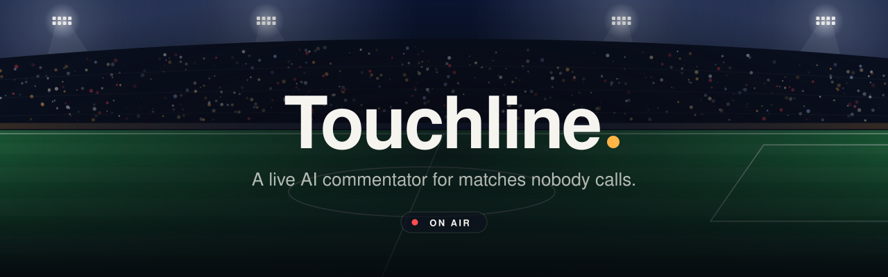
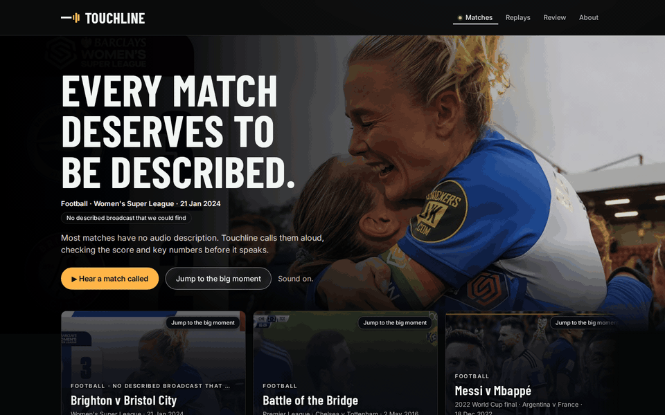
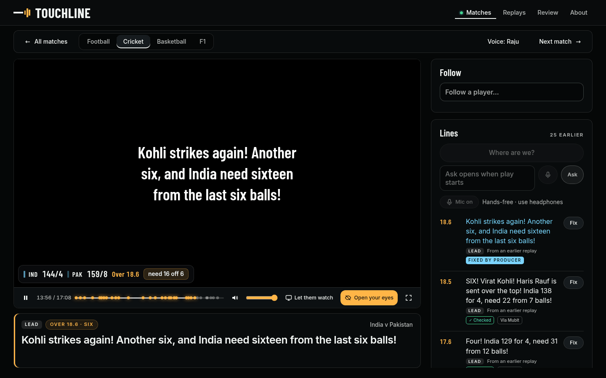
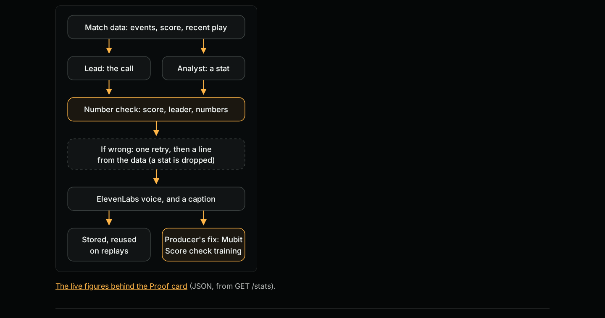
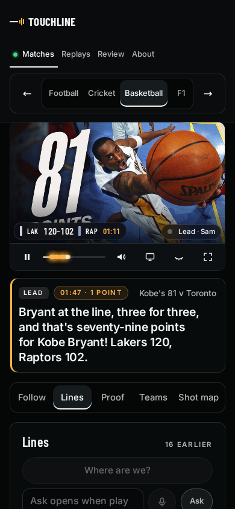

<div align="center">



<sub><b>Touchline: the describer that checks itself.</b> For the match nobody described.</sub>

<br>

[](https://www.python.org)
[](https://fastapi.tiangolo.com)
[](https://mubit.ai)
[](https://elevenlabs.io)
[](https://night-shift-5zvig7nbvq-ew.a.run.app)

# Touchline: the describer that checks itself

**Touchline describes matches aloud for fans who can't see them, and checks the score and the key
numbers in each line against the match data before it goes on air.**

**Why a fan comes back every match day:** for a blind or low-vision fan whose team's match has no
described broadcast, Touchline calls that match aloud moment by moment, answers their questions
about it at any point, and a producer's fix to one line goes with the request for every later line
of that match.



<sub>Touchline calls match moments as spoken lines. Each line is checked against the match data, and one is marked auto-fixed.</sub>

<table>
<tr>
<td width="33%"></td>
<td width="33%"></td>
<td width="33%"></td>
</tr>
<tr>
<td align="center"><sub>Close your eyes</sub></td>
<td align="center"><sub>How a line is made</sub></td>
<td align="center"><sub>On a phone</sub></td>
</tr>
</table>

[**Try it live**](https://night-shift-5zvig7nbvq-ew.a.run.app) · [**On stage**](#on-stage) · [**What's new**](#whats-new-tonight) · [**How well the check works**](#how-well-the-check-works) · [**Every feature**](docs/features.md) · [**The evidence**](docs/evidence.md) · [**Architecture**](docs/ARCHITECTURE.md)

</div>

What you hear are **replays, as if live**: real matches' event data played back over their
broadcast highlights, each line called at its moment, in four sports.

**For agents and reviewers:** [Architecture](docs/ARCHITECTURE.md) · [Integrations](docs/integrations.md) · [Every feature](docs/features.md) · [Decisions](docs/decisions.md) · [Build log](docs/build-log.md)

## On stage

The planned film and the stage run in this order.

1. **A match nobody described, described.** **Brighton v Bristol City** (WSL, 2024) plays with its
   highlights, and Touchline calls each moment aloud. Press **E** to **Close your eyes**: the picture
   goes black, only the line and the score stay, and the commentary carries on. The **Proof** card
   counts the lines that passed first time, were auto-fixed or went to a person, and shows the cost per
   full replay.
2. **A wrong line caught before air.** Every lead line goes through a number check first: the score,
   who leads, the margin, the players' counts ([`core/insight.py`](core/insight.py) `wrong_numbers`).
   A failed line gets one retry: if the retry passes, that is said, tagged **Auto-fixed**; if it
   fails too, a line built from the data is said instead and the wrong one goes to the producer's fix
   queue. On stage it is Kobe Bryant's line at 00:43 in the fourth quarter in **Lakers v Raptors** (NBA, 2006), tagged
   Auto-fixed: the replay from that moment is `/?match=0020500591&at=22`. Another catch: in Jordan's last game as a Bull the model wrote "Chicago Bulls take the lead,
   85-86!" when Utah led 86-85; the check's reason was "Chicago Bulls do not lead", so that line was
   never said. (Score check, the Mubit task in step 4, judges only the score's numbers, not
   who leads: its key for this line is ok, since 85 and 86 are the score.)
3. **A producer's fix, and the next lines on this match carry it.** At 30:57 Touchline said
   "Elisabeth Terland! Brighton take the lead, one nil!". A producer fixed it to "Elisabeth Terland
   scores! The Seagulls lead one-nil." ("Call Brighton the Seagulls"), and the fix goes with the request
   for every later line of that match. At 94:48 the line went from "Elisabeth Terland! Brighton take
   the lead, 3-2!" before the fix to "Elisabeth Terland! The Seagulls go three-two up with that
   left-footed half volley!" after it. Moments 18, 34 and 35 took up "the Seagulls"; the other three
   later lines changed only as any new generation does. Made once on live by
   [`scripts/fix_then_later.py`](scripts/fix_then_later.py), output saved as
   [the run](eval/fix_then_later_live_20261024.txt) from [#501](https://github.com/atiladeokegab/night-shift/pull/501).
4. **The fix sent to Score check training.** On Cahill's goal at Chelsea v Spurs the line said
   "level it at one-all, but Tottenham still lead two to one". A producer fixed it on the review page,
   and the line as said and the fixed text went to Mubit as two recorded Score check examples,
   labelled by code, never a model ([`agent/scorecheck.py`](agent/scorecheck.py) `teach`,
   [`eval/linecheck.py`](eval/linecheck.py) `gold`): the count went from 2,161 to 2,163 after the
   Cahill fix (live `/stats` `scorecheck.examples_sent`, 24 October 2026, 23:45 UTC).
5. **Mubit's console.** The Score check task, its examples and its version. This is **training, not
   serving**: no trained version answers anything on the site ([below](#mubit-training-not-serving)).
6. **Who buys it.** The streaming platforms that carry the WSL and NWSL, at a cost to us of about
   $0.45 a replay, voice included ([who pays](#who-pays)).

**Also in the product: Ask.** Type a question mid-match, such as "Where are we?" in the World Cup
final. The answer uses only what has happened up to the moment on screen, is checked the same way,
and is spoken. On a keyed run of 33 questions ([`eval/ask_eval.py`](eval/ask_eval.py), 25 Oct), 32 of
33 answers were right, 1 wrong and 0 refused; the output is saved as
[`eval/ask_eval_keyed_20261025.txt`](eval/ask_eval_keyed_20261025.txt).

## Who pays

The buyer is whoever streams a match with nobody describing it: the streaming platforms that carry
the WSL and NWSL, and clubs' media teams. Nobody has agreed to pay yet and we have not set a price.
The figures we have, side by side ([the problem](docs/evidence.md#the-problem)):

- **Sky describes about 109 of the Premier League's 380 games** a season, one match a game week.
- **At Wrexham, the disabled supporters' association and local sponsors raised £4,000** for four
  years of human audio description at the ground.
- **Touchline costs us about $0.45 a replay, voice included**, over 84 replays (live
  [`GET /stats`](https://night-shift-5zvig7nbvq-ew.a.run.app/stats), 24 Oct; saved at 23:08 UTC as
  [`eval/live_stats_2026-10-24.json`](eval/live_stats_2026-10-24.json): `cost_per_match_usd`,
  `matches_measured`). That is a highlights replay, not a whole 90 minutes.

## For judges

**Live:** <https://night-shift-5zvig7nbvq-ew.a.run.app> (Cloud Run, real Mubit calls, sound on).
Built at Night Shift: Mubit Hackathon, London, 23 to 25 October 2026. **Track: Recurring tasks.**
Score check is the recurring task: does this line's score match the match data? The number check
answers it in code for every lead line on every match before air, and every producer's fix goes to
Score check's training on Mubit as a labelled example. Training, not serving.

### The 60-second path

1. Tap **Brighton v Bristol City**, a Women's Super League match from the long tail, press **E** to
   close your eyes, then open the **Proof** card.
2. Tap **Fix** on any line to see the producer's form. Sending a fix needs the producer token, so
   without it the live site asks for one and refuses the fix (401). The real fix on Brighton v
   Bristol City and the later lines that carried it: [On stage](#on-stage), step 3.
3. Tap **Kobe's 81 v Toronto** and ask the commentator "How many points does Kobe have?", or press
   **Talk** and ask out loud.
4. Check the Proof card's figures: `curl -s https://night-shift-5zvig7nbvq-ew.a.run.app/stats`.

**Keyboard and screen reader:** E, T, W, Talk with Escape, focus order, live captions and the Follow
card, each traced to its code and its test:
[the table](docs/evidence.md#keyboard-and-screen-reader). Every figure in this README, its source
and its test: [the figures](docs/evidence.md#readme-figures).

**Your check-in #2:** each point and where it landed: [docs/feedback.md](docs/feedback.md).

## Mubit: training, not serving

Every model call goes through Mubit. Training runs and eligible correction examples are recorded;
Ask and Talk answers are unrecorded, and deployed commentary defaults to recording off. Mubit's console,
read by hand on 25 October 2026 at 06:27 UTC ([`data/mubit_console.json`](data/mubit_console.json)),
shows 12 tasks and 9 adapters; the serving count was not read then. Mubit's "Check one line of 2" task
(one of our two line-checking tasks; the console cuts the name short) shows 94.6% for its first
version, testing v1, in testing (console read by hand, 25 Oct 2026 06:27 UTC). The app does not call
an adapter. The earlier read, at 00:14 UTC, showed 11 tasks, 8 adapters and 0 serving. The first
Score check version scored 33.3% against a 95% target, on 12 test cases; the best commentary task
scores 58.3%. At 00:14 every version read "Not ready yet" or was still training, and we make no claim
that any matches the big model.
Score check, the narrower task above, has 2,161 examples sent to training, 60 of them from producer
fixes (46 the model already matched, 5 corrected, 9 not corrected); the big model agreed with the
code's answer key on 74 of 74 held-out lines (live `/stats` `scorecheck`, saved on 24 October 2026 at
23:08 UTC as [`eval/live_stats_2026-10-24.json`](eval/live_stats_2026-10-24.json)).

The Ask run (`eval.ask_eval --provider mubit`, recording off): the one wrong answer is row 24,
"What just happened?" at Lakers 120-102. The model named Vujacic's steal but said the Lakers "extend
their lead" on a play that scored nothing; the check stopped that answer and the safe line from the
data was said instead. That line doesn't name the steal, so the eval counts it wrong.

### Where Mubit is called

Function names first, since line numbers drift; a test keeps every link below on its call.

- **Commentary and check calls, `MubitProvider._stream`:** the Anthropic client's `base_url` is
  Mubit, `MUBIT_URL` [`agent/commentator.py:36`](agent/commentator.py#L36), set at
  [`:819`](agent/commentator.py#L819). [`_stream`, `:856`](agent/commentator.py#L856) calls
  `client.messages.stream` at [`:858`](agent/commentator.py#L858) and reads Mubit's request id at
  [`:871`](agent/commentator.py#L871) and the model that served it at [`:874`](agent/commentator.py#L874).
  A moment's line is [`commentate`, `:334`](agent/commentator.py#L334), through
  [`_call`, `:751`](agent/commentator.py#L751).
- **Line check on each line:** the replay starts a second opinion on every line that passed the
  number check, [`core/replay.py:361-363`](core/replay.py#L367);
  [`live_check`, `agent/linecheck.py:106`](agent/linecheck.py#L106) runs
  [`check`, `:88`](agent/linecheck.py#L88), which calls Mubit at [`:94`](agent/linecheck.py#L94).
- **Producer fix (#245):** `POST /lines/{line_id}/fix`,
  [`fix_line`, `core/app.py:456`](core/app.py#L456), calls
  [`correct`, `agent/commentator.py:403`](agent/commentator.py#L403) at [`core/app.py:490`](core/app.py#L490).
  The fix goes to Mubit as the next turn of the line's own call; the recorded send, on
  `correction_provider`, is [`agent/commentator.py:447`](agent/commentator.py#L447), and its Mubit
  request id is stored with the fix at [`core/app.py:504`](core/app.py#L504). Later lines of the
  match carry the fixes, at most five ([`core/app.py:78`](core/app.py#L78)).
- **Fix to Score check training:** the fix route starts `score_teach` at
  [`core/app.py:521`](core/app.py#L521) (defined at [`:337`](core/app.py#L337)); it calls
  [`send_fix`, `eval/seed_scorecheck.py:129`](eval/seed_scorecheck.py#L129), which labels each
  example with [`teach`, `agent/scorecheck.py:83`](agent/scorecheck.py#L83) and sends it with
  [`send`, `eval/seed_scorecheck.py:82`](eval/seed_scorecheck.py#L82). Each example sent is stored in
  `scorecheck_examples` at [`eval/seed_scorecheck.py:143`](eval/seed_scorecheck.py#L143).
- **Ledger:** `GET /ledger` at [`core/app.py:675`](core/app.py#L675) returns
  [`ledger`, `core/ledger.py:43`](core/ledger.py#L43): every example sent to Score check, with its
  Mubit session and request id.

The console, the correction loop and a real fix step by step:
[the evidence](docs/evidence.md).

## How well the check works

The tagline's "checks itself" has this scope: the check covers the score, who leads and the key
numbers, not every claim a line makes. The table shows how many wrong lines that catches.

Two sets of 300 lines the live site had said, labelled right or wrong by a separate model before the
checker ran on them. The rules were written against the first set, so its score is tuned-on; the
held-out set is the honest measure. This table is generated from
[`eval/checker_eval.py`](eval/checker_eval.py) by [`eval/readme_numbers.py`](eval/readme_numbers.py),
and [`tests/test_readme_numbers.py`](tests/test_readme_numbers.py) fails if it drifts.

<!-- checker-eval:start -->
| Set | Checker | Lines | Wrong (labels) | Caught | False alarms |
|---|---|---|---|---|---|
| Held-out, every line | Number check (rules) | 300 | 6 | 2 of 6 | 0 |
| Held-out, lead lines | Number check (rules) | 288 | 5 | 2 of 5 | 0 |
| Held-out, lead lines | Line check (keyed run) | 288 | 5 | 3 of 5 | 3 |
| First set (rules tuned on it) | Number check (rules) | 300 | 15 | 14 of 15 | 0 |
<!-- checker-eval:end -->

The number check runs before a line is said; Line check is a second model that reads each lead line
after it is said. Lead lines leave out the analyst's. The Line check row is a keyed run,
read from [`eval/linecheck_heldout.json`](eval/linecheck_heldout.json), which `/stats` serves as
`linecheck.heldout`. A Line check flag only sends a line to the producer's queue; it never stops it
being said. These are small counts: one more catch moves held-out recall by about 17 points. How the
lines were picked and labelled, and what the check still misses: [the evidence](docs/evidence.md#how-well-the-check-works).

## Known limitations

- **The checks miss most wrong lines they were not tuned on** (the table above). They check the
  score, the leader and the key numbers, not every claim.
- **The voice comes seconds after the moment.** The text's first word is out in about half a second;
  the audio clip takes longer (`by_speaker.lead.audio_first_ms_p50` on `/stats`).
- **No adapter serves.** Mubit serves one only in its console, once a version passes its test.
- **A fix is locked only where `PRODUCER_TOKEN` is set**; a fix that contradicts the data gets a 422
  either way and never reaches Mubit ([`core/app.py`](core/app.py) `fix_line`). On Cloud Run,
  [`scripts/deploy.sh`](scripts/deploy.sh) mounts it from the Secret Manager secret `producer-token`
  (latest version, checked ENABLED before the build), never as a plain env var; a `PRODUCER_TOKEN` in
  the deploy's own environment is ignored.
- **One instance, and every viewer starts their own replay** ([`scripts/deploy.sh`](scripts/deploy.sh),
  [`core/replay.py`](core/replay.py)).
- **Two stored analyst lines on Lakers v Raptors admit what they lack** ("season numbers I can't give
  you here", "Smush I can't speak to"). A stored line replays unless a check drops it, and `admits` in
  [`core/insight.py`](core/insight.py) misses these words; a producer's fix is heard on later replays
  only for a lead line ([`core/replay.py`](core/replay.py) `run_replay`). The cause is the analyst's
  prompt, [`agent/analyst.md`](agent/analyst.md), frozen for the event.
- **Ask and Talk at the cold open can be given the first event before it is on screen.** The server
  cuts the match by moment index, and the cold open shares its index with the first mapped event
  ([`core/app.py`](core/app.py) `asked_so_far`, [#520](https://github.com/atiladeokegab/night-shift/issues/520)). [#519](https://github.com/atiladeokegab/night-shift/pull/519) gates
  both in the page only, so a direct API caller can bypass it.
- **Talk can say a sentence the model wrote before it called a tool**, checked against the match data
  only, not the tool's output ([`core/converse.py`](core/converse.py) `speak`).
- **No headless test holds a real Talk conversation.** The server side is tested headless
  ([`tests/test_converse.py`](tests/test_converse.py)) and the page with a faked ElevenLabs session
  ([`web/e2e/talk.spec.ts`](web/e2e/talk.spec.ts)); a real one needs a browser, a microphone and the
  ElevenLabs agent.
- **Cricket has no ball timestamps** in Cricsheet, so a ball counts as 30 seconds.
- **The highlights are re-uploads** for four of the seven matches with video; if one is taken down,
  the commentary carries on without the picture.
- **Two files break the repo's 1,000-line rule** ([AGENTS.md](AGENTS.md)): `core/insight.py` and
  `tests/test_core_voice.py`. Splitting them waits until after the event.

## What's new tonight

- **A graph of teams and players:** SurrealDB holds the seasons around our matches in football (620 matches), basketball and cricket, and answers only from matches before this one, so nothing later leaks.
- **Talk:** press **Talk** and the match pauses while you speak with the commentator; each answer goes through Claude via Mubit and the same check as Ask. Escape, or 12 s of silence, resumes.
- **One speaking queue:** ordinary commentary lines queue; a decisive moment can fade and interrupt
  a spoken answer, and routine lines that have gone stale are dropped.
- **Teams tab:** press **T** for each side's form, their last meetings and the squad, as they stood before the match.
- **One broadcast pair:** the event call lifts for a big moment; stat interjections and comebacks stay
  calm, and in quiet stretches the pair take turns on one player.

Everything else, with its code and tests: [every feature](docs/features.md).

## Run it

Needs [uv](https://docs.astral.sh/uv/) and `make`.

```bash
make smoke   # offline: lint, the test suite, and every sample match replayed with a fake model
make check   # lint and the test suite, offline
make dev     # the server on localhost; export MUBIT_API_KEY for real commentary (make dev doesn't read .env)
```

`make dev` records to Mubit unless `MUBIT_RECORD=off` is exported; the deploy sets it off. The web
tests are `cd web && npm ci && npm test`. CI runs the smoke and the browser tests on every PR into
`integration`, and every deploy runs a live smoke on the real URL.

The live site's budget guard; `0` turns one off.

| Setting | Default | What it limits |
|---|---|---|
| `MAX_LIVE_REPLAYS` | 4 | Replays making new lines at once; past it, the match's stored lines play with no model call, or 429 if it has none |
| `REPLAYS_PER_HOUR` | 10 | Replay starts per visitor per hour; past it, stored lines play the same way, or 429 |
| `ASKS_PER_HOUR` | 20 | Asks per visitor per hour; then 429 |
| `DAILY_BUDGET_USD` | 50 | Today's model and voice spend (UTC); past it, stored lines only and Ask is off air |

## Data and video

- Football: [StatsBomb open data](https://github.com/statsbomb/open-data), used under its licence.
- Cricket: ball-by-ball data from [Cricsheet](https://cricsheet.org).
- Basketball: stats.nba.com play-by-play, via the [shufinskiy/nba_data](https://github.com/shufinskiy/nba_data) mirror (Apache-2.0).
- F1: timing data from the [OpenF1](https://openf1.org) API.
- Video: broadcast highlights on YouTube, embedded and muted, never downloaded or rehosted; the
  commentator reads the event feed, not the video. The two basketball games are from the NBA's own
  channel, and Brighton v Bristol City from Brighton & Hove Albion's. Argentina v France, Chelsea v
  Tottenham, India v Pakistan and the São Paulo Grand Prix are re-uploads or fan edits of the TV
  coverage by others, because the official uploads block embedding or don't exist.

## Pre-existing work

All application code was written during the event. The only files brought in are the team's own deploy
tooling (`Dockerfile`, `scripts/deploy.sh` and the bootstrap script), copied from our starter repo; that
commit names its source.

## What we'd build next

- **Scale**, as in [docs/ARCHITECTURE.md](docs/ARCHITECTURE.md): Redis and SurrealDB, so one call per
  moment serves every viewer.
- **More sports, then esports**, through the same agent, tools and Mubit task.
- **Live streams, not just replays**, with the same producer fixes feeding the same training loop.

The longer view: [where this goes](docs/ARCHITECTURE.md#at-scale-a-plan-not-built).

## Team

- Atilade ([@atiladeokegab](https://github.com/atiladeokegab)): lead and design
- Persia ([@PersiaF04](https://github.com/PersiaF04)): full stack

Requirements: [docs/PRD.md](docs/PRD.md); each one has an ID such as A-6.4, and the tests that
check one name its ID. How the team works: [TEAMWORK.md](TEAMWORK.md).
