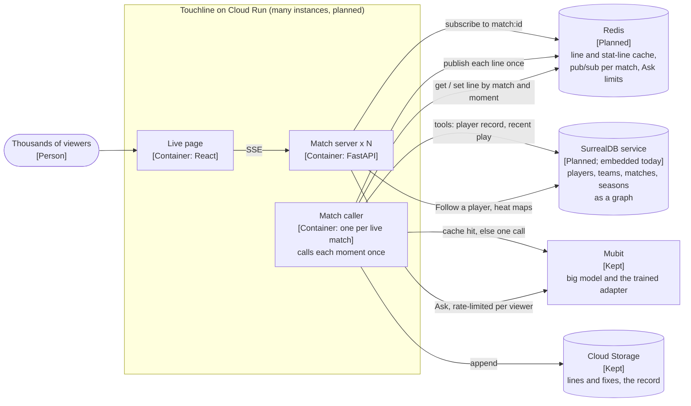

# Architecture

Two pictures: what runs today, and how it would grow to thousands of matches and viewers. The
second is a plan and is not built; the first is running now.

## Now: what is running

C4 container level. Everything inside the box is one Cloud Run service, one instance
([`scripts/deploy.sh`](../scripts/deploy.sh), `--max-instances 1`).

```mermaid
flowchart LR
    viewer(["Viewer or producer<br/>[Person]<br/>Watches a match, asks a question, fixes a line"])

    subgraph run["Touchline on Cloud Run (one instance)"]
        direction TB
        web["Live page<br/>[Container: React, Vite]<br/>web/src, served by the app at /"]
        app["Match server<br/>[Container: FastAPI, Python 3.12]<br/>core/app.py: replays, SSE stream, Ask, Fix, /stats"]
        agent["Commentator agent<br/>[Component: Python]<br/>agent/commentator.py, one fixed prompt and tools"]
        packs[("Per-match stats packs<br/>[Files: JSON]<br/>data/packs, built offline")]
        graph[("Player graph<br/>[SurrealDB, embedded, in memory + on disk]<br/>core/graph.py: players, teams,<br/>matches, seasons")]
        feeds[("Match event feeds<br/>[Files: JSON]<br/>data/sample, built offline from StatsBomb, Cricsheet, NBA, OpenF1")]
    end

    store[("Store<br/>[Cloud Storage: JSON lines]<br/>lines, fixes, answers, adapter")]
    mubit["Mubit<br/>[External: Anthropic endpoint]<br/>claude-haiku-4-5 moment lines, recorded, train the adapter;<br/>claude-sonnet-5-5 analyst lines, unrecorded"]
    eleven["ElevenLabs<br/>[External: text to speech]<br/>eleven_v3, one voice per role and sport"]
    yt["YouTube<br/>[External: embedded player]<br/>muted broadcast highlights"]

    viewer -->|"HTTPS"| web
    web -->|"POST /replays, /ask, /lines/id/fix<br/>JSON"| app
    app -->|"SSE: moments, lines, stats"| web
    web -->|"GET /lines/id/audio"| app
    web -->|"plays the clip; its clock gates each line"| yt
    app --> agent
    agent -->|"one call per line, two after a tool round<br/>HTTPS"| mubit
    agent -->|"tool lookups"| packs
    app -->|"Follow a player; the packs if it fails"| graph
    graph -->|"loaded once at startup"| packs
    app -->|"reads moments, never ahead"| feeds
    app -->|"append and read<br/>compare-and-swap"| store
    app -->|"one clip per line, ahead of its moment"| eleven
```

| Container | What it does | Code |
|---|---|---|
| Live page | The match wall, the live screen, the Lines and Proof cards, Ask and Fix. The YouTube player's clock decides when each line is shown and spoken | [`web/src/`](../web/src) |
| Match server | Starts a replay, streams moments and lines over server-sent events, takes fixes and questions, serves `GET /stats` | [`core/app.py`](../core/app.py), [`core/replay.py`](../core/replay.py), [`core/stats.py`](../core/stats.py) |
| Commentator agent | One system prompt and one tool set for every sport, so Mubit sees one task. Sees only moments up to the one it calls | [`agent/commentator.py`](../agent/commentator.py), [`agent/prompt.md`](../agent/prompt.md), [`agent/tools.json`](../agent/tools.json) |
| Stat lines | Fill the quiet stretches between big moments with numbers from the pack and the match so far | [`core/insight.py`](../core/insight.py) |
| Stats packs | Each player's record before the match: shots by zone, runs by phase. Used by the tools, the stat lines and the shot map | [`agent/packs.py`](../agent/packs.py), [`core/predict.py`](../core/predict.py), [`data/packs/`](../data/packs) |
| Player graph | Embedded SurrealDB in the app's process, in memory, loaded at startup from the packs and feeds: `player`, `team`, `match` and `season` records with `plays_for`, `played_in` and `competed` edges. Serves Follow a player and its "Also in our library" traversal; on any error it logs the type and the packs answer | [`core/graph.py`](../core/graph.py) |
| Moment picker | Turns each feed into key moments | [`agent/feed.py`](../agent/feed.py) |
| Store | JSON lines on Cloud Storage; each append rewrites the object under a generation check | [`core/store.py`](../core/store.py) |
| Voice | ElevenLabs `eleven_v3` with an audio tag per moment; the lead and the analyst have their own voices | [`core/voice.py`](../core/voice.py) |

### How a line is made

1. The page posts `POST /replays` with a match. The server reads that match's moments from its feed.
2. For each moment in the highlights, the agent makes one call to Mubit's Anthropic endpoint,
   or two when it uses its one round of tools. It is given only the moments up to this one.
3. Each moment's line goes through the number check, `checked()` in
   [`core/insight.py`](../core/insight.py). A line whose numbers don't match the moment's data gets
   one retry; if the retry is wrong too, a line built from the data is spoken instead. A retry that
   passes is sent to Mubit as an automatic correction of the first try. The analyst's stat lines,
   the lead's replies to them and Ask answers get the same check; one still wrong after its retry is
   dropped, never said.
4. The line is appended to the store, sent to ElevenLabs, and published on the SSE stream with its
   video time.
5. The page holds the line until the YouTube player reaches that time, then shows and speaks it.
6. Between big moments, the analyst fills the gap with stat lines; now and then the lead replies.

### Where Mubit training data comes from

The live site runs on a teammate's Mubit key with recording off (`MUBIT_RECORD=off`, set in
[`scripts/deploy.sh`](../scripts/deploy.sh)), so the demo key trains nothing. If that key runs out,
the commentator moves to the owner's key, which records
([`agent/commentator.py`](../agent/commentator.py)). Training traffic comes from
[`scripts/replay_matches.py`](../scripts/replay_matches.py), which replays real football and cricket
matches through the owner's key, and from producer fixes and the number check's automatic
corrections to moment lines, which go through the owner's key recorded, whatever `MUBIT_RECORD`
says. Ask answers and the analyst's stat lines are always unrecorded: they have their own prompts and
would split the one task the lines train.

## At scale: a plan, not built

> **Plan only.** Nothing in this section is built or deployed. It is how we would take Touchline
> from one instance and seven matches to thousands of matches and viewers.



**Redis.** Today each replay belongs to one viewer and one instance: two viewers of the same match
start two replays, and each pays Mubit for its own lines. Stat lines are reused from the store, but a
replay reads them once when it starts, so two cold replays that start together both pay. The voice
clips sit in the instance's memory ([`core/voice.py`](../core/voice.py)). With Redis:

- a shared cache of lines, stat lines and voice clips, keyed by match and moment, across instances;
- one caller per match publishes each line once on a pub/sub channel, and every viewer's SSE stream
  subscribes to it, so a thousand viewers cost one line, not a thousand;
- per-viewer limits on Ask, so one viewer can't spend the budget.

**SurrealDB.** Built: Follow a player reads players, teams, matches and seasons as a graph in
SurrealDB's embedded engine, in the app's own process ([`core/graph.py`](../core/graph.py)), loaded
from the JSON packs ([`data/packs/`](../data/packs)) at startup. Beside it, an on-disk SurrealDB
store ([`data/graph/`](../data/graph), surrealkv, built offline by `scripts/build_graph.py`) holds
every match, team and player of each sample match's competition and season (football: 612 matches,
four competition-seasons; other sports not yet). `team_form`, `head_to_head`, `player_season`,
`squad` and `teams` read it, cut at the kickoff asked about; on any error they return nothing and
the packs answer. About 75 MB of memory and under a second to open. Still planned: at thousands of
matches the graph moves to a SurrealDB service shared by every instance, with edges for "shot in",
and the commentator's tools and the shot and heat maps query it too, instead of loading one file
per match.

**What stays.** Mubit stays the only way to the model: every line still goes through its endpoint,
and the trained adapter takes over from the big model once a version passes Mubit's tests. Cloud Run
stays the host; it just runs more than one instance once state lives in Redis and SurrealDB.
