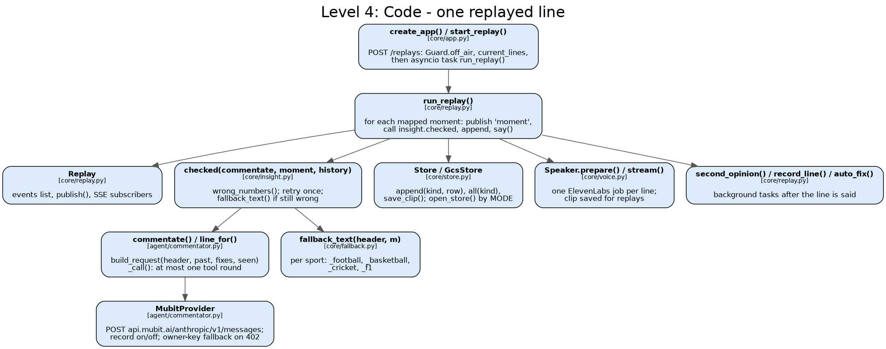

# Architecture

How Touchline is built, from the code. Every claim points at a file (`path:line` where it helps) or
a test. The diagrams are drawn by [`architecture/c4.py`](architecture/c4.py); run it again after a
change (command at the end).

## Read this first

1. Touchline replays a real match as spoken commentary for blind and low-vision fans.
2. One process: a FastAPI server ([`core/app.py`](../core/app.py)) that also sends the React page in `web/dist`.
3. It runs on Cloud Run as one instance, kept warm ([`scripts/deploy.sh`](../scripts/deploy.sh):21, :144).
4. Matches are bundled JSON: moments in `data/sample`, player records in `data/packs`, YouTube maps in `data/video`.
5. Commentary runs on Claude. Every model call goes through Mubit's Anthropic endpoint ([`agent/commentator.py`](../agent/commentator.py):36).
6. Each moment's line has its numbers compared with that moment's event data; a wrong one is retried once, then replaced by a line built from the data ([`core/insight.py`](../core/insight.py):1768).
7. Lines, fixes, answers and voice clips are stored as JSON lines on Cloud Storage ([`core/store.py`](../core/store.py)).
8. A match already called is played again from the store: no model call, saved clips ([`core/app.py`](../core/app.py):259).
9. Producers fix lines with a token; each fix is sent to Mubit as a training example.
10. `make smoke` is the merge gate: offline, no keys, every sample match replayed ([`Makefile`](../Makefile)).

Related: [stack](stack.md), [evidence](evidence.md), [features](features.md), [voice](voice.md).

## One replayed line, end to end

1. The page posts `POST /replays` with a match id ([`web/src/api.ts`](../web/src/api.ts)).
   `start_replay` ([`core/app.py`](../core/app.py):230) asks the `Guard` whether today's budget is
   spent or too many replays are live ([`core/guard.py`](../core/guard.py):143), and looks for this
   match's stored lines (`current_lines`, [`core/guard.py`](../core/guard.py):101). If either says
   so, the replay is cached: stored lines, saved clips, no model call.
2. Otherwise it starts `run_replay` ([`core/replay.py`](../core/replay.py):148) as a task and returns
   the replay id. The page opens `GET /replays/{id}/stream` as an `EventSource`
   ([`web/src/api.ts`](../web/src/api.ts):82).
3. For each moment in the YouTube map, `run_replay` publishes a `moment` event, then calls
   `insight.checked(commentate, moment, history)`. `history` holds only earlier moments: the model
   never sees later play.
4. `commentate` reaches `line_for` ([`agent/commentator.py`](../agent/commentator.py):522), which
   builds one request from the fixed prompt, the moments so far and any producer fixes
   (`build_request`, :191) and sends it through `MubitProvider` (:806) with at most one tool round.
   The lead's model is `claude-haiku-4-5` (:31), or `LEAD_MODEL` when set (:199).
5. `checked` ([`core/insight.py`](../core/insight.py):1768) runs `wrong_numbers` on the line against
   the moment's data. Numbers that match: the line is marked `checked`. Numbers that don't: one more
   call. Still wrong: `fallback_text` ([`core/fallback.py`](../core/fallback.py):186) builds the line
   from the data, and the failed try is kept for the producer's review queue.
6. The line is appended to the store (`store.append("lines", ...)`), its voice job starts
   (`Speaker.prepare`, [`core/voice.py`](../core/voice.py):339), and a `line` event goes out with
   its video time.
7. The page holds the line until the YouTube player's clock reaches that time
   ([`web/src/player.ts`](../web/src/player.ts)), then shows it and plays the clip from
   `GET /lines/{id}/audio` ([`core/voice.py`](../core/voice.py):717). The clip is saved with
   `save_clip`, so a later replay plays it without paying for it again.
8. Off the line's path, as background tasks: Line check gives a second opinion and may flag the
   line for review (`second_opinion`, [`core/replay.py`](../core/replay.py):127); a checked line is
   sent again to be recorded (`record_line`, :116); a rejected first try is corrected to the kept
   retry (`auto_fix`, :89). None of these unsays a line.

## C4 level 1: system context


| Actor or system | Role | Where in the code |
|---|---|---|
| Fan (blind or low-vision) | Hears each key moment, asks questions, follows a player | [`web/src/`](../web/src) |
| Producer | Fixes a wrong line with the producer token | `POST /lines/{id}/fix`, [`core/app.py`](../core/app.py):456 |
| Anthropic Claude | Writes every line and answer | models named in [`agent/commentator.py`](../agent/commentator.py):31, [`agent/linecheck.py`](../agent/linecheck.py):13 |
| Mubit | Every model call goes through it; records training examples per task | `MUBIT_URL`, [`agent/commentator.py`](../agent/commentator.py):36 |
| ElevenLabs | One voice clip per line; the conversational agent behind Talk | [`core/voice.py`](../core/voice.py), [`core/converse.py`](../core/converse.py) |
| YouTube | Muted highlights in the page; its clock times each line | [`web/src/player.ts`](../web/src/player.ts), [`data/video/`](../data/video) |
| StatsBomb open data | Football events | `STATSBOMB`, [`agent/feed.py`](../agent/feed.py):24 |
| Cricsheet | Cricket ball-by-ball (T20 internationals) | `CRICSHEET_ZIP`, [`agent/feed.py`](../agent/feed.py):25 |
| NBA play-by-play (shufinskiy/nba_data) | Basketball events | `NBA_PBP`, [`agent/feed.py`](../agent/feed.py):28 |
| OpenF1 | Formula 1 laps and positions | `openf1()`, [`agent/feed.py`](../agent/feed.py):509 |

The data sources are read offline, when a match is bundled; the running service reads only the
bundled files.

## C4 level 2: containers


| Container | Technology | What it does | Code |
|---|---|---|---|
| Web app | React 19, Vite, TypeScript | Match wall, live screen, Ask, Fix, Follow a player | [`web/src/`](../web/src), built in the Dockerfile's `node:22-slim` stage |
| API server | FastAPI, Python 3.12, uvicorn | Replays, SSE stream, Ask, Fix, `/stats`, `/review`, `/teams`; sends `web/dist` at `/` | [`core/app.py`](../core/app.py):183, mount at :706 |
| State store | Cloud Storage, JSON lines | `lines`, `fixes`, `answers`, `linechecks`, `auto_fixes`, clips; each append is a generation-checked rewrite | `GcsStore`, [`core/store.py`](../core/store.py):102 |
| Player graph | SurrealDB, embedded in the process | In memory from the packs at startup; `data/graph` (surrealkv, built by [`scripts/build_graph.py`](../scripts/build_graph.py)) for seasons, form and squads | [`core/graph.py`](../core/graph.py) |
| Bundled data | JSON files in the image | Moments, pre-match packs, YouTube maps | [`data/matches.py`](../data/matches.py), [`agent/packs.py`](../agent/packs.py) |
| Cloud Run | Managed container | One service, min 1 and max 1 instance, 1 GiB, CPU always on, 3600 s timeout | [`scripts/deploy.sh`](../scripts/deploy.sh):138 |
| Cloud Build, Artifact Registry | GCP | `gcloud run deploy --source .` builds the [`Dockerfile`](../Dockerfile) and stores the image | [`scripts/deploy.sh`](../scripts/deploy.sh):138 |
| Secret Manager | GCP | Keys and the producer token, mounted as env vars | `SECRETS`, [`scripts/deploy.sh`](../scripts/deploy.sh):26 |
| Precompute script | Python CLI | Plays each match once against the live site with the producer token, so its lines and clips are stored | [`scripts/precompute.py`](../scripts/precompute.py) |
| Eval scripts | Python CLIs | Line check and Score check held-out evals, seeding examples, agreement | [`eval/`](../eval) |

## C4 level 3: components of the replay pipeline


- **Moments.** `agent/feed.py` turns each source into key moments; `data/matches.py` loads the
  bundled ones (`load_moments`) and the video map (`video_map`).
- **Commentator.** One system prompt ([`agent/prompt.md`](../agent/prompt.md)) and one tool set
  ([`agent/tools.json`](../agent/tools.json)) for every sport, so the lines are one Mubit task.
- **Number check.** `wrong_numbers` in [`core/insight.py`](../core/insight.py): the score, leader,
  player totals and events a line says, compared with the moment's data. It covers the numbers and
  named facts its rules know; it is a rules check, not a full fact check.
- **Retry or data fallback.** One retry; then `fallback_text`. A retry that matches is kept, and its
  rejected first try goes to `auto_fix` ([`core/replay.py`](../core/replay.py):89), stored under
  `auto_fixes`, never under the producers' `fixes`.
- **Stored line and clip.** `store.append("lines")`, then `Speaker` makes one ElevenLabs clip and
  saves it ([`core/voice.py`](../core/voice.py):277).
- **Analyst stat lines.** Between moments, `insight.Gaps` fills the quiet with stat lines from the
  packs; the same number rules apply, and one still wrong after its retry is dropped.
- **Line check.** A second opinion on a checked line, by `claude-sonnet-5-5` through Mubit
  (`live_check`, [`agent/linecheck.py`](../agent/linecheck.py):106). It flags a line into the review
  queue ([`core/review.py`](../core/review.py)); it never unsays it.
- **Producer fix to training example.** `POST /lines/{id}/fix` ([`core/app.py`](../core/app.py):456)
  needs the producer token, rejects a fix the data contradicts (`review.wrong`), sends the correction
  through `commentator.correct` on the owner's key, recorded (`correction_provider`,
  [`agent/commentator.py`](../agent/commentator.py):497), and stores it. It also sends a Line check
  example (`linecheck.teach`, [`agent/linecheck.py`](../agent/linecheck.py):120) and a Score check
  example (`scorecheck.teach`, [`agent/scorecheck.py`](../agent/scorecheck.py):83). The next replay
  of that match says the fix.
- **Ask.** `POST /replays/{id}/ask` ([`core/app.py`](../core/app.py):574): `checked_answer`
  ([`core/insight.py`](../core/insight.py):2017) answers from the moments so far, through Mubit
  unrecorded, and an answer with a number nothing it was given supports is dropped. "Where are we?"
  goes to [`agent/status.py`](../agent/status.py).
- **`/stats`.** [`core/stats.py`](../core/stats.py):299 computes cost, latency, check and fix counts
  from the store only, plus the budget guard's state ([`core/app.py`](../core/app.py):680).

## C4 level 4: code of the replay path



| Function or class | File | Job |
|---|---|---|
| `start_replay` | [`core/app.py`](../core/app.py):230 | Validates the match, picks live or cached, starts `run_replay` |
| `Replay` | [`core/replay.py`](../core/replay.py):45 | One replay's events and SSE subscribers |
| `run_replay` | [`core/replay.py`](../core/replay.py):148 | The moment loop, quiet stretches, background tasks |
| `checked` | [`core/insight.py`](../core/insight.py):1768 | Number check, one retry, data fallback |
| `line_for`, `build_request` | [`agent/commentator.py`](../agent/commentator.py):522, :191 | One request, at most one tool round, word limit |
| `MubitProvider` | [`agent/commentator.py`](../agent/commentator.py):806 | HTTPS to Mubit; recording on or off; the owner's key after a 402 |
| `FakeProvider` | [`agent/commentator.py`](../agent/commentator.py):879 | No keys, no network: tests and `make smoke` |
| `fallback_text` | [`core/fallback.py`](../core/fallback.py):186 | A line from the event data, per sport |
| `Store`, `GcsStore`, `open_store` | [`core/store.py`](../core/store.py):36, :102, :193 | Local files, or GCS when `MODE=cloud` |
| `Speaker` | [`core/voice.py`](../core/voice.py):277 | ElevenLabs jobs, clips, backup keys |
| `second_opinion`, `record_line`, `auto_fix` | [`core/replay.py`](../core/replay.py):127, :116, :89 | Off-path Line check, recording, auto-correction |

## Module map

| Module | Job | Key entry point | Test |
|---|---|---|---|
| `core/app.py` | HTTP routes and wiring | `create_app`, `default_deps` | `tests/test_core_spine.py` |
| `core/replay.py` | The replay loop | `run_replay` | `tests/test_core_spine.py`, `tests/test_replay_gap.py` |
| `core/insight.py` | Number check, stat lines, Ask check | `checked`, `checked_answer`, `Gaps` | `tests/test_insight.py`, `tests/test_ask_check.py` |
| `core/fallback.py` | Lines built from data | `fallback_text` | `tests/test_fallback.py` |
| `core/guard.py` | Budget, caps, cached playback | `Guard`, `current_lines` | `tests/test_guard.py`, `tests/test_cached_first.py` |
| `core/store.py` | JSON-lines store, local or GCS | `open_store` | `tests/test_core_store.py` |
| `core/voice.py` | ElevenLabs clips and `/lines/{id}/audio` | `Speaker` | `tests/test_core_voice.py` |
| `core/review.py` | Producer review queue | `queue`, `wrong` | `tests/test_core_review.py` |
| `core/ledger.py` | Correction ledger | `ledger` | `tests/test_core_ledger.py` |
| `core/stats.py` | `/stats` numbers | `stats` | `tests/test_core_stats.py` |
| `core/graph.py` | Embedded SurrealDB graph | `start`, `pack`, `team_form` | `tests/test_graph.py`, `tests/test_graph_store.py` |
| `core/teams.py` | `/teams/{sport}/{id}` | router | `tests/test_teams.py` |
| `core/predict.py` | Predictions from packs | `load_pack` | `tests/test_predict.py` |
| `core/converse.py` | Talk to the commentator | router | `tests/test_converse.py` |
| `agent/commentator.py` | Prompts, requests, providers | `line_for`, `correct`, `MubitProvider` | `tests/test_commentator.py` |
| `agent/feed.py` | Sources to moments | `load` | `tests/test_feed.py` |
| `agent/packs.py` | Pre-match player packs | `build` | `tests/test_packs.py` |
| `agent/linecheck.py` | Line check task | `live_check`, `teach` | `tests/test_linecheck.py`, `tests/test_linecheck_live.py` |
| `agent/scorecheck.py` | Score check task | `teach` | `tests/test_scorecheck.py` |
| `agent/status.py` | "Where are we?" | `status` | `tests/test_status.py` |
| `agent/look.py` | Shared-screen note | `see` | `tests/test_look.py` |
| `scripts/precompute.py` | Store every match's lines and clips | `main` | `tests/test_precompute.py` |
| `scripts/deploy.sh` | Cloud Run deploy | script | `tests/test_deploy.py` |
| `web/src/` | The page | `App.tsx`, `useReplay.ts` | `web/src/*.test.ts`, Playwright in CI |

## Mubit and Claude

- Commentary runs on Claude. Every model call goes through Mubit's Anthropic endpoint
  (`MUBIT_URL`, [`agent/commentator.py`](../agent/commentator.py):36).
- Three providers ([`agent/commentator.py`](../agent/commentator.py):480-519): `default_provider`
  for the lines, recorded as `MUBIT_RECORD` says; `correction_provider` on the owner's key, always
  recorded, for producer fixes; `unrecorded_provider` for Ask and the analyst's stat lines, which
  have their own prompts and would split the lines' task.
- The live site runs with `MUBIT_RECORD=off` ([`scripts/deploy.sh`](../scripts/deploy.sh):104).
  Training examples come from producer fixes, auto-fixes, checked lines sent by `record_line`,
  [`scripts/replay_matches.py`](../scripts/replay_matches.py) and the seeding scripts in
  [`eval/`](../eval).
- Producer fixes are sent to Mubit as training examples. The Line check task's first adapter version
  (testing v1) shows 94.6% in Mubit's test and is in testing. The app does not call any adapter:
  every line and check is made by the Claude models named above.

## Deploy and ops

- **Host.** Cloud Run service `night-shift` in `europe-west1`, deployed by `make deploy`
  ([`scripts/deploy.sh`](../scripts/deploy.sh)) from a clean checkout; the commit is a label on the
  revision. One-time setup is [`scripts/bootstrap.sh`](../scripts/bootstrap.sh). After the deploy,
  the script calls `/health` and runs the live smoke (`core/smoke.py`).
- **Instances.** `MIN_INSTANCES` defaults to 1 so the demo stays warm (:21); `--max-instances 1`
  (:144) because a replay lives in the process that started it and its stream must reach that
  instance. CPU stays on between requests; 1 GiB; one-hour request timeout.
- **LEAD_MODEL.** Overrides the lead's model (default `claude-haiku-4-5`); deploy passes it only
  when set. `ANALYST_MODEL` does the same for stat lines, `LOOK_MODEL` for the screen note.
- **Producer token.** `PRODUCER_TOKEN`, mounted from Secret Manager, never a plain env var. It locks
  `POST /lines/{id}/fix` and is required for a replay that makes fresh lines (`fresh` or `smoke`,
  [`core/app.py`](../core/app.py):258). Unset (local, tests), the fix route is open.
- **Stored lines and clips.** A match already called plays from the store, with saved clips; no
  model or voice call. [`scripts/precompute.py`](../scripts/precompute.py) fills the store for every
  match ahead of the demo, two at a time, and stops near the budget.
- **Budget guard.** `Guard` ([`core/guard.py`](../core/guard.py):143): `DAILY_BUDGET_USD` (default
  50), `MAX_LIVE_REPLAYS` (4), and per client IP `REPLAYS_PER_HOUR` (10) and `ASKS_PER_HOUR` (20).
  Over the budget, replays play stored lines and Ask says the commentator is off air for today.
  Spend is read from the store's own cost records.
- **Env var names.** Secrets: `MUBIT_API_KEY`, `MUBIT_FALLBACK_KEY`, `ELEVENLABS_API_KEY`,
  `ELEVENLABS_API_KEY_FALLBACKS`, `PRODUCER_TOKEN`, `CONVERSE_LLM_SECRET`. Settings: `MODE`,
  `STORE_URL`, `STORE_DIR`, `MUBIT_RECORD`, `LEAD_MODEL`, `ANALYST_MODEL`, `LOOK_MODEL`,
  `DAILY_BUDGET_USD`, `MAX_LIVE_REPLAYS`, `REPLAYS_PER_HOUR`, `ASKS_PER_HOUR`, `CONVERSE_AGENT_ID`,
  `VOICE_<SPORT>`, `VOICE_MODEL_<SPORT>`, `VOICE_LABEL_<SPORT>`.
- **CI.** [`.github/workflows/smoke.yml`](../.github/workflows/smoke.yml): `make smoke` (ruff,
  pytest, offline replays), the Docker image built and `core.main` imported inside it, and the
  page's unit, lint, build and Playwright checks.
  [`freeze-gate.yml`](../.github/workflows/freeze-gate.yml): after code freeze, only PRs labelled
  `fix` merge.
- **Rollback.** Route traffic to the previous revision (comment at the top of `scripts/deploy.sh`).

## At scale: a plan, not built

> **Plan only.** Nothing in this section is built or deployed.

Today each replay belongs to one viewer and one instance, and the stored lines are what make a
second viewing free. To reach thousands of matches and viewers:

- **Redis** as a shared cache of lines, stat lines and clips keyed by match and moment, with one
  caller per live match publishing each line once on a pub/sub channel that every viewer's SSE stream
  subscribes to, and per-viewer Ask limits across instances.
- **SurrealDB as a service** shared by every instance, in place of the embedded engine in
  [`core/graph.py`](../core/graph.py), with the commentator's tools and the shot maps reading it.
- **More Cloud Run instances**, once replay state lives in Redis rather than in one process.
- **Mubit stays the only way to the model.** Moving lines to a trained adapter would be a change to
  the provider, made only once the adapter's test results justify it.

## Redraw the diagrams

```bash
uv run --with graphviz==0.20.3 python docs/architecture/c4.py
```

Needs Graphviz's `dot`. It writes the four PNGs above beside the script.
