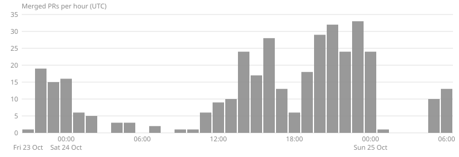

# Build log

How much the team shipped during Night Shift (23 to 25 Oct 2026), in what order, and how each
piece was checked. Every number below comes from git, GitHub or the live site, with the command
that gives it again. Times are UTC. UK clocks were one hour ahead of UTC until they went back at
01:00 UTC on 25 Oct.

Read at 2026-10-25 06:55 UTC, on `integration` at `2ddf784` (after #554).

## Headline numbers

| What | Number | Reproduce it |
|---|---|---|
| Pull requests merged | **369** (366 into `integration`, 3 into `main`), from 23 Oct 21:22 to 25 Oct 06:38 | `gh pr list --state merged --limit 1000 --json number,mergedAt,title,baseRefName` |
| Commits on `integration` | **1,290**, of which 852 are not merge commits | `git rev-list --count origin/integration` and `git rev-list --count --no-merges origin/integration` |
| Python tests | **1,332** | `uv run pytest --collect-only -q \| tail -1` |
| Web unit tests | **163**, all passing | `cd web && npm ci && npm test` |
| Browser (Playwright) tests | **55** in 21 spec files | `cd web && npx playwright test --list \| tail -1` |
| CI checks on every PR | **4**: `freeze-gate`, `smoke`, `image`, `web` | `.github/workflows/freeze-gate.yml`, `.github/workflows/smoke.yml`; `gh pr checks 554` |
| Sports | **4**: football, basketball, cricket, Formula 1 | `ls data/sample` |
| Matches | **9** matches bundled, 7 listed on the site (2 hidden) | `ls data/sample`; `HIDDEN` in `data/matches.py` |
| Commentary lines made | **10,393** | `curl -s https://night-shift-5zvig7nbvq-ew.a.run.app/stats` → `lines` |
| Mubit requests behind those lines | **10,414** | `/stats` → `mubit_requests` |
| Lead lines heard as timed ElevenLabs audio | **3,552** | `/stats` → `by_speaker.lead.audio_lines` |
| Characters voiced by ElevenLabs | **639,578** | `/stats` → `voice_chars` |
| Full match replays measured | **123**, at $0.43 each (model $0.17, voice $0.27) | `/stats` → `matches_measured`, `cost_per_match_usd` |
| Producer fixes | **70**, and 180 later lines spoken from a fix | `/stats` → `fixes`, `spoken_from_fix` |
| First word of text | **557 ms** median, 1,401 ms p95 | `/stats` → `first_word_ms_p50`, `first_word_ms_p95` |

The `/stats` figures were read at 2026-10-25 06:55 UTC and keep growing as people use the site.

### Lines of code by area

Text files tracked by git, binaries and lock files left out:

```bash
git ls-files | grep -vE '\.(png|jpg|jpeg|gif|mp3|mp4|webm|woff2?|ico|lock|pdf)$|package-lock' \
  | xargs -d '\n' wc -l | grep -v ' total$' \
  | awk '{split($2,a,"/"); d=(a[2]==""?"(root)":a[1]); s[d]+=$1} END{for(k in s) print s[k], k}' | sort -rn
```

| Area | Lines | What it holds |
|---|---:|---|
| `data/` | 78,012 | Match feeds, pre-match packs, the player graph and video maps (mostly JSON) |
| `tests/` | 16,426 | Python tests |
| `web/` | 11,719 | The live page, its unit tests and Playwright specs |
| `core/` | 7,221 | Server, replay stream, number check, voice, stats, store |
| `eval/` | 3,781 | Held-out evals, labelled lines and saved runs |
| `agent/` | 2,854 | The commentator agents and their tools |
| `scripts/` | 2,743 | Deploy, live checks, precompute, film capture |
| `docs/` | 2,465 | Contract, architecture, demo and design docs |
| root files | 1,035 | README, Makefile, Dockerfile and project files |
| `demo/` | 354 | Demo assets |
| `.github/` | 143 | CI workflows, PR and issue templates, CODEOWNERS |

## Mubit

Every model call goes through Mubit: 10,414 Mubit requests for 10,393 lines. Producer fixes are
sent to Mubit as training examples (2,163 examples to Score check so far, 62 of them from
producers). Mubit's 'Check one line of 2' task (one of our two line-checking tasks; the console cuts the
name short) shows 94.6% for its first version, testing v1, in testing (console read by hand,
25 Oct 06:27 UTC, recorded in `data/mubit_console.json` by
[#560](https://github.com/atiladeokegab/night-shift/pull/560)). The app does not call an adapter.

## Timeline



The chart counts the 369 merged PRs by the UTC hour they merged. It was made once from the
`gh pr list` output above by a short script; the busiest hour was 23:00 on 24 Oct, with 33.

| When (UTC) | Milestone | PRs |
|---|---|---|
| Fri 23 Oct 21:22 | Design doc and a clickable mockup | [#24](https://github.com/atiladeokegab/night-shift/pull/24) |
| 22:09 | The spine: server, store, replay stream over SSE, `make check` | [#22](https://github.com/atiladeokegab/night-shift/pull/22) |
| 22:14 to 22:19 | ElevenLabs voice with a browser-speech fallback; `make deploy` to Cloud Run with a live smoke | [#44](https://github.com/atiladeokegab/night-shift/pull/44), [#45](https://github.com/atiladeokegab/night-shift/pull/45) |
| 22:27 | A producer's fix becomes a training example | [#48](https://github.com/atiladeokegab/night-shift/pull/48) |
| 22:36 to 23:08 | Four sports from real data: the 2022 World Cup final, Jordan's 1998 Game 6 and Kobe's 81, Hamilton at Silverstone 2024 | [#51](https://github.com/atiladeokegab/night-shift/pull/51), [#60](https://github.com/atiladeokegab/night-shift/pull/60), [#62](https://github.com/atiladeokegab/night-shift/pull/62) |
| 23:09 to 23:52 | Proof panel, the live page, then the match wall | [#37](https://github.com/atiladeokegab/night-shift/pull/37), [#65](https://github.com/atiladeokegab/night-shift/pull/65), [#72](https://github.com/atiladeokegab/night-shift/pull/72) |
| 23:53 to Sat 24 Oct 00:45 | First eval on held-out matches | [#75](https://github.com/atiladeokegab/night-shift/pull/75), [#77](https://github.com/atiladeokegab/night-shift/pull/77) |
| 00:13 to 02:44 | Fixes from the first full rehearsal: subtitles, phone layout, voice picks, F1 red flags | [#80](https://github.com/atiladeokegab/night-shift/pull/80), [#81](https://github.com/atiladeokegab/night-shift/pull/81), [#82](https://github.com/atiladeokegab/night-shift/pull/82) |
| 05:06 to 05:14 | A provider outage shows a calm off-air state; unwatched replays stop | [#107](https://github.com/atiladeokegab/night-shift/pull/107), [#108](https://github.com/atiladeokegab/night-shift/pull/108) |
| 11:15 to 12:56 | Ask the commentator, by text then by voice; predictions from pre-match records | [#121](https://github.com/atiladeokegab/night-shift/pull/121), [#124](https://github.com/atiladeokegab/night-shift/pull/124), [#145](https://github.com/atiladeokegab/night-shift/pull/145) |
| 12:26 to 12:56 | A second commentator for stat lines; the big model and ours side by side | [#133](https://github.com/atiladeokegab/night-shift/pull/133), [#144](https://github.com/atiladeokegab/night-shift/pull/144) |
| 14:07 to 14:41 | The number check: scores and counts in a line checked against the data, a review queue for what it flags, wrong-event lines rejected | [#168](https://github.com/atiladeokegab/night-shift/pull/168), [#180](https://github.com/atiladeokegab/night-shift/pull/180), [#190](https://github.com/atiladeokegab/night-shift/pull/190) |
| 14:51 to 16:48 | The long tail: Brighton v Bristol City (WSL), then whole NWSL and women's T20 matches | [#198](https://github.com/atiladeokegab/night-shift/pull/198), [#257](https://github.com/atiladeokegab/night-shift/pull/257) |
| 15:15 to 15:32 | Touchline, the describer that checks itself: README and home page | [#207](https://github.com/atiladeokegab/night-shift/pull/207), [#208](https://github.com/atiladeokegab/night-shift/pull/208) |
| 15:21 | Accessible for blind and low-vision fans: keyboard, screen reader, audio first | [#183](https://github.com/atiladeokegab/night-shift/pull/183) |
| 16:02 to 16:06 | Line check as a Mubit task with exact answers; a producer's fix is heard on the next replay | [#225](https://github.com/atiladeokegab/night-shift/pull/225), [#240](https://github.com/atiladeokegab/night-shift/pull/240) |
| 17:02 to 17:03 | Budget guard on the live site; web checks and a browser test that the voice is heard join CI | [#251](https://github.com/atiladeokegab/night-shift/pull/251), [#262](https://github.com/atiladeokegab/night-shift/pull/262) |
| 17:33 to 18:08 | "Close your eyes" mode; hands-free Ask by voice | [#282](https://github.com/atiladeokegab/night-shift/pull/282), [#289](https://github.com/atiladeokegab/night-shift/pull/289) |
| 18:58 to 19:06 | Line check on every live line; six kinds of miss measured on a held-out set | [#302](https://github.com/atiladeokegab/night-shift/pull/302), [#301](https://github.com/atiladeokegab/night-shift/pull/301) |
| 19:32 to 21:22 | A SurrealDB graph of teams and players behind Follow a player and the Teams panel | [#304](https://github.com/atiladeokegab/night-shift/pull/304), [#377](https://github.com/atiladeokegab/night-shift/pull/377), [#382](https://github.com/atiladeokegab/night-shift/pull/382) |
| 19:49 | README claims checked against the code, tests and live `/stats` | [#325](https://github.com/atiladeokegab/night-shift/pull/325) |
| 20:24 to 21:41 | Score check as one Mubit task; every producer fix reaches it; a line is recorded only after the number check accepts it | [#333](https://github.com/atiladeokegab/night-shift/pull/333), [#392](https://github.com/atiladeokegab/night-shift/pull/392), [#413](https://github.com/atiladeokegab/night-shift/pull/413) |
| 21:16 | Talk to the commentator, live | [#387](https://github.com/atiladeokegab/night-shift/pull/387) |
| 23:32 to Sun 25 Oct 00:31 | Score check before-and-after script, held-out receipts, every README claim traced to its code and test | [#489](https://github.com/atiladeokegab/night-shift/pull/489), [#518](https://github.com/atiladeokegab/night-shift/pull/518), [#527](https://github.com/atiladeokegab/night-shift/pull/527) |
| 05:40 to 06:33 | Every match's lines and audio made ahead and replayed from the store; the Touchline mark, home hero and broadcast lower third | [#537](https://github.com/atiladeokegab/night-shift/pull/537), [#539](https://github.com/atiladeokegab/night-shift/pull/539), [#543](https://github.com/atiladeokegab/night-shift/pull/543), [#551](https://github.com/atiladeokegab/night-shift/pull/551) |

## How the work was verified

### On every pull request

Every PR into `integration` runs four checks (`gh pr checks <number>` shows them); the merge
tooling requires them before it merges:

- **freeze-gate**: after the code freeze, only PRs labelled `fix` may merge.
- **smoke**: `make smoke`, which runs `ruff check`, `ruff format --check`, the whole Python suite,
  then replays every bundled match through the real app with every API key blanked, so it runs
  offline and checks the stream and the store.
- **image**: builds the Docker image Cloud Run runs and imports the app inside it, so a missing
  dependency fails before a deploy, not after.
- **web**: `npm test`, lint, a production build, then the Playwright suite in Chromium.

### In the browser

The 55 Playwright tests drive the real page against an offline server. Among them:

- `web/e2e/a11y.spec.ts`: axe finds no serious or critical violation on the wall or the live
  screen at 390 px and 1280 px; every control is a 44 px target; a keyboard alone starts a match
  and asks a question.
- `web/e2e/keyboard.spec.ts`: the W key, Follow a player by keyboard, and what a screen reader
  hears while the voice is silent.
- `web/e2e/audio.spec.ts`: a line is actually spoken.
- `web/e2e/fix-replay.spec.ts`: a fix made in the review queue is said on the next replay.

### After each deploy

- `make deploy` ends with the live smoke (`core/smoke.py` against the real URL): one replay
  streams moments and lines, and the service's store grows by the lines it streamed.
- `make live-e2e` plays a judge's path on the live site in a real Chromium;
  `web/postdeploy/live.spec.ts` covers the public routes; `make demo-check` confirms health,
  ElevenLabs voice and budget before a live demo.

### Held-out matches

- `eval/agreement.py` runs on held-out matches with recording off, so those moments never
  become training examples.
- The line check's held-out set (`eval/heldout_labels.jsonl`, shown on `/stats` under
  `linecheck.heldout`): 288 lines, 5 of them wrong. The rules caught 2 with no false alarms;
  the Line check caught 3 with 3 false alarms.

### Docs pinned to code

- `tests/test_readme_claims.py` traces each README claim to its source: the keyboard table's
  links, every figure, and each known limitation, so a claim cannot drift from its code or saved
  run. Once a limitation is gone, the test fails until the README says so.
- `tests/test_readme_numbers.py` checks the README's numbers against the eval output and the
  Mubit console read in `data/mubit_console.json`.
