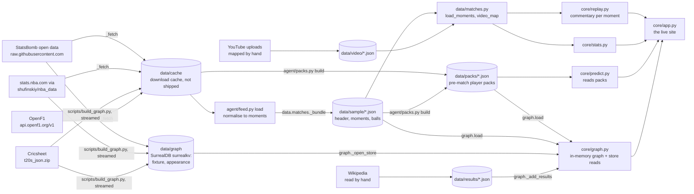

# Data: sources, pipelines and provenance

Touchline calls nine bundled matches across four sports. Every fact it can say comes from one of
four public data sources, enters through one loader file, and is committed to the repo as plain
JSON (plus one embedded database). Nothing is fetched while a match plays. This page says where
each fact came from, how it got in, what checks it, and what does not.

Counts on this page were measured from the files in the repo on 25 Oct 2026.

## 1. Sources, one row per sport

| Sport | Source | Licence or terms, as the source states them | What we take | Loader | Rebuild | Bundled |
|---|---|---|---|---|---|---|
| Football | [StatsBomb open data](https://github.com/statsbomb/open-data) | StatsBomb's user agreement; it asks anyone who publishes work from the data to name StatsBomb as the source and use its logo | Match records; events (shots with xG, own goals, fouls and cards, substitutions, injury stoppages, full time) with pitch x/y; lineups (player nicknames) | `agent/feed.py:78` `statsbomb_matches`, `agent/feed.py:84` `statsbomb_events`, `agent/feed.py:92` `statsbomb_nicknames` | `uv run python -m data.matches` | 4 matches, 196 moments |
| Basketball | stats.nba.com play-by-play (`playbyplayv2`) and shot charts, through the mirror [shufinskiy/nba_data](https://github.com/shufinskiy/nba_data) | The mirror repo is Apache-2.0. The data itself comes from stats.nba.com, which is governed by the [NBA.com terms of use](https://www.nba.com/termsofuse) | Play-by-play rows (made shots, free throws, steals, end of game, score), shot-chart rows for packs | `agent/feed.py:373` `nba_rows`, `agent/packs.py:88` `nba_shots` | `uv run python -m data.matches` | 2 matches, 60 moments |
| Cricket | [Cricsheet](https://cricsheet.org) T20 internationals (`t20s_json.zip`) | [Cricsheet licensing](https://cricsheet.org/licensing/): most data under the Open Data Commons Attribution License | Ball-by-ball deliveries (batter, bowler, runs, extras, wickets), match info, target | `agent/feed.py:248` `cricsheet_zip`, `agent/feed.py:253` `cricsheet_match` | `uv run python -m data.matches` | 2 matches, 120 moments |
| F1 | [OpenF1](https://openf1.org) REST API | The [OpenF1 repo](https://github.com/br-g/openf1) LICENSE file is CC BY-NC-SA 4.0. OpenF1 states it is unofficial and not affiliated with Formula 1 companies | `drivers`, `position`, `intervals`, `pit`, `stints`, `laps`, `race_control` for one session | `agent/feed.py:509` `openf1` | `uv run python -m data.matches` | 1 race, 15 moments |

Two smaller stores sit beside these. Neither comes from an API.

| Store | Source | Bundled |
|---|---|---|
| `data/video/*.json` | Hand-made maps from a moment to a time in a public YouTube upload; each file names the upload in its `source` field | 7 maps, 116 mapped moments |
| `data/results/nwsl-2018-orlando.json` | Orlando Pride's 2018 results before 23 May, read by hand from [Wikipedia](https://en.wikipedia.org/wiki/2018_Orlando_Pride_season) on 24 Oct 2026, because StatsBomb does not cover them | 8 fixtures |

## 2. Lineage

Every arrow below is a call or a file read in the code; the label names it.



Where each arrow is in the code:

| Arrow | Code |
|---|---|
| Source to cache | `agent/feed.py:57` `_fetch`: downloads once, `raise_for_status`, writes `data/cache/<name>` |
| Cache to moments | `agent/feed.py:729` `load`: one branch per sport |
| Moments to `data/sample` | `data/matches.py:202` `_bundle`, driven by the `__main__` block at `data/matches.py:217` |
| To `data/packs` | `agent/packs.py:442` `build`: reads the sample file plus the feed's caches |
| To `data/graph` | `scripts/build_graph.py:355` `write`; builders for football, basketball and cricket at `scripts/build_graph.py:318`. F1 has no graph builder |
| Sample and video to the replay | `data/matches.py:76` `load_moments`, `data/matches.py:184` `video_map`, imported at `core/app.py:108` |
| Packs to prediction | `core/predict.py:14` `PACKS` |
| Packs and sample to the in-memory graph | `core/graph.py:68` `rows`, `core/graph.py:130` `load` |
| Store and results to graph reads | `core/graph.py:274` `_open_store`, `core/graph.py:250` `_add_results` |

## 3. The stores

### `data/sample/<sport>-<match_id>.json`: the match feed

What: one file per match. `header` names the sides, competition, stage and date, never the
result (`agent/feed.py:105`). `moments` is the list of events the commentator may speak about,
one per line of the file. Football files also carry `balls`: who has the ball a beat after a
moment, kept apart so a moment never carries play from after it (`data/matches.py:133`).

Moment fields: `sport`, `match_id`, `idx`, `period`, `clock`, `type`, `team`, `players`
(roles to names), `outcome`, `score`, `detail` (sport-specific), and `x`, `y` for located
football events.

| File | Moments | Balls |
|---|---|---|
| `basketball-0020500591` (Kobe's 81 v Toronto, 2006) | 26 | 0 |
| `basketball-0049700088` (1998 Finals Game 6) | 34 | 0 |
| `cricket-1298150` (India v Pakistan, T20 World Cup 2022) | 57 | 0 |
| `cricket-1515217` (Netherlands v Nepal, Women's T20 World Cup Qualifier 2026) | 63 | 0 |
| `f1-9636` (São Paulo Grand Prix 2024) | 15 | 0 |
| `football-3754092` (Chelsea v Tottenham, 2016) | 47 | 0 |
| `football-3869685` (World Cup final 2022) | 69 | 44 |
| `football-3913122` (Brighton v Bristol City, WSL 2024) | 36 | 26 |
| `football-7457` (Orlando Pride v North Carolina Courage, NWSL 2018) | 44 | 35 |
| **Total** | **391** | **105** |

At load time `data/matches.py:81` `_stated` adds derived words to each moment's `detail`: who
leads (`lead`), a cricket chase (`chase`), a basketball points milestone (`milestone`), and where
a football event happened (`where`). Each is built only from that moment and the ones before it.

Rebuild: `uv run python -m data.matches` (needs the network).

Checked by: `tests/test_feed.py` (which events become moments, per sport; an F1 moment never reads
a later row; untrusted ids rejected), `tests/test_where.py` (pitch zones), `tests/test_video_map.py`,
`tests/test_core_spine.py` (a replay streams every moment in order).

Not checked: that a committed file still equals what the loader would build today. No test
re-downloads a source. A moment does not keep its source row's id (see section 4).

### `data/packs/<sport>-<match_id>.json`: pre-match player packs

What: the players and teams in the match, and only their record from earlier in the same season,
up to the day before the match (`agent/packs.py:72`). `tonight` holds the match's own shots (or,
for cricket, every ball), each linked to the moment that reveals it.

Fields: `match_id`, `sport`, `source` (names the archive or competition and season), `window`
(`from`, `to`), `coords`, `players` (per player: `team`, `games`, totals, zones, up to 300 recent
shots; cricket: batting by phase and bowling; F1: earlier grid and finish), `teams`, `tonight`.

| Pack | Players | Tonight | Source field |
|---|---|---|---|
| `basketball-0020500591` | 20 | 164 | stats.nba.com shotchartdetail via shufinskiy/nba_data shotdetail_2005 |
| `basketball-0049700088` | 20 | 131 | ... shotdetail_1997 + shotdetail_po_1997 |
| `cricket-1298150` | 22 | 251 | Cricsheet T20Is, 2022 |
| `cricket-1515217` | 22 | 256 | Cricsheet T20Is, 2026 |
| `f1-9636` | 20 | 0 | OpenF1 2024 races |
| `football-3754092` | 36 | 29 | StatsBomb open data, competition 2 season 27 |
| `football-3869685` | 50 | 38 | StatsBomb open data, competition 43 season 106 |
| `football-3913122` | 38 | 26 | StatsBomb open data, competition 37 season 281 |
| `football-7457` | 35 | 35 | StatsBomb open data, competition 49 season 3 |

Rebuild: `uv run python -m agent.packs`, or one pack with `uv run python -m agent.packs football 3754092`.

Checked by: `tests/test_packs.py`: nothing pre-match is dated on or after the match day, every
shooter and everyone named in the moments is in the pack, `tonight` never reveals a ball before
its moment, the F1 season stops before São Paulo.

Not checked: season totals against an outside record (for example, a player's official season
line). The packs agree with their own source only.

### `data/graph`: the competition store (SurrealDB, embedded surrealkv)

What: every team and player of each bundled match's competition and season, not just the nine
matches. Two tables (`scripts/build_graph.py:7`):

- `fixture`, one per match: `sport`, `mid`, `competition`, `season`, `start` (ISO), `home`,
  `away`, `hg`, `ag`.
- `appearance`, one per player, team and season: `sport`, `identity`, `player`, `team`,
  `competition`, `season`, `gender`, `keys` (the totals' names), `games` (rows of
  `[start, minutes, *totals]`).

Rows measured now (15 MB on disk):

| Sport | Competition and season | Fixtures | Appearances (sport total) |
|---|---|---|---|
| Football | Premier League 2015/16 | 380 | 1,744 |
| Football | FIFA World Cup 2022 | 64 | |
| Football | FA Women's Super League 2023/24 | 132 | |
| Football | NWSL 2018 | 36 | |
| Basketball | NBA 1997-98 | 1,260 | 1,007 |
| Basketball | NBA 2005-06 | 1,319 | |
| Cricket | T20I 2022 | 655 | 5,006 |
| Cricket | T20I 2026 | 898 | |
| **Total** | | **4,744** | **7,757** |

At open, the app adds the 8 cited fixtures from `data/results/`, so football reads 620 fixtures
(`core/graph.py:287`).

Rebuild: `uv run python scripts/build_graph.py` (all three sports) or `... build_graph.py football`.
It streams each match, keeps nothing raw, and retries a failed request up to four times
(`scripts/build_graph.py:31`).

Checked by: `tests/test_graph_store.py` (form, head to head, squads and player seasons stop at
kick-off, compared in UTC; same name with different provider ids stays apart; Kobe's 81 game
sees only earlier games; men's and women's sides with one name stay apart),
`tests/test_graph.py` (the graph answers like the packs; the packs answer when the engine fails),
`tests/test_readme_claims.py:161` (the README's football count equals the store's).

Not checked: F1 has no graph. Football's NWSL 2018 season is partial in StatsBomb, which is why
`data/results/` exists.

### In-memory graph (built at start-up, not on disk)

`core/graph.py:130` `load` builds `season`, `match`, `team`, `player`, `plays_for`, `played_in`
and `competed` from `data/packs` and `data/sample`, with fixed ids in file order, so every load
is the same. No new data enters here; it reshapes the packs. Checked by `tests/test_graph.py:43`.

### `data/video/<sport>-<match_id>.json`: highlight maps

What: `youtube_id`, `source` (the uploader and title, in words), optional `embed: false`, and
`moments: [{idx, video_t}]`. The replay calls only mapped moments, timed to the video.

| Map | Mapped moments |
|---|---|
| `basketball-0020500591` | 20 |
| `basketball-0049700088` | 15 |
| `cricket-1298150` | 32 |
| `f1-9636` | 7 |
| `football-3754092` | 4 |
| `football-3869685` | 31 |
| `football-3913122` | 7 |

Rebuild: by hand; there is no script.

Checked by: `tests/test_video_map.py`: every demo match on the picker has a map, the YouTube id is
well formed and a source is named, each `idx` is a real moment of the same sport, one entry per
moment, video times increase.

Not checked: that a mapped second shows that exact moment. That was matched by eye.

### `data/results/*.json`: cited results

What: `source` (URL and date read), `note`, `fixtures: [[date, home, away, hg, ag]]`. One file,
8 fixtures. Read by `core/graph.py:250`. Not checked against a second source.

## 4. Provenance: from a spoken line back to the source

A stored line names its match and moment. A moment names its match, period, clock and the
source's own words. That is enough to find the source row.

1. **The line.** Every line the commentator says is stored with `line_id`, `match_id`,
   `moment_idx` and `text` (`agent/commentator.py:535`), appended to the `lines` store
   (`core/replay.py:362`).
2. **The moment.** `match_id` picks the file in `data/sample`; `moment_idx` is the moment's `idx`.
3. **The source row.** The loader for that sport says which download and which fields.

Worked example: Kobe Bryant's 80th point, Lakers v Raptors, 22 Jan 2006, moment 22.

The moment as committed in `data/sample/basketball-0020500591.json`:

```json
{"sport": "basketball", "match_id": "0020500591", "idx": 22, "period": 4, "clock": "00:43",
 "type": "Free throw", "team": "Los Angeles Lakers", "players": {"shooter": "Kobe Bryant"},
 "outcome": "1 point", "score": {"home": 121, "away": 102},
 "detail": {"play": "Bryant Free Throw 1 of 2 (80 PTS)", "player_points": 80}}
```

What `load_moments` adds before the commentator sees it:

```json
"lead": "Los Angeles Lakers lead 121-102",
"milestone": "Kobe Bryant has 80 points tonight"
```

The source: `agent/feed.py:373` `nba_rows` turns game id `0020500591` into the 2005-06 regular
season archive, `https://github.com/shufinskiy/nba_data/raw/main/datasets/nbastats_2005.tar.xz`,
and keeps rows whose `GAME_ID` is `20500591` (the archive drops the leading zeros). The row,
re-downloaded on 25 Oct 2026:

| GAME_ID | EVENTNUM | EVENTMSGTYPE | PERIOD | PCTIMESTRING | HOMEDESCRIPTION | SCORE | PLAYER1_NAME |
|---|---|---|---|---|---|---|---|
| 20500591 | 481 | 3 (free throw) | 4 | 0:43 | Bryant Free Throw 1 of 2 (80 PTS) | 102 - 121 | Kobe Bryant |

How each field maps (`agent/feed.py:416` `basketball_moments`): `EVENTMSGTYPE` 3 with no "MISS"
makes a made free throw worth 1; `PERIOD` and `PCTIMESTRING` become `period` and `clock`;
`HOMEDESCRIPTION` becomes `detail.play`; `PLAYER1_NAME` becomes the shooter. The score is not
copied from the row. The loader adds up every made shot itself, and its 121-102 agrees with the
row's own `102 - 121` (visitor first). `player_points` is the loader's own running count, and it
agrees with the "(80 PTS)" in the source text.

The same chain holds for the other sports: football moments come from StatsBomb event JSON
(`statsbomb_events`, `https://raw.githubusercontent.com/statsbomb/open-data/master/data/events/<match_id>.json`),
cricket from the match file in Cricsheet's zip, F1 from OpenF1 rows for `session_key=<match_id>`.

Gap: a moment does not store its source row's id (`EVENTNUM`, StatsBomb event `id`, Cricsheet
over and ball, OpenF1 `date`). The trace above goes by match, period, clock and text, which is
unique in this example but is a lookup, not a key.

## 5. Hardening already in place

| What | Where |
|---|---|
| A match id from a request reaches a file glob only if it is plain letters and digits; anything else is a 404 | `data/matches.py:39`, `data/matches.py:189` |
| The NBA loader accepts only a 10-digit game id of a regular-season or playoff game | `agent/feed.py:376`; test `tests/test_feed.py:254` |
| The OpenF1 loader accepts only a numeric session key | `agent/feed.py:510`; test `tests/test_feed.py:442` |
| Downloads are untrusted: every field that reaches a moment is cut to a short single-line string or a real number | `agent/feed.py:49` `_s`, `agent/feed.py:53` `_num` |
| A match header never carries the result | `agent/feed.py:105` |
| A failed download stops the build instead of writing a half file | `agent/feed.py:61` `raise_for_status` |
| OpenF1's rate limit is respected when not cached | `agent/feed.py:514` |
| No network while a match plays: matches, packs and the store are committed or shipped in the image; the download cache is kept out of the image | `data/matches.py:1`, `agent/packs.py:8`, `.dockerignore:7` |
| Nothing from later in the match reaches a moment: derived words use only earlier moments, and who has the ball is kept apart | `data/matches.py:81`, `data/matches.py:133`; test `tests/test_feed.py:430` |
| Pre-match records stop the day before the match; graph reads stop at kick-off, compared in UTC | `agent/packs.py:72`, `tests/test_packs.py:33`, `tests/test_graph_store.py:64`, `tests/test_graph_store.py:261` |
| The demo matches, and a fixed one in five of all others (by hash), are held out of training and evaluation examples | `agent/feed.py:32`, `agent/feed.py:45`; test `tests/test_feed.py:148` |
| The number check: a line's numbers are compared with its own moment's data. A line with a wrong number is asked for once more; if that is wrong too, a line built from the moment's data is said instead, and the failed try goes to the producer's review queue | `core/insight.py:1429` `wrong_numbers`, `core/insight.py:1768` `checked`, `core/review.py:1` |
| If the graph engine or store fails, the app reads the JSON packs and the page keeps working | `core/graph.py:274`, `core/graph.py:293`; test `tests/test_graph.py:68` |
| The shipped store is opened from a temporary copy, so a read never writes to the image | `core/graph.py:275` |

## 6. Next sources (not built)

None of these are in the code. Each would enter the same way the current ones do: a loader in
`agent/feed.py` that returns `(header, moments)` from `load`, a `_bundle` line in
`data/matches.py`, and, for season context, a builder in `scripts/build_graph.py` `BUILDERS`
writing `fixture` and `appearance` rows.

| Sport | Source | Terms, as stated | What it would add | Where it slots in |
|---|---|---|---|---|
| Football | Other StatsBomb open data competitions | Same user agreement as now | More matches with the same event model | Already supported: a `statsbomb_matches(comp, season)` call and a `_bundle` line |
| Football | [openfootball/football.json](https://github.com/openfootball/football.json) | "Dedicated to the public domain. Use as you please with no restrictions whatsoever." | Results and fixtures for leagues StatsBomb does not cover; would replace hand-read files like `data/results/` | `fixture` rows in `data/graph`, read like `core/graph.py:250` |
| Basketball | Other seasons in [shufinskiy/nba_data](https://github.com/shufinskiy/nba_data) | Repo Apache-2.0; data from stats.nba.com under the NBA.com terms | More games with the same play-by-play columns | Already supported: `nba_rows` picks the archive from the game id |
| Basketball | [nba_api](https://github.com/swar/nba_api) | Client is MIT; the data stays under the [NBA.com terms of use](https://www.nba.com/termsofuse) | Box scores and player ids straight from stats.nba.com; the loader notes stats.nba.com times out from cloud IPs, so it would be a build-time step only | A builder in `scripts/build_graph.py`, never at runtime |
| Cricket | Cricsheet's other archives (ODIs, Tests, leagues such as the IPL) | [Open Data Commons Attribution License](https://cricsheet.org/licensing/) | More formats and matches, same JSON shape | `cricsheet_zip` takes one archive URL today; a second URL is the change |
| Cricket | [The Cricsheet Register](https://cricsheet.org/register) | Cricsheet's licensing page | One id per person across sources, so two players with one name never merge | The `identity` field of `appearance` rows in `scripts/build_graph.py` |
| F1 | Other OpenF1 sessions | Repo LICENSE CC BY-NC-SA 4.0 | More races with the same endpoints | Already supported: `openf1(endpoint, session_key)` |
| F1 | [Jolpica F1](https://github.com/jolpica/jolpica-f1), the Ergast-compatible successor | [Its terms](https://github.com/jolpica/jolpica-f1/blob/main/TERMS.md): free for non-commercial use, data under CC BY-NC-SA 4.0, rate limited | Results and standings back to 1950; F1 has no graph store today | A new `f1` builder in `scripts/build_graph.py` `BUILDERS` |
