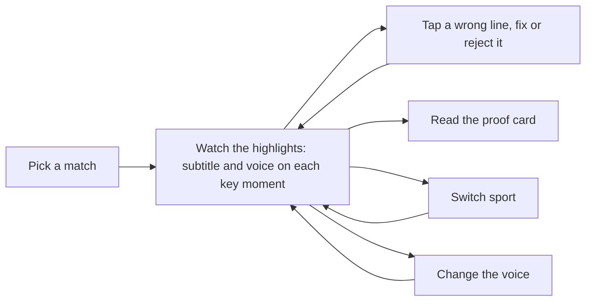

# Design

> Spec as of PRD v2; the shipped page differs: a seven-match wall, four sports, voices in
> `docs/voice.md`.

Designer: Atilade (@atiladeokegab). Owned by the designer: to change anything here, open a
change-request (AGENTS.md §7) addressed to them. Each vertical's `Design:` line says which
sections of this page it must follow.

The mockup is `docs/mockup/index.html`: every screen and state, clickable, with the exact copy.
Open it in a browser; the thin bar at its top ("Mockup") jumps to each screen and state and is not
part of the product. Add `?still` to the URL to hide that bar (the README's still uses it).

This is the second look (PRD v2). The first, a stickman replay on a flat dark set, is retired: the
live page now plays the match's broadcast highlights and Touchline calls each key moment over them.

## References

Described in words, never copied in.

- **The lead's target (two screenshots, 23 Oct 2026, not committed).** A match picker on a dark navy
  page: the wordmark "Touchline." in a heavy rounded sans with an amber full stop, top left; a slim nav
  top right, "Live" (with a small green live dot), "Fixtures", "About". A muted tagline, then "Pick a
  match" large. Two wide cards, each a night-stadium photograph (floodlights, a blurred crowd, a lit
  pitch) behind a translucent glass panel, with player artwork on the right of the card and the text on
  the left: a small capital sport label, the match title, the detail line, the result in bold, and an
  amber "Start replay →" button. Rounded corners, soft shadows, everything slightly lit from above.
- **The look we move away from (the first mockup).** Flat navy panels with thin borders, condensed
  type everywhere, no imagery, every state crammed into one dense bar. It read as a template.
- **TV highlights packages.** The video is the stage; graphics sit in its corners and lower third and
  stay out of the action. Example: [BBC Sport football highlights](https://www.bbc.co.uk/sport/football).
- **Broadcast subtitles.** [BBC subtitle guidelines](https://www.bbc.co.uk/accessibility/forproducts/guides/subtitles/):
  at most two lines, centred at the bottom, high contrast. Ours are the biggest type on the page.
- **Cricket score line.** [ESPNcricinfo](https://www.espncricinfo.com) ball by ball: "154/5", "Over 19.4",
  "need 6 off 3" in a chase.
- **Typefaces.** [Outfit](https://fonts.google.com/specimen/Outfit) for the wordmark, headings, the
  score bar and subtitles (the closest open match to the target's rounded heavy sans);
  [Inter](https://fonts.google.com/specimen/Inter) for everything else. Both open-licence, from Google
  Fonts; the live page self-hosts them.

Our own pages use no match photographs, broadcast stills or player likenesses. The night stadium and
the team crests in the mockup are drawn in SVG; in the product, the only footage is the
broadcast highlights embedded from YouTube (the TV coverage for Chelsea v Tottenham, the TV feed for India v Pakistan).

## Look

- **Mood.** A broadcast highlights package at night: the match fills the screen, the graphics are
  glass laid over it. Calm, premium, high contrast, one warm accent.
- **Restraint.** One accent colour, two typefaces, one glass treatment. No gradient text, no icon that
  doesn't carry meaning, at most one moving thing per area.

### Tokens

| Token | Value | Use |
|---|---|---|
| `--bg` | `#06080F` | Page |
| `--fg` | `#F6F4EF` | Text (warm white) |
| `--muted` | `#F6F4EF` at 66% | Secondary text |
| `--faint` | `#F6F4EF` at 42% | Labels |
| `--glass` | `rgba(14, 18, 31, .55)` under a white sheen from 7% to 1.5% | Every card, bar and sheet |
| `--line` / `--line-hi` | white at 10% / 20% | Glass borders and dividers / hover |
| `--amber` | `#FFB547`; buttons a gradient `#FFC56B` → `#F5A524` with text `#1B1203` | The accent: the wordmark, primary buttons, the selected speed chip, the clock, the moment tag, timeline markers |
| `--air` | `#FF4D4F` | The ON AIR dot only |
| `--live` | `#3DDC84` | The nav's live dot and the adapter's result dot only |
| `--fix` | `#7CD4FF` | Fixed lines |
| `--err` | `#FF6B6B` | Errors, rejected lines |
| Teams | Chelsea `#034694`, Tottenham `#F4F4F4`, India `#2F7DE1`, Pakistan `#0F8A4C`, Verstappen `#3671C6` | Team bars in the score bar and the card crests only |

Glass: the `--glass` fill, `backdrop-filter: blur(22px) saturate(150%)`, a 1px `--line` border, a 1px
inner top highlight, and a long soft shadow (`0 24px 64px -28px`, black at 70%).

### Type

| Role | Font | Size, weight, line height |
|---|---|---|
| Wordmark | Outfit | 1.55rem, 700, tracking −0.025em; "Touchline." all in `--amber` |
| Page heading | Outfit | clamp(2.5rem, 5.2vw, 4.25rem), 600, 1.0, tracking −0.035em |
| Card title | Outfit | 2.1rem, 600 (1.8rem on phones) |
| Subtitle | Outfit | clamp(1.6rem, 3.3vw, 3.3rem), 600, 1.1, at most 24 characters a line, balanced, two lines at most |
| Score bar | Outfit | 1.05rem, 600; the score 1.5rem; numbers tabular |
| Body | Inter | 1rem, 400, 1.5 |
| Labels | Inter | 0.7rem, 600, capitals, tracking 0.16em, `--faint` |
| Log lines | Inter | 0.92rem, 1.45 |

### Spacing and shape

A 4px base: 8, 12, 16, 24, 32, 48. Page gutter 32px (16px on phones). Radii: cards 24px, glass
panels 20px, buttons 12px, chips 10px, pills fully round. Buttons are 44px tall (38px in the dock,
30px small).

### Motion

All on `cubic-bezier(.2, .7, .2, 1)`. A new subtitle rises 10px and unblurs over 380ms. In the mockup
the stage drifts (scale to 1.06 over 28s, back and forth) to stand in for playing video; the product
leaves the real video alone. The ON AIR dot pulses a red ring and four amber bars move only while the
voice speaks. Cards lift 3px on hover and their artwork scales 3.5% over 1.2s. Sheets rise 16px over
320ms. With reduced motion: none of it, instant changes.

## Layout

- **Picker and About.** The nav, then a muted tagline, a large heading and the two match cards side by
  side (stacked under 760px). Each card's artwork fills it; a dark wash from the left keeps the text
  legible (from the bottom on phones, with the text at the bottom).
- **Live, desktop (over 1100px).** The highlights fill the first screen edge to edge. Over them: the
  nav; the score bar top left with the ON AIR pill at the right of the same row; the moment tag and
  subtitle centred over the lower third; the dock (Fixtures, sport switch, voice) under it; the video
  timeline at the very bottom. The Lines and Proof cards stand in a 384px glass column on the right,
  over the video. A dark wash at the top and bottom keeps the overlays legible.
- **Live, tablet (760 to 1100px).** The stage is 74% of the screen height; Lines and Proof sit under it
  side by side.
- **Live, phone (under 760px).** The stage is 76% of the screen height, with the artwork anchored to
  the bottom so the pitch, not the sky, fills it. The score bar keeps the period and REPLAY and may wrap
  inside itself; the ON AIR pill stays on the same row and drops the voice name and bars. The subtitle
  is 1.6rem and sits above the dock, never under it; the timeline drops its caption; Lines then Proof
  stack under the stage. Sheets dock to the bottom edge.

## Components

| Component | Shows | Behaviour |
|---|---|---|
| Nav | "Touchline." left; "Live" (green dot), "Replays", "About" right; the current page tinted | Live opens the live page; Replays is the match picker |
| Match card | Night-stadium artwork with the two teams' crests (shield in team colour, three-letter code), sport label, title, detail (the date never wraps), result, a meta row (highlights length, key moments, default voice), the speed chips, "Start replay →" | Starts the replay |
| Video stage | The broadcast highlights (re-uploads of the TV coverage on YouTube): an embedded YouTube player, muted, full-bleed. In the mockup an SVG night stadium stands in | Plays from the start. The player's current time drives the commentary, so a line never runs ahead of the picture (A-6.4@2) |
| Score bar | Team colour bars and codes, the score, the clock (football "69:01" and the half; cricket "Over 19.4", "need 6 off 3" in an amber chip, with both teams' totals at the same weight: "IND 154/5 PAK 159/8"), "REPLAY" | Updates with each moment |
| ON AIR pill | Red dot, "ON AIR", four amber bars, the voice ("British commentator") | Dot and bars move only while speaking; "VOICE OFF" or "VOICE UNAVAILABLE" otherwise |
| Subtitle | Over a soft dark scrim so it never sits on the players: the moment tag ("28:29 · Goal", "Over 19.4 · No-ball · Six") above the line in large type | Replaced by the next moment's line; a fixed line turns `--fix` with a "Fixed" tag |
| Dock | "← Fixtures", the Football / Cricket switch, "Voice: British" | The switch starts the other demo match; Voice opens the voice setting |
| Timeline | "Broadcast highlights · YouTube · muted", the progress track with a marker per mapped moment (amber once called), a small "Synced to video" chip, "3:05 / 4:56" | Read only |
| Lines card | Every line so far, newest first: clock, line, first-word time, "Fix". Sized to its content; the oldest line fades out at the bottom rather than being cut | "Fix" opens the producer fix |
| Proof card | First word p50 and p95, cost per line, lines, fixes, the adapter's result | Read only |
| Fix sheet | The original line, an editable box, the reason chips, "Send fix", "Reject line", "Cancel" | See States |
| Voice setting | A Voice on/off switch, then per sport the choices British, Indian and Australian, the default marked | A change applies from the next line with no reload; a toast confirms |
| Toast | One short sentence in a glass pill at the bottom | Leaves after 2.4s |

Speed chips (Real time, 4x, 16x) on each card set the replay speed. Whatever the speed, the video
clock drives the commentary (A-6.4@2). Open point: YouTube's player plays at most 2x, so 4x and 16x
need another mechanism in the product, such as jumping from one mapped moment to the next.

## Flow

## States

| Where | Empty | Loading | Error |
|---|---|---|---|
| Match picker | "No matches yet. Load the demo data, then refresh." | Two shimmering card outlines and "Loading matches…" | "Couldn't load matches. Is the server running?" with "Try again". |
| Live page | Before the first moment: the highlights play, the subtitle area reads "Waiting for the first moment…", the Lines card "Lines appear here as Touchline calls them." | Starting: the stage dims, a spinner and "Starting replay…", the dock disabled. | "Couldn't start the replay." with "Try again" and "Back to matches". |
| Video | None | "Loading highlights…" over the dimmed stage. | The embed won't play: the stage goes dark with "Highlights unavailable here. Commentary carries on."; subtitles and voice continue. |
| Sport switch | None | "Switching to cricket…" with the match and the voice under it, over the dimmed stage. | As the live page's error. |
| Stream | Between moments: the last subtitle stays, the ON AIR dot rests. | A glass banner with a pulsing amber dot: "Reconnecting to the replay…"; the stage dims; the dock stays usable. | A glass banner with a red dot: "Stream disconnected. Lines may be missing." with "Reconnect". The Lines card keeps every line received. |
| Voice | Voice off: the pill reads "VOICE OFF · Subtitles only". | Speaking: the dot pulses and the bars move beside "ON AIR". | "VOICE UNAVAILABLE · Subtitles carry on"; the voice setting shows "Voice unavailable. Subtitles carry on." and no switch. |
| Producer fix | Box emptied: "Send fix" disabled, hint "Type the corrected line, or reject it." | "Sending fix…" with a spinner on the button, the sheet locked. | "Fix not saved. Check the connection and send again." The sheet stays open with the text kept. |
| Proof card | Every number "–" and "No lines yet." | "Loading stats…" | "Stats unavailable. Lines still play." |
| Adapter result | "Not trained yet: needs 25 kept lines (<n> so far)." | "Training: Mubit is building the adapter." | Cost not measurable: "Adapter cost: Not measurable. Mubit doesn't report the adapter's cost to the app." |

## Copy

| Where | Words |
|---|---|
| Wordmark | "Touchline." |
| Nav | "Live", "Replays", "About" |
| Tagline on the picker | "Touchline: the describer that checks itself" |
| Picker heading | "Pick a match" |
| Football card | "Football" / "Battle of the Bridge" / "Premier League · Chelsea v Tottenham · 2 May 2016" / "Chelsea 2–2 Tottenham: Leicester are champions" |
| Cricket card | "Cricket" / "India v Pakistan" / "T20 World Cup · MCG, Melbourne · 23 Oct 2022" / "India won by 4 wickets, off the last ball" |
| Card meta | "Highlights 3:08", "4 key moments", "British commentator" (cricket: "Highlights 4:48", "5 key moments", "Indian commentator") |
| Card button | "Start replay →" |
| Picker footer | "Match data: StatsBomb open data and Cricsheet. Highlights: broadcast highlights on YouTube (the TV coverage for Chelsea v Tottenham, the TV feed for India v Pakistan), embedded, muted. Commentary is AI-generated." |
| About heading | "The describer that checks itself." |
| About text | "Most matches are played with nobody describing them. Touchline watches a match's event feed and describes each key moment in one emotional spoken line, with the model's first word in about half a second (median, GET /stats), over the broadcast highlights." / "It checks every number before it speaks." (score, leader, margin, counts; one retry, then a line built from the data; analyst lines and answers dropped if still wrong) / "One describer, four sports." / "Every fix trains the platform's own describer." (no version has passed Mubit's test yet). Shipped text: `web/src/components/About.tsx`. |
| Score bar tag | "REPLAY" |
| Football clock | "82:39" with "1st half" or "2nd half" |
| Cricket clock | "Over 19.4" with "need 6 off 3", and "PAK 159/8" |
| Moment tag | "<clock> · <moment>": "Goal", "Penalty", "Off the woodwork", "Stoppage", "Six", "Wicket", "No-ball · Six", "India win" |
| ON AIR pill | "ON AIR" and "<voice> commentator"; "VOICE OFF" and "Subtitles only"; "VOICE UNAVAILABLE" and "Subtitles carry on" |
| Timeline caption | "Broadcast highlights · YouTube · muted" |
| Dock | "← Fixtures", "Football", "Cricket", "Voice: <British, Indian, Australian, Off or Unavailable>" |
| Voice setting | "Commentator voice" / "Each line is spoken in this voice. A change applies from the next line, without reloading." / "Voice" / "Football", "Cricket" / "British", "Indian", "Australian" / "Default" / "Done" |
| Voice toast | "<voice> commentator from the next line." |
| Lines card | "Lines", "<n> called", "Fix", "first word 0.58 s", "Fixed", "Rejected" |
| Fix sheet | "Fix this line" / "Touchline said" / "Corrected line" / "What was wrong" / "Wrong fact", "Wrong player", "Wrong score", "Tone", "Other" / "Send fix", "Reject line", "Cancel" / "Your fix goes back through Mubit and is kept beside the original." |
| Toasts | "Fix sent. Kept beside the original." / "Line rejected." |
| Proof card | "Proof" / "First word p50", "First word p95", "Cost per line", "Lines", "Fixes", "Adapter" / "6 versions trained, best 55.8% on Mubit's test; none passed yet." / "First word: time from the moment to the first spoken word. Measured through Mubit." |

Sample lines in the mockup (samples of the emotional register A-3.6 asks for, not the agent's output;
the video times are the mockup's, not the video maps' in `data/video/`):

| Moment | Line |
|---|---|
| 34:29 Kane goal | "Harry Kane! Left foot, and Tottenham lead at the Bridge!" |
| 43:40 Son goal | "Son Heung-Min! Two-nil Spurs, just before the break!" |
| 57:41 Cahill goal | "Gary Cahill, on the half volley! Chelsea are back in it!" |
| 82:39 Hazard equaliser (wrong line, then fixed) | "Eden Hazard! And Chelsea lead!" fixed to "Eden Hazard! Two-all! Chelsea have come back from two down!" |
| Over 18.5 Kohli six off Rauf | "Kohli goes straight back over Rauf's head! Six! India need 22 off 7!" |
| Over 18.6 Kohli six off Rauf | "And again! Flicked over fine leg! Sixteen needed off the last over!" |
| Over 19.1 Pandya out | "Pandya goes! Caught off Nawaz, first ball of the last over!" |
| Over 19.4 no-ball six | "Full toss, waist high, and Kohli dispatches it for six! No-ball, free hit!" |
| Over 19.6 Ashwin winning single | "Ashwin lifts it over mid-off! India win it off the very last ball!" |
