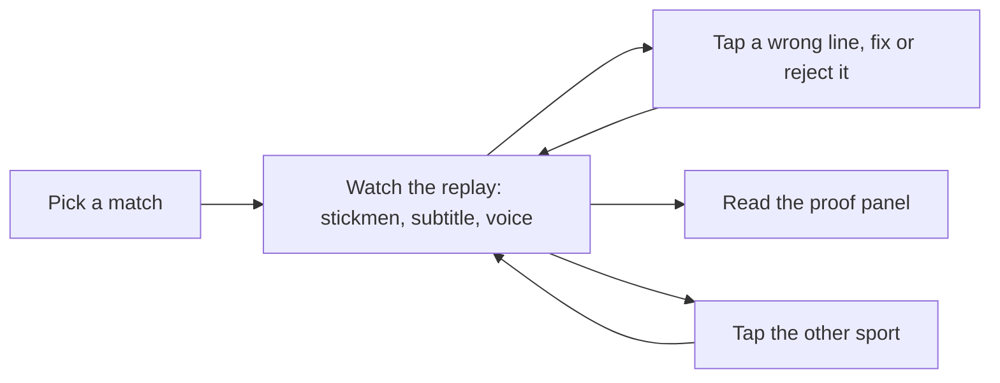

# Design

Designer: Atilade (@atiladeokegab). Owned by the designer: to change anything here, open a
change-request (AGENTS.md §7) addressed to them. Each vertical's `Design:` line says which
sections of this page it must follow.

The mockup is `docs/mockup/index.html`: every screen and state, clickable, with the exact copy.
Open it in a browser; the thin bar at its top ("Mockup") jumps to each screen and state and is not
part of the product.

References: described in words, never copied in.

- **TV score bug.** Any live football broadcast: a slim bar with three-letter team codes on
  team-coloured chips, the score between them, the running clock beside it, all in condensed capitals.
  Ours runs full width at the top. Example: [BBC Sport live football](https://www.bbc.co.uk/sport/football).
- **Broadcast subtitles.** [BBC subtitle guidelines](https://www.bbc.co.uk/accessibility/forproducts/guides/subtitles/):
  large, high contrast, at most two lines, sentence case, centred at the bottom. Ours are the biggest
  type on the page so the back of the room can read them.
- **Top-down event maps.** StatsBomb's pitch, 120 by 80, as used in its
  [open data](https://github.com/statsbomb/open-data): the moment drawn where it happened, not a video.
  We draw stickmen at the event's x and y.
- **Cricket score line.** [ESPNcricinfo](https://www.espncricinfo.com) ball by ball: "138/4", the over as
  "18.5", and "need 22 off 7" in a chase. Data from [Cricsheet](https://cricsheet.org).
- **Typefaces.** [Barlow Condensed](https://fonts.google.com/specimen/Barlow+Condensed) for the score
  bar, labels and numbers; [Source Sans 3](https://fonts.google.com/specimen/Source+Sans+3) for
  subtitles and text. Both are open-licence; the live page self-hosts them, and the mockup, which loads
  nothing from the network, falls back to "Arial Narrow" and system-ui.

## Look

- **Mood.** A broadcast graphics package on a dark set: calm, high contrast, nothing decorative. Readable
  on a projector from the back of a room.
- **Colour.** Background `#0E1524`, panels `#16203A`, borders `#2A375A`, text `#EEF2F7`, muted text
  `#9AA8BF`. One accent, amber `#FFB547`: the clock, the speaking indicator, the moment's ball path and
  the primary button. Team colours only on team chips and stickmen: Spain `#E8414C`, England `#F4F4F4`,
  India `#4FA3FF`, Pakistan `#2FBF71`. Two status colours: fixed `#6FD3FF`, error and rejected `#FF6B6B`.
  The pitch and the cricket field are `#1E5B3A` with lines `#DCE7DF` at 80% opacity; the cricket
  strip is `#C9B27C`.
- **Type.** Subtitle 2.25rem (36px) semibold, line height 1.25, at most two lines, centred; 1.5rem on
  phones. Score bar 1.6rem bold condensed, numbers tabular. Labels 0.8rem condensed capitals, letter
  spacing 0.12em. Body 1rem, line height 1.5.
- **Spacing.** An 8px grid: 8, 16, 24, 32. Panels have 16px padding and an 8px radius; chips a 3px radius.
  Pages keep a 16px side gutter on phones.
- **Layout.** Desktop: score bar on top, the field on the left (about two thirds) with the subtitle under
  it, the line log and proof panel on the right. Under 760px everything stacks: score bar, field,
  subtitle, controls, line log, proof panel.
- **Motion.** Stickmen move to the next moment over 600ms ease-out; the ball's path draws in 400ms as a
  dashed amber line. A new subtitle fades in over 150ms. The speaking indicator is three amber bars that
  pulse only while the voice speaks. With reduced motion: no movement, instant changes.
- **Copy.** Plain broadcast English. Real names and real scores from the data; never an invented statistic.
  Lines in the mockup are samples of what the agent might say, not its output.

## Flow

## Screens and commands

| Screen or command | Shows | The user can |
|---|---|---|
| Match picker | The two demo matches as cards: football, 2023 Women's World Cup final, Spain v England, Sydney, 20 Aug 2023; cricket, India v Pakistan, T20 World Cup, MCG, 23 Oct 2022. Each card has the result line and a speed choice. | Pick a speed (Real time, 4x, 16x) and tap "Start replay". |
| Live match page | Score bar (team chips, score or runs/wickets with what is needed, clock or over, period, "REPLAY"), the field with stickmen at the moment's position and the ball's path, the subtitle of the line now spoken, the speaking indicator, the voice switch, the sport switch, the line log and the proof panel. | Turn the voice on or off; tap Football or Cricket to switch sport; tap "Fix" on any line; tap "Matches" to go back. |
| Line log | Every line so far, newest first: clock or over, the line, first-word time. Fixed lines show the corrected line, a "Fixed" tag and the original struck through; rejected lines show "Rejected" and the line struck through. | Tap "Fix" on a line to open the producer fix. |
| Producer fix | A sheet over the page: the original line, an editable box holding it, a reason (Wrong fact, Wrong player, Wrong score, Tone, Other), "Send fix", "Reject line", "Cancel". | Edit the line and send it, reject the line, or cancel. |
| Proof panel | First-word latency p50 and p95, cost per line, lines, fixes, and the adapter's result. | Read only. Updates with every `stats` event. |
| Sport switch | Two tabs, Football and Cricket, in the controls row under the score bar. | One tap starts the other demo match; the score bar, field, subtitle and line log follow. |

## States

| Where | Empty | Loading | Error |
|---|---|---|---|
| Match picker | "No matches yet. Load the demo data, then refresh." | Two grey card outlines and "Loading matches…" | "Couldn't load matches. Is the server running?" with "Try again". |
| Live match page | Before the first moment: the empty field, the subtitle "Waiting for the first moment…", the line log "Lines appear here as Touchline calls them." | Starting the replay: "Starting replay…" over the field, controls disabled. | Replay failed to start: "Couldn't start the replay." with "Try again" and "Back to matches". |
| Stream | Connected and between moments: the last subtitle stays, the speaking indicator rests. | Reconnecting: an amber banner "Reconnecting to the replay…", the field dims to 50%, controls stay usable. | Disconnected after 3 tries: a red banner "Stream disconnected. Lines may be missing." with "Reconnect". The line log keeps every line received. |
| Voice | Voice off: the switch reads "Voice off", subtitles still show. | Speaking: the three amber bars pulse beside "On air". | No browser speech: the switch is disabled and reads "Voice unavailable in this browser"; subtitles carry on. |
| Producer fix | Box emptied: "Send fix" disabled, hint "Type the corrected line, or reject it." | "Sending fix…" on the button, the sheet locked. | "Fix not saved. Check the connection and send again." The sheet stays open with the text kept. |
| Proof panel | No lines yet: every number shows "–" and "No lines yet." | "Loading stats…" | "Stats unavailable. Lines still play." |
| Adapter result | "Not trained yet: needs 25 kept lines (12 so far)." | "Training: Mubit is building the adapter." | Cost not measurable: the adapter's cost reads "Not measurable" with "Mubit doesn't report the adapter's cost to the app." |

## Copy

| Where | Words |
|---|---|
| Product name, top left | "Touchline" |
| Tagline on the picker | "A live AI commentator for matches nobody calls." |
| Picker heading | "Pick a match" |
| Football card title | "Spain v England" |
| Football card detail | "2023 Women's World Cup final · Sydney · 20 Aug 2023" |
| Football card result | "Spain 1–0 England" |
| Cricket card title | "India v Pakistan" |
| Cricket card detail | "T20 World Cup · MCG, Melbourne · 23 Oct 2022" |
| Cricket card result | "India won by 4 wickets, off the last ball" |
| Speed choice | "Real time", "4x", "16x" |
| Card button | "Start replay" |
| Picker footer | "Match data: StatsBomb open data and Cricsheet. Commentary is AI-generated." |
| Score bar replay tag | "REPLAY" |
| Football clock | "28:29" with the period "1st half" or "2nd half" |
| Cricket clock | "Over 18.5" with "need 22 off 7" |
| Back link | "Matches" |
| Sport switch | "Football", "Cricket" |
| Voice switch | "Voice on", "Voice off" |
| Speaking indicator | "On air" |
| Line log heading | "Lines" |
| Line action | "Fix" |
| Fixed tag | "Fixed" |
| Rejected tag | "Rejected" |
| Fix sheet heading | "Fix this line" |
| Fix sheet original label | "Touchline said" |
| Fix sheet box label | "Corrected line" |
| Fix sheet reason label | "What was wrong" |
| Reasons | "Wrong fact", "Wrong player", "Wrong score", "Tone", "Other" |
| Fix sheet buttons | "Send fix", "Reject line", "Cancel" |
| Fix sheet note | "Your fix goes back through Mubit and is kept beside the original." |
| Fix sent toast | "Fix sent. Kept beside the original." |
| Rejected toast | "Line rejected." |
| Proof panel heading | "Proof" |
| Proof labels | "First word p50", "First word p95", "Cost per line", "Lines", "Fixes", "Adapter" |
| Adapter result | "Agrees with the big model on 23 of 25 test moments." |
| Proof footnote | "First word: time from the moment to the first spoken word. Measured through Mubit." |

Sample lines used in the mockup (samples, not the agent's output):

| Moment | Line |
|---|---|
| 15:11 Hemp shot, off the woodwork | "Hemp lets fly from the edge… and it cracks back off the woodwork!" |
| 28:29 Carmona goal | "Olga Carmona! Low across Earps and in. Spain lead one-nil." |
| 64:18 Hermoso injury stoppage | "Play stops: Hermoso is down and holding her ankle." |
| 69:01 Hermoso penalty saved (wrong line, then fixed) | "Hermoso steps up… and doubles Spain's lead!" fixed to "SAVED! Earps guesses right and keeps England alive!" |
| Over 18.5 Kohli six off Rauf | "Kohli goes straight back over Rauf's head! Six! India need 22 off 7." |
| Over 18.6 Kohli six off Rauf | "And again! Flicked over fine leg. Sixteen needed off the last over." |
| Over 19.1 Pandya out | "Pandya goes! Caught off Nawaz, first ball of the last over." |
| Over 19.4 no-ball six | "Full toss, waist high, Kohli dispatches it for six. No-ball, free hit!" |
| Over 19.6 Ashwin winning single | "Ashwin lifts it over mid-off! India win off the last ball!" |

Open, for the lead: the voice (browser speech for now) and the final colours. Rejecting a line has no
endpoint in the contract yet; the mockup assumes it is sent as a fix with the reason "Rejected" and an
empty corrected line.
