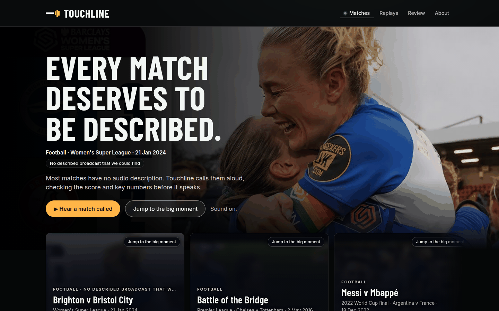
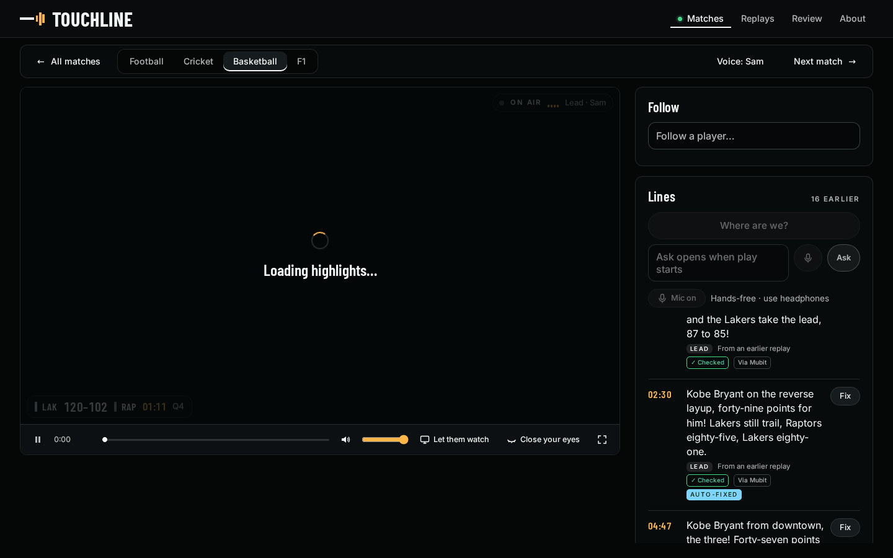
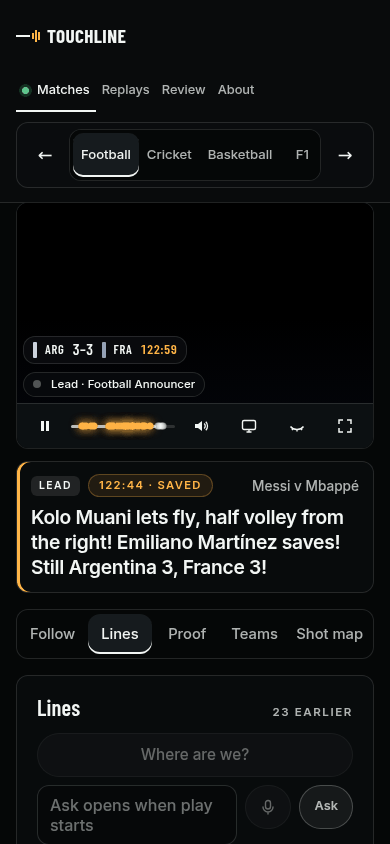
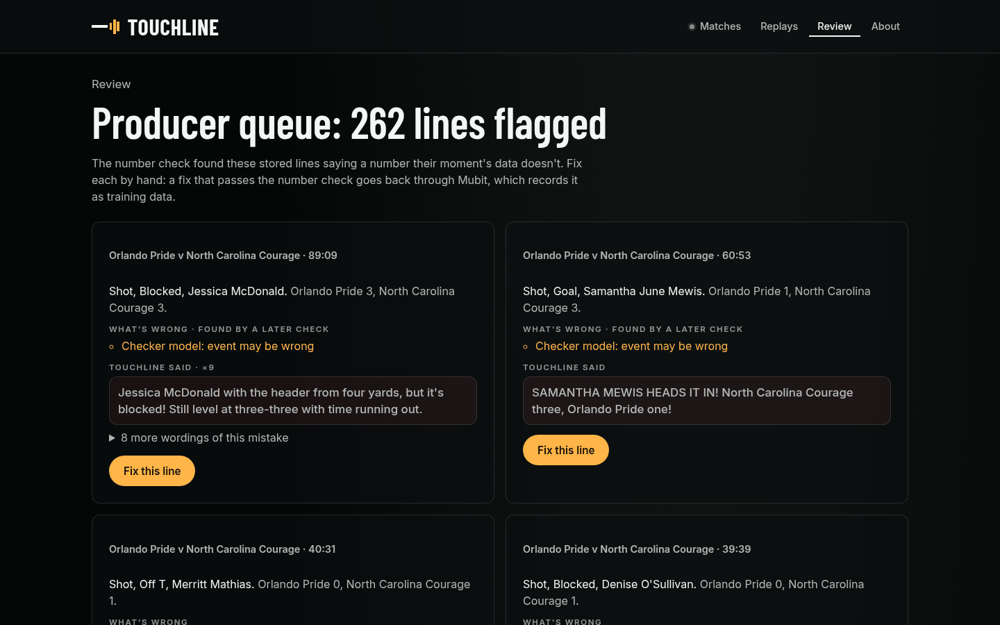

# Touchline: every feature

Touchline describes a match aloud for fans who can't see it. As each key moment of a real match plays
(a goal, a wicket, a three), two commentators call it in one short line, read aloud and shown as a
large caption. Before a moment line is said, a number check holds its score and counts to the match
data. A producer can fix any line, and each fix is sent to Mubit as a training example.

Every link below opens the live site, <https://night-shift-5zvig7nbvq-ew.a.run.app>. A link with
`?match=ID&at=N` opens that match at moment N. Code is cited as `path:line` from the repo root, and the
last column names the test that holds the feature.

## The best bits

| | What you get | See it live |
|---|---|---|
| **Spoken commentary, two voices** | A lead calls each moment and an analyst fills the gaps with a stat, both voiced by ElevenLabs, never before the moment reaches the picture | [Argentina v France, moment 59](https://night-shift-5zvig7nbvq-ew.a.run.app/?match=3869685&at=59) |
| **The number check, and Auto-fixed** | A line whose score or counts don't match the data is retried once; a retry that passes is tagged Auto-fixed, and one that fails again is replaced by a line built from the data | [Kobe's 81, moment 22](https://night-shift-5zvig7nbvq-ew.a.run.app/?match=0020500591&at=22) |
| **Ask and Talk to the commentator** | Type, speak or hold a conversation; answers use only what has happened so far, so nothing is spoiled | [India v Pakistan, moment 48](https://night-shift-5zvig7nbvq-ew.a.run.app/?match=1298150&at=48) |
| **Close your eyes** | Press E: the picture goes black and the match goes on as voice and caption, as a blind fan follows it | any match, then E |
| **The producer's Review queue** | Every line a check flagged, with a Fix button; each fix is stored beside the line and sent to Mubit as a training example | [Review](https://night-shift-5zvig7nbvq-ew.a.run.app/#review) |
| **Watching again costs nothing** | Lines and voice clips are stored the first time, so a fan's replay of a called match makes no model call | any match on the [home page](https://night-shift-5zvig7nbvq-ew.a.run.app/) |

## Fan

| Feature | What the fan gets | Live | Code | Test |
|---|---|---|---|---|
| Seven matches, four sports | Real event data replayed over broadcast highlights: football (StatsBomb), cricket (Cricsheet), basketball (NBA play-by-play) and F1 (OpenF1) | [home](https://night-shift-5zvig7nbvq-ew.a.run.app/), [`GET /matches`](https://night-shift-5zvig7nbvq-ew.a.run.app/matches) | `core/app.py:216`, `agent/feed.py` | `tests/test_feed.py`, `tests/test_long_tail.py` |
| Jump to the big moment, deep links | A tile's pill, or `?match=ID&at=N`, opens the match at that moment | [Argentina v France, 59](https://night-shift-5zvig7nbvq-ew.a.run.app/?match=3869685&at=59) | `web/src/App.tsx:192`, `core/app.py:220` | `web/e2e/deeplink.spec.ts:77`, `tests/test_core_jump.py` |
| Spoken commentary | Each line voiced by ElevenLabs `eleven_v3`, with an audio tag per moment: shouting for a goal, hushed for the build-up | [Kobe's 81](https://night-shift-5zvig7nbvq-ew.a.run.app/?match=0020500591&at=22) | `core/voice.py:160`, `core/voice.py:717` | `tests/test_core_voice.py`, `web/e2e/audio.spec.ts` |
| Two commentators, Jim and Julian | The lead calls the moment; in the quiet the analyst adds a stat from the pre-match pack and the match so far, and the lead comes back to it | [India v Pakistan](https://night-shift-5zvig7nbvq-ew.a.run.app/?match=1298150&at=48) | `core/voice.py:107`, `core/insight.py:342`, `agent/analyst.md` | `tests/test_two_hander.py`, `tests/test_insight.py` |
| Never ahead of the picture | A line is released only when the video's clock reaches its moment | any match | `web/src/gate.ts:34` | `web/src/gate.test.ts` |
| Saved voice clips | Each line's audio is made once, stored, and played from the store after that | any match | `core/store.py:29`, `core/voice.py:717` | `tests/test_core_store.py` |
| The number check, Auto-fixed | Score, leader, margin and player counts are checked against the data before a moment line is said; one retry, then a line built from the data. A retry that passes carries an Auto-fixed tag, with its reason for a screen reader | [Kobe's 81, 22](https://night-shift-5zvig7nbvq-ew.a.run.app/?match=0020500591&at=22) | `core/insight.py:1781`, `core/insight.py:1442`, `agent/status.py:130`, `core/replay.py:89` | `tests/test_autonomy.py`, `tests/test_fallback.py`, `web/src/live.test.ts:309` |
| The lower third | For about 5 s over the picture: the clock, the player, the event and the score after it; hidden from screen readers, which hear the line itself | [Argentina v France, 59](https://night-shift-5zvig7nbvq-ew.a.run.app/?match=3869685&at=59) | `web/src/components/LowerThird.tsx:8` | `web/e2e/lower-third.spec.ts` |
| Timeline moment dots | A mark on the scrub bar for every moment, amber once called | any match | `web/src/components/Controls.tsx:46` | `web/e2e/marks.spec.ts:18` |
| Ask the commentator | Type a question; the analyst answers from the match so far only, at a gap in the commentary, and the answer gets the same number check | [India v Pakistan](https://night-shift-5zvig7nbvq-ew.a.run.app/?match=1298150&at=48) | `core/app.py:575`, `core/insight.py:2050`, `agent/ask.md` | `tests/test_core_ask.py`, `tests/test_ask_check.py` |
| Ask by voice, and "Where are we?" | Hold the mic button or the space bar and speak; W asks "Where are we?" from anywhere but a text box | any match | `web/src/components/MicButton.tsx:22`, `web/src/voice.ts` | `web/src/voice.test.ts`, `web/e2e/keyboard.spec.ts:55` |
| Talk | The Talk button pauses the match and opens a spoken conversation with the commentator, an ElevenLabs agent whose every turn is answered through the same checked Ask path; 12 s of quiet, Resume or Escape picks the match up where it paused | any match, Talk | `web/src/components/Converse.tsx:19`, `core/converse.py:355` | `tests/test_converse.py`, `web/e2e/talk.spec.ts` |
| Close your eyes | Press E or the eye button: a black cover over the picture with only the line and the score, the player still playing under it | any match, then E | `web/src/components/Live.tsx:138`, `web/src/eyes.ts:2` | `web/src/live.test.ts:215` |
| Let them watch | Share the tab so the commentators see the picture as well as the data | any match | `web/src/components/Watch.tsx:55`, `core/app.py:527` | `web/e2e/watch.spec.ts:12`, `tests/test_look.py` |
| Follow a player | Search anyone in the match: their record before tonight and tonight's so far, with their lines marked in the log, read from the SurrealDB graph | [Kobe's 81](https://night-shift-5zvig7nbvq-ew.a.run.app/?match=0020500591&at=22) | `web/src/components/FollowPicker.tsx:12`, `core/app.py:655`, `core/graph.py:201` | `tests/test_follow.py`, `tests/test_graph.py`, `web/src/follow.test.ts` |
| Teams | Each side's form and head-to-head before the match, from the same graph | any match | `web/src/components/TeamPanel.tsx:39`, `core/teams.py:80` | `tests/test_teams.py`, `web/e2e/teams.spec.ts` |
| The shot map | A player's shots before tonight and tonight so far, with hit rate by zone, cut at the moment on screen | [Kobe's 81](https://night-shift-5zvig7nbvq-ew.a.run.app/?match=0020500591&at=22) | `web/src/components/ShotMap.tsx:24`, `core/app.py:619` | `tests/test_core_shots.py`, `web/src/shotmap.test.ts` |
| Choice of voices | Pick the lead's voice per sport, and whether the quiet stretches are described | any match, Voice | `web/src/components/VoiceSheet.tsx:21`, `core/voice.py:167` | `tests/test_core_voice.py` |
| Accessibility | No serious or critical axe finding at 390 and 1280 px; every control a 44 px target; the whole flow by keyboard; captions and answers in screen-reader live regions | any page | `web/src/components/Caption.tsx:19`, `web/src/components/LineLog.tsx:67` | `web/e2e/a11y.spec.ts:91`, `web/e2e/a11y.spec.ts:131`, `web/e2e/keyboard.spec.ts:103` |
| Glass UI and branding | The Touchline wordmark and frosted glass cards over the broadcast still, one layout from phone to desktop | [home](https://night-shift-5zvig7nbvq-ew.a.run.app/) | `web/src/App.css`, `web/src/hero.css:59`, `web/src/components/Wall.tsx:23` | `web/e2e/a11y.spec.ts` (390 and 1280 px) |

## Producer

| Feature | What the producer gets | Live | Code | Test |
|---|---|---|---|---|
| The Review queue | Every line the number check or the line check flagged, grouped by match, each with a Fix button | [Review](https://night-shift-5zvig7nbvq-ew.a.run.app/#review) | `web/src/components/Review.tsx:11`, `core/review.py:35`, `core/app.py:670` | `tests/test_core_review.py`, `web/e2e/a11y.spec.ts:117` |
| Fix a line | Write the corrected line and pick what was wrong; the fix is checked against the data (one it contradicts gets 422), stored beside the original, and later replays say the corrected line | [Review](https://night-shift-5zvig7nbvq-ew.a.run.app/#review) | `web/src/components/FixSheet.tsx:21`, `core/app.py:457` | `tests/test_core_fix.py`, `tests/test_fix_heard.py`, `web/e2e/fix-replay.spec.ts` |
| Each fix sent to Mubit as a training example | A fix that passes the number check goes back through the line's own Mubit task as a correction, and to the Score check's training; the panel after a fix shows the examples sent | [Review](https://night-shift-5zvig7nbvq-ew.a.run.app/#review) | `agent/commentator.py:403`, `web/src/components/Review.tsx:187` | `tests/test_record_checked.py`, `web/e2e/training.spec.ts:46` |
| The Proof card and `/stats` | Lines called, cost per line and per replay, first-word latency, the lead and analyst split, fixes recorded, and each check's own counts | [`/stats`](https://night-shift-5zvig7nbvq-ew.a.run.app/stats) | `web/src/components/ProofPanel.tsx:16`, `core/stats.py`, `core/app.py:680` | `tests/test_core_stats.py`, `web/src/proof.test.ts` |
| Big model side by side | A larger model's line on six held-out moments, with its latency and cost: the baseline a smaller commentator has to match | any match, under Proof | `web/src/components/SideBySide.tsx:10`, `eval/side_by_side.py` | `tests/test_side_by_side.py`, `web/src/sideBySide.test.ts` |
| About, with the Mubit flow | How the two commentators work, and a diagram: match data to the lead and the analyst, the number check, ElevenLabs, the store, and a producer's fix to Mubit | About, in the top bar | `web/src/components/About.tsx:72` | `tests/test_readme_claims.py` |

## Engineering

| Feature | What it does | Code | Test |
|---|---|---|---|
| Every model call through Mubit | Commentary runs on Claude, and every model call goes through Mubit, one session per match; no model is called from the browser | `agent/commentator.py:480`, `agent/commentator.py:522` | `tests/test_commentator.py`, `tests/test_mubit_status.py` |
| One task, four sports | The same system prompt, message template and tools for every sport; the sport goes in the message | `agent/prompt.md`, `agent/tools.json`, `agent/commentator.py:191` | `tests/test_commentator.py` |
| Never sees the future | The request and its tools see only moments up to the one being called | `agent/commentator.py:222` | `tests/test_core_spine.py` |
| The line check | A second check reads published lines off the speaking path and sends the fields it calls wrong to the Review queue. Mubit's 'Check one line of 2' task (one of our two line-checking tasks; the console cuts the name short) shows 94.6% for its first version, testing v1, in testing (console read by hand, 25 Oct 06:27 UTC, `data/mubit_console.json`, #560). The app does not call an adapter | `core/replay.py:127`, `agent/linecheck.py:106` | `tests/test_linecheck.py`, `tests/test_linecheck_live.py` |
| The SurrealDB graph | Players, teams, matches and seasons in SurrealDB's embedded engine, in process; any graph error falls back to the JSON pack, so the page never breaks on it | `core/graph.py:1`, `core/graph.py:201` | `tests/test_graph.py`, `tests/test_graph_reads.py`, `tests/test_graph_store.py` |
| Stored lines, so replays cost nothing | Lines already said for a match are played from the store; `scripts/precompute.py` calls every match once ahead of time, voice included | `core/guard.py:84`, `scripts/precompute.py:142` | `tests/test_cached_first.py`, `tests/test_precompute.py` |
| The budget guard | Caps on replays making new lines at once, replay starts and Asks per client an hour, and a daily spend; over a limit a replay plays the lines already stored, with no model call, or the route answers 429 | `core/guard.py:143` | `tests/test_guard.py`, `tests/test_converse_budget.py` |
| CI | Every PR into `integration` runs four checks: `freeze-gate` (after code freeze only PRs labelled `fix` merge), `make smoke` (ruff, ruff format, the Python suite and an offline replay of each sample), the Docker image build with an import of the app inside it, and the web job (unit tests, lint, build and Playwright) | `.github/workflows/smoke.yml`, `.github/workflows/freeze-gate.yml`, `Makefile:14` | the Python suite in `tests/`, unit tests in `web/src/*.test.ts`, Playwright specs in `web/e2e/` |

## The numbers

Read from [`/stats`](https://night-shift-5zvig7nbvq-ew.a.run.app/stats) at 06:55 UTC on 25 Oct 2026;
the endpoint itself is always current.

| | |
|---|---|
| Lines called | 10,393 |
| Moment lines through the number check | 2,519: 2,391 right first time, 63 Auto-fixed by the retry, 65 to a producer |
| Producer fixes recorded in Mubit | 70 |
| First word, median | 557 ms |
| Cost per line | $0.0023 |

How the checks are measured, and every README figure with its test: [docs/evidence.md](evidence.md).
