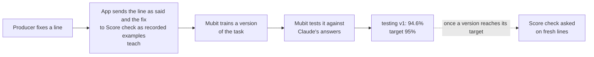

# Mubit: a correction, step by step

A producer's fix becomes a labelled Score check example sent to Mubit; Mubit trains a version of
that task and tests it against Claude's answers. Every step below points at code, a ledger row, a
Mubit request id or a console screenshot.

Score check asks one question of one line: does every score it gives match the score at its
moment? The answer is `ok`, `wrong` or `not_said`
([`agent/scorecheck.py`](../agent/scorecheck.py) `SYSTEM`).

## The loop

The ledger counts are from a copy of the deployed store's ledgers, taken on 25 October 2026.

| Step | What happens | Code | Evidence |
|---|---|---|---|
| 1. Fix | A producer fixes a line on the page. A fix that contradicts the match data gets a 422 and never reaches Mubit | [`core/app.py`](../core/app.py#L457) `fix_line` | `fixes` ledger: 70 producer fixes, each with its own Mubit request id |
| 2. Label | Code labels the line as said, and the fixed text, from the event data. No model labels anything. A held-out match, an analyst's line, or a line code can't label is skipped | [`agent/scorecheck.py`](../agent/scorecheck.py#L83) `teach`, [`eval/linecheck.py`](../eval/linecheck.py#L492) `gold` | Held-out matches: `HELD_OUT` at [`eval/linecheck.py:20`](../eval/linecheck.py#L20) |
| 3. Send | Each labelled line goes to Score check as a recorded example: the request, Claude's reply, and a correction turn with the code's answer when Claude's reply differs. Each example is sent once ever | [`eval/seed_scorecheck.py`](../eval/seed_scorecheck.py#L129) `send_fix`, [`send`](../eval/seed_scorecheck.py#L82); started by the fix route at [`core/app.py:521`](../core/app.py#L521) | `scorecheck_examples`: 2,163 sent, each with a request id. 62 came from fixes (48 Claude already matched, 5 corrected, 9 not corrected) and 2,101 from seeding |
| 4. Receipt | Each fix gets a receipt: how many examples went, and whether a call failed | [`core/app.py:337`](../core/app.py#L337) `score_teach` | `scorecheck_receipts`: 3 rows (below) |
| 5. Train and test | Mubit trains a version of the task on the examples it keeps and tests it against Claude's answers | Mubit; read off the console by hand into [`data/mubit_console.json`](../data/mubit_console.json) | Console, 25 Oct 06:27 UTC: testing v1 at 94.6%, 192 kept examples ([below](#the-946-version)) |
| 6. Ask | Every request is built the same way, so each call joins the same Mubit task. A test pins the request's hash, since any change would start a new task | [`agent/scorecheck.py:58`](../agent/scorecheck.py#L58) `build_request`, [`tests/test_scorecheck.py`](../tests/test_scorecheck.py) | Asked by `teach`, the seeding script and the held-out run ([below](#held-out-run-25-oct)) |

### Worked examples (real ledger rows)

**Gary Cahill, Chelsea v Tottenham (match 3754092, moment 26), 24 Oct 23:45 UTC.** Touchline said
"Gary Cahill scores! Chelsea level it at one-all, but Tottenham still lead two to one." Chelsea
had 1 and Tottenham 2. The producer chose "Wrong score".

| Ledger | Row | Mubit request id |
|---|---|---|
| `fixes` | corrected to "Gary Cahill scores! Chelsea pull one back, but Tottenham still lead two-one.", `fix_uid` `6b80f044…` | `mreq_01a1704dc8a77860af9185a7a6d1d98e` |
| `scorecheck_examples` | the line as said, `gold: wrong`, `kind: matched`, `source: fix` | `mreq_01a1704dcc2876e0a0d36745de0f1d75` |
| `scorecheck_examples` | the fixed text, `gold: ok`, `kind: matched`, `source: fix` | `mreq_01a1704dd7b470b2bc3261ebb3b7d2bc` |
| `scorecheck_receipts` | `fix_uid` `6b80f044…`, `sent: 2`, `failed: false` | none |

The examples count went from 2,161 to 2,163 with this fix.

**Michael Jordan, Jazz v Bulls (match 0049700088, moment 30).** The producer fixed the line at
24 Oct 16:23 UTC (`fixes`, `mreq_01a16eb90c9076f0b88abe5089b47e1e`), before fixes reached
Score check. `eval.seed_scorecheck --fixes` sent it at 21:38 UTC: "Jordan with the driving layup!
Chicago Bulls take the lead, 85-86!", `gold: ok` (85 and 86 are the score; Score check judges the
numbers, not who leads), `kind: corrected` (Claude's first reply differed and the correction turn
gave the answer), `mreq_01a16fd989607510a42284c68e9ff1e5`. 60 of the 62 fix examples were sent
by this catch-up run.

**Elisabeth Terland, Brighton v Bristol City (match 3913122), 24 Oct 23:40 UTC.** Fixed to "The
Seagulls lead one-nil". Receipt `sent: 0`: 3913122 is a held-out match, so none of its lines are
ever sent as training.

## The 94.6% version

Read by hand off Mubit's console ([`data/mubit_console.json`](../data/mubit_console.json)):

| Reading (UTC) | Tasks | Adapters | Task as the console shows it | Version | Score | Status |
|---|---|---|---|---|---|---|
| 25 Oct 00:14 | 11 | 8 (0 serving) | "Check one line of…" (Score check) | v1 | 33.3% on 12 test cases, target 95% | Not ready yet |
| 25 Oct 06:27 | 12 | 9 | "Check one line of 2" | testing v1 | 94.6%; 2,235 calls, 192 kept examples | Testing |

"Check one line of 2" is one of our two line-checking tasks (Line check or Score check): both
prompts start "You check one line", and the console cuts the name short. Between the readings
the console gained one task and one adapter, so we don't claim the 94.6% version is the same
task's v1 as the 33.3% one. Mubit's docs: a version that reaches its target becomes available in
Try models. 94.6% is just under the 95% target.

*Screenshot 1: Mubit console overview, 25 Oct 2026 (`docs/media/mubit-console-1.png`). If no image shows above, the file is missing.*

*Screenshot 2: the "Check one line of 2" task: calls and kept examples (`docs/media/mubit-console-2.png`). If no image shows above, the file is missing.*

*Screenshot 3: testing v1 at 94.6% against the 95% target (`docs/media/mubit-console-3.png`). If no image shows above, the file is missing.*

## Held-out run, 25 Oct

Score check's request went through Mubit to Claude Sonnet 5.5 with recording off, on the 74
held-out lines from matches 3913122 and 9636 ([`eval/scorecheck_heldout.jsonl`](../eval/scorecheck_heldout.jsonl)).
None of those lines was ever sent as training.

| Code's answer | Lines | Claude agreed |
|---|---|---|
| ok | 48 | 48 |
| wrong | 23 | 23 |
| not_said | 3 | 3 |
| **All** | **74** | **74 (0 unparsed)** |

Run on 25 Oct 2026 at about 07:44 UTC with `uv run python -m eval.seed_scorecheck --claude`, then
`--score` ([`eval/seed_scorecheck.py`](../eval/seed_scorecheck.py)). The same result was recorded
on 24 Oct at 20:09 UTC (`scorecheck_evals`). This is the yardstick Mubit grades each version
against: Claude's own answers. Testing v1 matches 94.6% of the provider model's answers on its
own test cases.

## What is not true yet

| Limit | Why |
|---|---|
| No version is serving | testing v1 is at 94.6%, under the 95% target. No trained version answers anything in the app |
| The app cannot name an adapter as its model | Mubit has no model id for an adapter: "you can't send a call to an adapter by naming it as the model", docs.mubit.ai, Keep your model IDs ([`eval/side_by_side.py`](../eval/side_by_side.py)) |
| The live app does not ask Score check on fresh lines | The number check in code ([`core/insight.py`](../core/insight.py)) answers that question for every line before air. Line check, a separate Mubit task, gives the live second opinion: 1,313 calls in `linechecks`, all Claude Sonnet 5.5 |
| Some labelled examples are planted | Seeding adds, for each line whose score is right, one copy with a score number changed, labelled `wrong` by the code's answer key ([`eval/seed_scorecheck.py`](../eval/seed_scorecheck.py#L46) `examples`, [`eval/linecheck.py`](../eval/linecheck.py#L678) `plant`) |
| Commentary traffic is real matches only | Every commentary line comes from a replay of a real, recorded match, never a made-up one |
